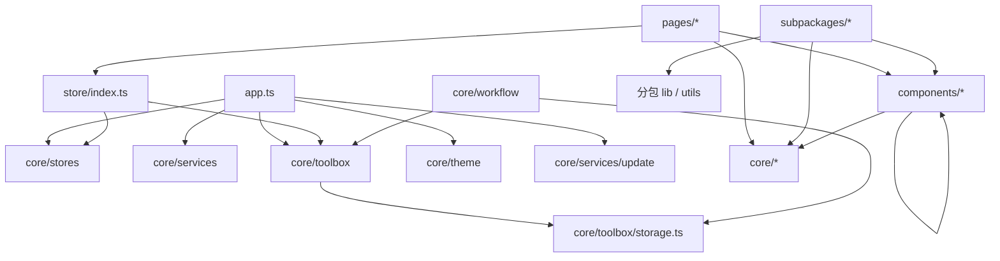
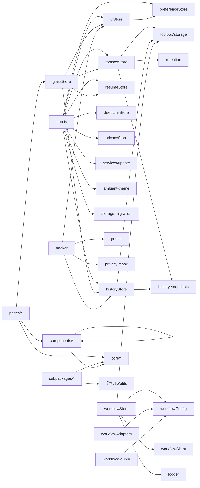

# 超欢（CHAOHUAN）Code Wiki

> 工程名：`chaohuan-toolbox`（`package.json` 的 `name` 为 `qinchao-toolbox`）
> AppID：`wx0f5c60d97c1ce6e2`
> 应用版本：`1.1.0`（`core/constants/index.ts` 的 `APP_VERSION`）
> 渲染引擎：Skyline + glass-easel
> 基础库：`3.17.6`
> 文档基线：2026-11-08（已按当前源码全量核验）
> 校验状态：`npm run typecheck` 通过；`npm test` 271/271 通过（复核于 2026-11-08）

本文是面向开发者的完整 Code Wiki，覆盖项目定位、技术栈、整体架构、启动编排、核心 Store、Workflow 流转引擎、23 个工具算法、组件库、39 个页面、设计令牌、存储迁移、隐私与更新机制、依赖关系、运行方式、部署发布流程和扩展指南。文中路径均为仓库相对路径，关键公式与常量标注来源文件。

---

## 目录

1. [项目速览](#1-项目速览)
2. [技术栈与工程配置](#2-技术栈与工程配置)
3. [整体架构](#3-整体架构)
4. [目录结构与模块职责](#4-目录结构与模块职责)
5. [状态管理层](#5-状态管理层)
6. [工具箱领域层](#6-工具箱领域层)
7. [Workflow 流转引擎](#7-workflow-流转引擎)
8. [工具算法与 23 个工具](#8-工具算法与-23-个工具)
9. [组件库](#9-组件库)
10. [页面与路由](#10-页面与路由)
11. [设计系统与主题引擎](#11-设计系统与主题引擎)
12. [存储、迁移、隐私与更新](#12-存储迁移隐私与更新)
13. [依赖关系](#13-依赖关系)
14. [运行方式](#14-运行方式)
15. [测试与质量保障](#15-测试与质量保障)
16. [扩展指南](#16-扩展指南)
17. [已知限制与技术债](#17-已知限制与技术债)
18. [附录](#18-附录)

---

## 1. 项目速览

超欢是一个**完全本机运行**的微信小程序工具箱：以 23 个纯前端工具为主体，附带一套个人简历 / 作品集模块（“曜石画廊”）。工具计算、图片处理、二维码生成、海报绘制均在本机完成，不登录、不上传、不发起业务网络请求。

### 1.1 关键数字

| 指标 | 数值 | 说明 |
|---|---|---|
| 页面总数 | 39 | 主包 5 页 + 5 个分包共 34 页 |
| 主包页面 | 5 | `pages/index`、`pages/lab`、`pages/favorites`、`pages/mine`、`pages/legal` |
| 分包 | 5 | `tools-core`（18 页）、`tools-media`（5 页）、`grow`（7 页）、`works`（3 页）、`campus`（1 页） |
| 工具 | 23 | 6 个分类，唯一注册表 `core/toolbox/registry.ts` |
| 工具分类 | 6 | `calc` / `date` / `text` / `media` / `life` / `work` |
| 主包组件 | 28 | `components/` 下 28 个组件目录 |
| 分包组件 | 12 | grow 8 个、works 2 个、campus 2 个 |
| 核心 TS 模块 | 45 | `core/` 下全部 `.ts` |
| 运行时 npm 依赖 | 2 | `mobx-miniprogram`、`mobx-miniprogram-bindings` |
| 工具分包依赖 | 2 | `crypto-js`、`diff-match-patch`（仅 tools-core） |
| AI SKILL 原子接口 | 12 | `core/skill/registry.ts` |
| 作品数据 | 11 | `core/data/resume-data.ts` 的 `projects` |
| 单元 / 集成测试 | 271 | 27 个 `.test.js` 文件，全部通过 |
| 存储结构版本 | 1 | `app:storage.version` |
| Spatial Glass 元数据版本 | 2 | `gallery.glass.meta` |

### 1.2 一句话架构

```text
配置层   app.json / app.ts / theme.json / project.config.json / tsconfig.json
页面层   pages/*（首页、收藏、我的、隐私、组件样板间）
         subpackages/tools-core/*（18 个计算/文本工具）
         subpackages/tools-media/*（5 个图片工具）
         subpackages/grow/*（简历、设置、数据驾驶舱）
         subpackages/works|campus/*（作品集）
组件层   components/*（Glass 3.0 + g-* 通用 + Workflow + 海报 + 更新守卫）
状态层   core/stores（ui / preference / history / privacy / deeplink / resume）
         core/toolbox/store（收藏 / 最近使用 / 累计打开）
         core/workflow/workflowStore（流转会话 / 流水线 / 撤销）
         store/index.ts（glassStore 门面）
服务层   core/services（request / resume / sound / motion / update / storage-governor）
算法层   core/toolbox + core/workflow + 各分包 lib/utils
基础层   core/utils（logger / blackbox / haptics / album / privacy / guards / migration）
样式层   app.wxss + styles/v3.wxss + styles/generated/tailwind.wxss
```

### 1.3 命名说明

- **超欢 / CHAOHUAN**：工具箱产品名。
- **曜石画廊 / 净忻**：简历作品集模块的视觉叙事名。
- **Spatial Glass 26 / Glass 3.0**：液态玻璃设计体系代号。
- **白昼 / 夜航**：项目对 `light` / `dark` 两套主题的正式中文叫法，代码中仍使用 `'light' | 'dark'`。

---

## 2. 技术栈与工程配置

### 2.1 运行时依赖

| 依赖 | 版本 | 使用位置 | 用途 |
|---|---|---|---|
| `mobx-miniprogram` | `^6.12.3` | 全局 | 可观察状态（`observable`、`reaction`） |
| `mobx-miniprogram-bindings` | `^7.0.1` | 页面 / 组件 | `createStoreBindings`、`storeBindingsBehavior` |

工具分包 `subpackages/tools-core/package.json` 另有：

| 依赖 | 版本 | 用途 |
|---|---|---|
| `crypto-js` | `^4.2.0` | Hash / HMAC 计算 |
| `diff-match-patch` | `^1.0.5` | 文本 Diff |

`subpackages/grow/lib/crypto-js.js` 是从 tools-core 已审计产物复制的独立副本，用于 AES 冷备保险箱，避免 grow 分包跨分包引用。

### 2.2 开发与构建依赖

| 依赖 | 用途 |
|---|---|
| `typescript` | `tsc --noEmit` 严格类型检查 |
| `tailwindcss` / `@tailwindcss/postcss` | Design Tokens v2 / 原子类 |
| `lightningcss` | Tailwind / weapp 构建期 CSS 引擎；显式锁定 1.33.0 以满足 peer 依赖 |
| `weapp-tailwindcss` / `@weapp-tailwindcss/cli` | 小程序选择器转义、rem → rpx |
| `fantasticon` | 从 `.icon-src/*.svg` 生成图标字体 |
| `remixicon` | 图标源 |
| `miniprogram-api-typings` | 微信 API 类型 |
| `miniprogram-automator` | 开发者工具自动化 / 视觉验收 |
| `miniprogram-ci` | CI 自动构建 npm 并上传开发版本 |

### 2.3 关键配置

| 文件 | 关键配置 |
|---|---|
| `app.json` | `renderer: "skyline"`、`componentFramework: "glass-easel"`、`custom` TabBar、`lazyCodeLoading: "requiredComponents"`、`workers: "workers"`、`darkmode: true`、`__usePrivacyCheck__: true` |
| `app.json` 全局组件 | `update-guard` 注册在 `usingComponents`，所有页面可用 |
| `theme.json` | `light.canvas = #eef1f7`、`dark.canvas = #070a12`，导航文字黑 / 白 |
| `project.config.json` | `useCompilerPlugins: ["typescript"]`、`packNpmManually: true`、根包与 tools-core 两条 npm 构建关系、`packOptions.ignore` 排除 `node_modules` / 测试 / Markdown / 设计源文件 / `.github` / `scripts` / `private` / `.key` |
| `project.private.config.json` | `skylineRenderEnable: true`、`bigPackageSizeSupport: false` |
| `tsconfig.json` | `strict: true`、`noImplicitAny`、`noImplicitThis`、`noUnusedLocals`、`noFallthroughCasesInSwitch`、`noEmit` |
| `postcss.config.js` | 当前为空；Tailwind 管线由 npm script `build:style` 调用 |
| `sitemap.json` | `allow *`，所有页面可被搜索索引 |

### 2.4 npm scripts

| 脚本 | 命令 | 作用 |
|---|---|---|
| `build:style` | `weapp-tw -i styles/tokens.css -o styles/generated/tailwind.wxss --target weapp` | 编译 Tailwind 原子类 |
| `build:icon` | `npx fantasticon .icon-src -o .icon-dist -n gicon --font-types ttf --asset-types json` | 生成图标字体到 `.icon-dist/` |
| `typecheck` | `tsc --noEmit` | 严格类型检查 |
| `test` | `node --experimental-strip-types --test tests/*.test.js` | 全部单元 / 集成测试 |
| `test:hologram` | 仅 `tests/spatial-hologram.test.js` | 空间全息单测 |
| `test:integration` | `tests/*.integration.test.js` | 集成测试 |
| `test:integration:hologram` | 仅空间全息集成测试 | 集成测试 |
| `test:visual:hologram` | `node tests/visual/spatial-hologram.visual.js` | 开发者工具视觉验收 |
| `test:e2e:palette` | `node tests/e2e/magic-wand-palette.e2e.js` | 魔法棒指令面板端到端 |
| `ci:upload` | `node scripts/ci-upload.js` | 自动构建 miniprogram_npm 并上传开发版本 |

---

## 3. 整体架构

### 3.1 分层与依赖方向



依赖规则：

1. **主包不得引用任何 `subpackages/*` 模块**；实际扫描 `core/`、`components/`、`pages/` 均无分包 import。
2. **分包之间不得互相引用**；`grow` / `works` / `campus` 的跨域能力全部通过主包 `core/*` 暴露。
3. **页面不直连数据层**：简历数据通过 `core/services/resume.ts`，工具数据通过 `core/toolbox/*`。
4. **Workflow 不使用 URL 传参**：载荷只经 `workflowStore` 内存传递，URL 只承担工具路由。
5. **纯函数优先**：`workflowSilent`、`history-insights`、`money`、`date`、`rmb`、`crc32` 等均为可独立测试的纯函数。
6. **组件只消费令牌**：页面 / 组件 WXSS 禁止写裸色值，统一消费 `--g-*` / `--glass-*` / `--sg-*`。

### 3.2 启动编排（`app.ts`）

`App.onLaunch` 的顺序是固定编排，排查启动问题按此顺序定位：

| 顺序 | 调用 | 目的 |
|---|---|---|
| 0 | `preferenceStore.init()` | 先恢复全局偏好，供主题 / 动效 / 音效读取 |
| 0.1 | `warmUpSound()` | 按偏好延迟 700ms 预热音效 |
| 0.2 | `installPrivacyGuard()` | 注册 `wx.onNeedPrivacyAuthorization`，必须早于敏感 API |
| 0.3 | `runStorageMigrations()` | v0 → v1 本地数据迁移，先于任何 Store 读取 |
| 0.4 | `setAmbientToolCategoryResolver()` | 注册工具 id → 分类解析器 |
| 1 | `uiStore.initTheme()` | 恢复外观偏好、读取系统主题、订阅 `wx.onThemeChange`、同步原生导航 / 画布 |
| 2 | `toolboxStore.init()` | 恢复收藏、最近使用、累计打开次数 |
| 2.1 | `historyStore.init()` | 恢复本机计算轨迹 |
| 2.2 | `applyAutoClean()` | 按偏好阈值裁剪过期最近使用 |
| 3 | `resumeStore.bootstrap()` | 并发装载 profile / entries / projects |
| 4 | `installUpdateGuard()` | 初始化 `wx.getUpdateManager()`，只静默下载与暂存，不弹窗 |

其他 App 生命周期：

| 生命周期 | 行为 |
|---|---|
| `onShow(options)` | 读取 `options.query.tool` 写入 `deepLinkStore`；补一次 `applyAutoClean()` |
| `onHide()` | `historyStore.flush()`，把防抖中的轨迹立即落盘 |
| `onError(error)` | `recordDiagnostic('app-error', error)` |
| `onUnhandledRejection(res)` | 记录 `unhandled-rejection` |
| `onPageNotFound(res)` | 记录 `page-not-found`，`switchTab` 回首页，失败再 `reLaunch` |
| `onMemoryWarning(res)` | `uiStore.enterLowMemoryMode()` 并记录 `memory-warning` |

`globalData` 只维护更新运行时：

```ts
interface AppUpdateGlobalData {
  updateManager: WechatMiniprogram.UpdateManager | null
  hasUpdate: boolean
  updateReadyListeners: Array<() => void>
  promptState: 'idle' | 'custom' | 'native' | 'dismissed'
  promptOwner: string
  blockers: number
}
```

### 3.3 主题链路

```text
preferenceStore.init()
  → uiStore.initTheme()
    → 读取 gallery.theme.mode
    → readSystemTheme()（wx.getAppBaseInfo().theme）
    → resolvedTheme = themeMode === 'auto' ? systemTheme : themeMode
    → syncStatusBar()（setNavigationBarColor + setBackgroundColor）
    → wx.onThemeChange()
  → 页面根节点绑定 uiStore.themeClass
    → theme-light / theme-dark
    → motion-full / motion-lite / motion-saver
    → light-off（关闭动态光效或省电模式）
  → 需要原生状态栏同步的页面在 onShow 调用 uiStore.syncNativeChrome()
  → 工具页由 glass-tool-shell 的 pageLifetimes.show 统一调用
```

`uiStore.themeClass` 不是单一主题类，而是四段组合：主题 + 动效等级 + 光效开关。页面根节点必须完整绑定，否则省电 / 关光效可能失效。

### 3.4 数据流

#### 工具计算 → 轨迹 → 驾驶舱

```text
工具页输入
  → 页面 compute()（纯函数 / lib）
  → setData({ hasResult, posterData, ... })
  → glass-tool-shell observer hasResult / posterData
  → scheduleResultTrack()（160ms 防抖，同结果签名去重）
  → recordToolResult()
    → normalizePosterData()
    → maskSensitiveText() 生成脱敏摘要
    → historyStore.record()
      → 内存 records（最多 100 条）
      → 350ms 防抖写 tbx:history
  → cockpit 读取 historyStore
    → buildCategoryStats / buildDailyStats / buildHistoryInsight / buildTimeline
    → Canvas 环形图 + 折线图
```

#### Workflow 静默流转

```text
来源工具页
  → glass-tool-shell 打开 workflow-panel
  → readWorkflowSource(toolId, page.data)
  → workflowStore.beginFlow() / beginImageFlow()
  → 用户选择 silent 目标
  → workflowStore.runPipeline([target])
    → executeSilentTool() 纯函数
    → pipelineResult
  → 面板展示结果 / 复制 / 采纳 / 撤销
```

#### Workflow 跳转流转

```text
来源工具页
  → workflow-panel beginJump(toolId)
  → workflowStore.pendingJump
  → wx.navigateTo(tool.route)
  → 目标页 glass-tool-shell 内的 workflow-receiver
  → peekPendingJump() → hasInput?
    → 是：glass-modal 二次确认
    → 否：直接注入
  → claimPendingJump() → adapter.apply()
    → 页面 onReceiveWorkflow(data) 或 setData + recalculate()
  → setInjectionUndo() + Toast「撤销」
  → 页面卸载 / 撤销 / 取消时释放图片
```

### 3.5 生命周期与清理约定

- `createStoreBindings` 必须在 `onUnload` / `detached` 中 `destroyStoreBindings()`。
- 所有定时器在页面 / 组件卸载时清理；异步回调使用序列号或 `destroyed` 标志防止回写。
- `workflowStore.clear()` 在工具壳卸载时调用；图片进入孤儿队列批量删除。
- `historyStore.flush()` 在 `App.onHide`、工具壳 `pageLifetimes.hide`、`detached` 调用。
- Canvas 动画 / `requestAnimationFrame` 在 `onHide` / `onUnload` 取消。
- `ambientTheme.subscribe()` 返回取消订阅函数，首页 `cleanupPage()` 调用。
- `wx.onThemeChange` 为 App 级单例常驻，不做注销。

---

## 4. 目录结构与模块职责

```text
.
├── app.ts                     # 应用入口与启动编排
├── app.json                   # 页面 / 分包 / TabBar / Skyline / Worker 配置
├── app.wxss                   # 全局令牌 + Tailwind + V3 引入
├── theme.json                 # 原生窗口 / 状态栏主题色
├── project.config.json        # 开发者工具与打包配置
├── tsconfig.json              # strict TypeScript
├── package.json               # npm scripts 与运行时依赖
├── custom-tab-bar/            # 自定义底部导航（3 Tab）
├── pages/
│   ├── index/                 # 工具箱首页
│   ├── favorites/             # 工具收藏
│   ├── mine/                  # 我的
│   ├── legal/                 # 隐私与说明
│   └── lab/                   # 组件样板间
├── components/                # 28 个主包组件
├── core/
│   ├── constants/             # 路由、常量、Canvas 调色板
│   ├── data/                  # 简历 / 作品静态数据
│   ├── services/              # request / resume / sound / motion / update / storage-governor
│   ├── skill/                 # AI SKILL 原子接口
│   ├── stores/                # ui / preference / history / privacy / deeplink / resume
│   ├── theme/                 # ambient-theme / contrast-guardian
│   ├── toolbox/               # registry / storage / store / share / tracker / poster / insights
│   ├── types/                 # 全局类型宪法
│   ├── utils/                 # logger / blackbox / haptics / album / privacy / guards / migration
│   └── workflow/              # 流转类型、配置、执行器、来源、Store、适配器
├── subpackages/
│   ├── tools-core/            # 18 个计算 / 文本工具 + money/date/rmb/hash/diff
│   ├── tools-media/           # 5 个图片工具 + image/qrcode/png/worker-sandbox
│   ├── grow/                  # 简历域 7 页 + 设置 + 驾驶舱 + Cyber Space OS
│   ├── works/                 # 作品 hub / list / detail
│   └── campus/                # 园枢校园应用详情
├── store/index.ts             # glassStore 全局门面
├── styles/                    # Design Tokens / V3 / 旧工具箱样式
├── workers/compute.js         # Worker 计算入口
├── tests/                     # 271 项测试 + 视觉 / E2E
├── assets/                    # 头像、二维码、作品封面
└── CODE_WIKI.md               # 本文档
```

### 4.1 目录职责表

| 路径 | 职责 | 关键入口 |
|---|---|---|
| `app.ts` | 启动编排、全局错误、深链、更新管理器 | `App({...})` |
| `core/constants` | 路由表、版本、时序、限制、Canvas 调色板 | `ROUTES`、`TIMING`、`LIMITS` |
| `core/stores` | 全局 MobX 状态 | `uiStore`、`preferenceStore`、`historyStore` |
| `core/toolbox` | 工具注册表、收藏、最近使用、分享、轨迹、海报 | `TOOLS`、`toolboxStore` |
| `core/workflow` | 全域智能流转 | `workflowStore`、`executeSilentTool` |
| `core/services` | 传输层、简历装载、音效、动效、更新、存储治理 | `send()`、`useSound()`、`useMotion()` |
| `core/theme` | 环境光主题、对比度守护 | `ambientTheme`、`contrastGuardian` |
| `core/utils` | 日志、黑匣子、触觉、相册、隐私、迁移 | `logger`、`recordDiagnostic`、`tapTick` |
| `components` | 视觉与交互组件 | `glass-tool-shell`、`glass-toast` |
| `store/index.ts` | 统一门面：主题、收藏、作品收藏、最近使用 | `glassStore` |
| `pages` | 主包页面 | `index`、`favorites`、`mine` |
| `subpackages/tools-core` | 计算 / 文本工具 | 18 个 `pages/*` |
| `subpackages/tools-media` | 图片工具 | 5 个 `pages/*` |
| `subpackages/grow` | 简历域 + 设置 + 驾驶舱 | `home`、`settings`、`cockpit` |
| `subpackages/works` | 作品集 | `hub`、`list`、`detail` |
| `subpackages/campus` | 园枢详情 | `detail` |
| `workers/compute.js` | 长文本 / 去重 / Base64 / 校验和运算 | Worker 协议 |
| `tests` | Node 原生测试 + automator 视觉 / E2E | `npm test` |

### 4.2 非运行时目录

| 目录 | 用途 | 是否随包上传 |
|---|---|---|
| `.icon-src/` | 图标 SVG 源文件 | 否，`packOptions.ignore` 排除 |
| `.icon-dist/` | `build:icon` 生成的字体产物 | 否 |
| `.legacy/` | 旧组件 / 旧样式备份 | 否 |
| `.screenshots/` | 视觉验收截图 | 否 |
| `ai-skills/` | AI SKILL 说明与 `mcp.json` | 否 |
| `node_modules/` | npm 依赖源码 | 否 |
| `miniprogram_npm/` | 开发者工具构建的 npm 产物 | 是 |
| `tests/` | 单元 / 集成 / 视觉 / E2E 测试 | 否 |
| `补充文档/` | 设计与验收文档 | 否 |
| `docs/` | 预留文档目录 | 否 |

运行时真正参与小程序打包的是：`app.*`、`pages/`、`components/`、`custom-tab-bar/`、`core/`、`store/`、`subpackages/`、`styles/`、`assets/`、`workers/`、`miniprogram_npm/` 与项目配置。

---

## 5. 状态管理层

所有 Store 都使用 `observable` 创建，页面通过 `createStoreBindings` 或 `storeBindingsBehavior` 绑定。Store 只负责状态与持久化，副作用（音效 / 震动 / 动画）由服务层接管。

### 5.1 UI Store（`core/stores/ui.ts`）

```ts
export const uiStore = observable({
  toastShow: boolean
  toastMessage: string
  toastTimer: number
  themeMode: 'auto' | 'light' | 'dark'
  systemTheme: 'light' | 'dark'
  themeInited: boolean
  themeSwitching: boolean
  themeSwitchTimer: number
  lowMemory: boolean

  get resolvedTheme(): 'light' | 'dark'
  get themeClass(): string
  get themeModeLabel(): string
  get resolvedThemeLabel(): string
  markThemeSwitching(): void
  initTheme(): void
  setThemeMode(mode: ThemeMode): void
  syncNativeChrome(): void
  cycleTheme(): void
  showToast(message: string): void
  hideToast(): void
  enterLowMemoryMode(): void
})
```

关键行为：

- `initTheme()` 幂等；读取 `gallery.theme.mode`，无值保持 `auto`。
- 系统外观读取失败回退 `dark`（品牌默认基调）。
- `markThemeSwitching()` 只在昼↔夜真实翻转时置 `true`，420ms 后收口。
- `themeClass` = `theme-dark|theme-light` + `motion-full|lite|saver` + 可选 `light-off`。
- `syncNativeChrome()` 负责 `setNavigationBarColor` 与 `setBackgroundColor`；需要原生状态栏同步的页面在 `onShow` 调用，工具页由 `glass-tool-shell` 的 `pageLifetimes.show` 统一调用。
- 低内存模式由 `App.onMemoryWarning` 触发，页面 / 组件据此关闭 Canvas 动画。

### 5.2 Preference Store（`core/stores/preference.ts`）

全局偏好的唯一真相源，Storage 损坏时逐字段回退默认值。

```ts
type HapticLevel = 'off' | 'light' | 'heavy'
type MotionLevel = 'full' | 'lite' | 'saver'
type AutoCleanDays = 0 | 7 | 30

interface PreferenceSnapshot {
  version: 1
  haptics: HapticLevel
  sound: boolean
  lightEffects: boolean
  motion: MotionLevel
  autoCleanDays: AutoCleanDays
  isPrivacyMasked: boolean
  isHistoryTrackingEnabled: boolean
  flags: { enable_ai_assist: boolean }
}
```

默认值：

```ts
{
  version: 1,
  haptics: 'light',
  sound: true,
  lightEffects: true,
  motion: 'full',
  autoCleanDays: 30,
  isPrivacyMasked: true,
  isHistoryTrackingEnabled: true,
  flags: { enable_ai_assist: false }
}
```

主要方法：

| 方法 | 说明 |
|---|---|
| `init()` | 启动调用一次；v1 → v0 → `tbx:prefs` 逐级回退 |
| `applySnapshot(snapshot)` | 规范化后写入会话 |
| `snapshot()` | 返回深拷贝快照 |
| `persist()` | 写 `app:prefs.v1`，失败只记录 |
| `setHaptics()` / `setSound()` / `setLightEffects()` / `setMotion()` | 单项设置并持久化 |
| `setAutoCleanDays()` | 设置最近使用清理阈值 |
| `setPrivacyMasked()` / `togglePrivacyMasked()` | 驾驶舱隐私盾 |
| `setHistoryTrackingEnabled()` | 计算轨迹总开关 |
| `setFlag(key, value)` | 仅允许白名单 Feature Flag |
| `statusText` | “全效模式 · 光效开启 · 音效开启” |

归一化兼容：

- 布尔 / 数字 / 旧字符串三套 `haptics` 写法。
- `motion` 兼容 `reduceMotion`、`animation`、`motionLevel`。
- `autoCleanDays` 兼容 `autoClearDays`、`cleanDays`、`retentionDays`。
- 未知 Feature Flag 不会注入运行时。

### 5.3 Toolbox Store（`core/toolbox/store.ts`）

收藏 / 最近使用 / 累计打开次数。

```ts
export const toolboxStore = observable({
  favorites: string[]
  recents: string[]
  recentAt: Record<string, number>
  usageCount: number
  inited: boolean

  init(): void
  isFavorite(id: string): boolean
  toggleFavorite(id: string): boolean | null
  recordRecent(id: string): void
  recordOpen(id: string): void
  clearRecents(): boolean
  pruneRecents(days: number, now?: number): number
  favoriteTools(): ToolMeta[]
  recentTools(): ToolMeta[]
  get favoriteCount(): number
  clearAll(): number
})
```

规则：

- 只存工具 id，读取时用 `TOOL_IDS` 过滤下线工具。
- 收藏上限 `MAX_FAVORITES = 100`，最近使用上限 `MAX_RECENTS = 12`。
- `toggleFavorite` 乐观更新；落盘失败回滚并返回 `null`。
- `recordOpen` 先 `usageCount += 1`，再刷新最近列表。
- `clearAll` 先 `historyStore.clearMemory()`，再 `purgeHistoryFromSnapshots()`，最后删除全部 `tbx:*`。
- `recentAt` 只保留当前最近列表内的 id，避免历史键无限膨胀。

### 5.4 History Store（`core/stores/history.ts`）

本机计算轨迹，最多 100 条，只存摘要，不存原始图片。

```ts
interface HistoryRecord {
  id: string
  toolId: string
  toolName: string
  category: ToolCategory
  categoryLabel: string
  icon: string
  timestamp: number
  night: boolean
  themeLabel: string
  inputSummary: string
  outputSummary: string
  inputMasked?: string
  outputMasked?: string
}
```

常量与行为：

| 项 | 值 / 行为 |
|---|---|
| `HISTORY_MAX` | `100` |
| 写入防抖 | `350ms` |
| 摘要上限 | 输入 140 字、输出 160 字、工具名 24 字 |
| 写入失败 | 砍半重试一次，并置 `writeFailed = true` |
| `flush()` | `App.onHide`、工具壳 `pageLifetimes.hide`、`detached` 调用 |
| `clear()` | 取消在途写入、清内存、删除 `tbx:history` |
| `clearMemory()` | 清内存但不删 Storage，供 `clearAll` 统一删除 `tbx:*` |
| `version` | 轻量版本号，供驾驶舱避免全量 setData |

### 5.5 Privacy Store（`core/stores/privacy.ts`）

```ts
export const privacyStore = observable({
  visible: boolean
  referrer: string
  pending: PrivacyResolve[]

  enqueue(resolve, referrer?): void
  resolveAgree(buttonId): void
  resolveDisagree(): void
  reset(): void
})
```

- `installPrivacyGuard()` 在 `app.ts` 启动时注册 `wx.onNeedPrivacyAuthorization`。
- 多个隐私接口同时 pending 时全部入栈，同意 / 拒绝后统一 resolve。
- 不持久化任何状态，授权由微信基础库记忆。
- 同意按钮必须是原生 `<button open-type="agreePrivacyAuthorization">`。

### 5.6 DeepLink Store（`core/stores/deeplink.ts`）

```ts
export const deepLinkStore = observable({
  pendingToolId: '',
  setPending(toolId: string): void,
  takePending(): string, // 只允许消费一次
})
```

冷 / 热启动统一入口：

- `App.onShow` 把 `options.query.tool` 写入 `deepLinkStore`。
- 首页 `onLoad` / `onShow` 消费 `takePending()`。
- 首页仅在 `onLoad` 调用一次 `wx.getEnterOptionsSync()` 作为补漏（严禁放到 `onShow`：启动参数会持续保留 `?tool=xxx`，返回首页时会二次跳链），并设置 60ms 兜底探测。

### 5.7 Resume Store（`core/stores/resume.ts`）

简历域状态唯一真相源。

```ts
export const resumeStore = observable({
  profile: Profile | null
  entries: HomeEntry[]
  projects: Project[]
  favorites: string[]
  favoritesInited: boolean

  bootstrap(): Promise<void>
  projectsByCategory(category: ProjectCategory): Project[]
  projectById(id: string): Project | null
  restoreFavorites(): void
  isFavorite(id: string): boolean
  get favoriteCount(): number
  toggleFavorite(id: string): boolean | null
})
```

- `bootstrap()` 并发调用共享同一 Promise，成功后缓存，失败清空以便重试。
- 作品收藏上限 200；Storage 视为不可信输入，只接受短字符串 id、去重、限长。
- `toggleFavorite` 乐观更新，写入失败回滚并返回 `null`。
- 数据经 `core/services/resume.ts` 的原子接口装载，页面不直连 `resume-data.ts`。

### 5.8 Glass Store（`store/index.ts`）

`glassStore` 是旧 `gallery.*` 数据、工具收藏、作品收藏、主题、最近使用的统一门面。

```ts
export const glassStore = observable({
  inited: boolean
  migration: GlassMigrationResult
  storeMeta: GlassStoreMeta | null

  init(): GlassMigrationResult
  bootstrap(): Promise<void>

  get themeMode(): GlassThemeMode
  get resolvedTheme(): GlassResolvedTheme
  get themeClass(): string
  get themeSwitching(): boolean
  setThemeMode(mode): void
  cycleTheme(): void

  get ambientPreset(): GlassAmbientPreset
  setAmbientPreset(preset): boolean
  updateStoreMeta(patch): boolean

  get toolFavorites(): string[]
  get workFavorites(): string[]
  get favorites(): GlassFavoriteRef[]
  get favoriteItems(): GlassFavoriteItem[]
  get favoriteCount(): number
  isFavorite(kind, id): boolean
  toggleFavorite(kind, id): boolean | null

  get history(): GlassHistoryItem[]
  get historyCount(): number
  recordHistory(id): boolean
  clearHistory(): boolean
  clearAll(): number
})
```

`init()` 顺序：

1. `migrateLegacyStorage()`：调用 `runStorageMigrations()`，二次清洗收藏 / 最近使用，清理非法外观偏好与废弃键。
2. `migrateGlassStore()`：写入 `gallery.glass.meta`（`version: 2`、`schema: 'spatial-glass-26'`）。
3. `toolboxStore.init()`。
4. `historyStore.init()`。
5. `resumeStore.restoreFavorites()`。
6. `uiStore.initTheme()`。

### 5.9 页面绑定方式

| 方式 | 适用 | 示例 |
|---|---|---|
| `storeBindingsBehavior` | 首页等需要 `fields` 自动映射的页面 | `pages/index/index.ts` 绑定 `glassStore` |
| `createStoreBindings` | 收藏、我的、设置、工具壳等需要显式销毁的页面 / 组件 | `toolboxStore` / `uiStore` |
| `this.data` 手动同步 | 一次性读取或非响应式场景 | 页面 `onShow` 刷新 |

所有 `createStoreBindings` 都必须配对 `destroyStoreBindings()`。

### 5.10 服务层与 AI SKILL

#### 传输层（`core/services/request.ts`）

```ts
interface TransportRequest<T> {
  domain: string
  fetcher: () => Promise<T> | T
  retries?: number
}

interface Transport {
  name: string
  execute<T>(request: TransportRequest<T>): Promise<Result<T>>
}

send<T>(request: TransportRequest<T>): Promise<Result<T>>
```

- 当前生产实现固定为 `localTransport`，本地数据零延迟返回。
- 错误统一归一化为 `AppError`（`NETWORK` / `TIMEOUT` / `PARSE` / `NOT_FOUND` / `PERMISSION` / `CANVAS` / `SAVE_ALBUM` / `UNKNOWN`）。
- 瞬态错误按 `NETWORK_POLICY` 退避重试：基数 300ms、上限 2400ms、抖动 120ms。
- 不发起任何网络请求，纯离线。

#### 简历领域接口（`core/services/resume.ts`）

| 函数 | 返回 |
|---|---|
| `fetchProfile()` | `Result<Profile>` |
| `fetchContactLinks()` | `Result<ContactLink[]>` |
| `fetchGreetingCards()` | `Result<GreetingCard[]>` |
| `fetchAboutBlocks()` | `Result<AboutBlock[]>` |
| `fetchTimeline()` | `Result<TimelineEra[]>` |
| `fetchSkills()` | `Result<SkillGroup[]>` |
| `fetchStats()` | `Result<StatItem[]>` |
| `fetchCategories()` | `Result<CategoryMeta[]>` |
| `fetchProjects(category?)` | `Result<Project[]>` |
| `fetchProjectById(id)` | `Result<Project>` |
| `searchProjects(keyword)` | `Result<Project[]>`（标题 / 副题 / 角色 / 技术栈全文匹配） |
| `fetchHomeEntries()` | `Result<HomeEntry[]>`（5 个入口星表） |
| `galleryCount(gallery)` | 图集图片总数 |

#### 静态数据（`core/data/resume-data.ts`）

- `profile`：姓名、别名、座右铭、坐标、邮箱、头像、简介、英雄副题。
- `contactLinks`：Gitee / GitHub / 网站 / 掘金。
- `greetingCards`：问候卡。
- `aboutBlocks`：关于我叙事块。
- `timelineEras`：成长纪元时间线。
- `skillGroups`：前端 / 后端 / 工具链技能组。
- `statItems`：数字速览。
- `categoryMetas`：作品分类元信息。
- `projects`：11 个作品（实际工程 + 个人作品）。

#### AI SKILL 注册表（`core/skill/registry.ts`）

12 个原子接口，与 `ai-skills/resume/mcp.json` 对应：

| 名称 | 能力 |
|---|---|
| `get_profile` | 个人档案 |
| `get_contact_links` | 社交坐标 |
| `get_skills` | 技能矩阵 |
| `get_timeline` | 成长时间线 |
| `get_about` | 关于我叙事块 |
| `get_stats` | 数字速览 |
| `get_categories` | 作品分类 |
| `get_projects` | 作品列表（可按分类过滤） |
| `get_project_detail` | 作品详情 |
| `search_projects` | 作品搜索 |
| `list_favorites` | 作品收藏列表 |
| `toggle_favorite` | 切换作品收藏 |

所有接口复用 `core/services/resume.ts`，与页面数据链路完全同源；外部入参只接受协议内枚举与短字符串。

### 5.11 基础工具与分包辅助模块

以下模块被多个页面 / Store 复用，属于基础设施层，单独列出避免遗漏。

| 模块 | 关键导出 | 职责 |
|---|---|---|
| `core/utils/logger.ts` | `logger.info/warn/error` | 统一 `[gallery][domain]` 前缀；`info` 仅开发者工具输出 |
| `core/utils/blackbox.ts` | `recordDiagnostic(kind, error, level)` | 本地错误黑匣子，环形 20 条 |
| `core/utils/haptics.ts` | `vibrate`、`tapTick`、`tapSuccess`、`tapWarn`、`useHaptics` | 震动 + 语义音效统一出口，受偏好档位控制 |
| `core/utils/album.ts` | `saveImageToAlbum`、`albumFailureMessage` | 相册保存、授权补救、失败归一化 |
| `core/utils/privacy.ts` | `ensurePrivacyAuthorized()` | 敏感 API 前置隐私授权 |
| `core/utils/guards.ts` | `asArray<T>(value)` | 外部数据进入领域层前收敛为数组 |
| `core/utils/platform.ts` | `isDevtools()` | 平台探测；开发者工具 Canvas 降级依据 |
| `core/utils/storage-migration.ts` | `runStorageMigrations()` | v0 → v1 本地数据迁移 |
| `core/services/motion.ts` | `useMotion()`、`MotionProfile` | 动效等级 / 光效 / 模糊倍率读取 |
| `core/services/storage-governor.ts` | `readCacheSummary()`、`applyAutoClean()` | 本机缓存摘要、最近使用自动清理 |
| `core/toolbox/crc32.ts` | `crc32`、`crc32Hex` | 分片传输、Cyber 快照校验共用 |
| `components/glass-toast/behavior.ts` | `glassToastBehavior` | 为自定义组件注入 `this.$toast()` |
| `subpackages/tools-media/lib/image.ts` | `chooseSingleImage`、`getFileSize`、`getImageInfo`、`formatBytes`、`saveImageToAlbum` | 图片工具公共能力 |
| `subpackages/grow/lib/card.ts` | `CARD_W`、`CARD_H`、`computeCardDisplaySize`、`maxCardHeightFor`、`drawCardBase`、`drawAvatar`、`drawAvatarFallback`、`drawCardBody` | 名片 Canvas 绘制内核 |
| `subpackages/grow/lib/crypto-js.d.ts` | `CryptoJS` 类型声明 | 为 grow 内复制的 `crypto-js.js` 提供 TypeScript 类型 |

---

## 6. 工具箱领域层

### 6.1 工具注册表（`core/toolbox/registry.ts`）

`TOOLS` 是首页、搜索、收藏、最近使用、分享、指令面板、Workflow 的唯一元数据源。

```ts
interface ToolMeta {
  id: string
  name: string
  desc: string
  category: ToolCategory
  icon: string
  route: string
  keywords: string[]
  weight: number
}
```

首页分区 `HOME_SECTIONS`：

| key | 标题 | 分类 |
|---|---|---|
| `calc` | 计算换算 | `calc` |
| `date` | 日期时间 | `date` |
| `text` | 文本效率 | `text` |
| `media` | 图片处理 | `media` |
| `life-work` | 生活与职场 | `life`、`work` |

导出函数：

| 函数 | 说明 |
|---|---|
| `toolsForCategories(categories)` | 按分类过滤并按 `weight` 降序 |
| `searchTools(keyword)` | 名称 + 描述 + 关键词，大小写不敏感 |
| `toolsFromIds(ids)` | 收藏 / 最近使用 id → 元数据，自动过滤下线 id |
| `TOOL_IDS` | `Set<string>`，用于合法性校验 |

### 6.2 工具箱存储（`core/toolbox/storage.ts`）

命名空间 `tbx:`，与简历的 `gallery.*` 完全隔离。

| 键 | 内容 | 上限 / 说明 |
|---|---|---|
| `tbx:recent` | 最近使用 id 列表 | 12 |
| `tbx:recent.at` | id → 毫秒时间戳 | 只保留当前列表 |
| `tbx:favorites` | 工具收藏 id 列表 | 100 |
| `tbx:usage` | 累计打开次数 | 只增不减 |
| `tbx:history` | 计算轨迹摘要 | 100 |
| `tbx:workflow.pipes` | 快捷管道记忆 | 6 |
| `tbx:workflow.garbage` | 孤儿图片回收队列 | 跨启动恢复 |
| `tbx:prefs` | 旧偏好（只读迁移） | v0 遗留 |
| `tbx:ack.finance.v1` | 旧财务提示确认 | v0 遗留 |
| `tbx:ack.health.v1` | 旧健康提示确认 | v0 遗留 |
| `tbx:legacy-tip` | 旧收藏提示 | v0 遗留 |
| `tbx:legacy-tip-home` | 首页旧收藏提示 | 当前 |

通用读写函数：

```ts
readStorage(key): unknown
writeStorage(key, value): boolean
removeStorage(key): boolean
readIdList(key): string[]
writeIdList(key, ids, limit): boolean
readTimestampMap(key): Record<string, number>
writeTimestampMap(key, map): boolean
readCount(key): number
writeCount(key, value): boolean
clearToolboxData(): number
```

所有坏数据都被逐项丢弃，不阻塞启动。

### 6.3 最近使用保留策略（`core/toolbox/retention.ts`）

```ts
pruneRecentIds(ids, recentAt, days, now): {
  ids: string[]
  recentAt: Record<string, number>
  removed: string[]
}
```

- `days <= 0` 时原样返回。
- 缺失时间戳的旧记录按“刚刚打开”处理，升级不误删。
- 只裁剪最近使用，不触碰收藏。

### 6.4 分享与深链（`core/toolbox/share.ts`）

```ts
parseToolDeepLink(raw): ToolMeta | null
sharePayloadForTool(toolId): { title, path }
timelinePayloadForTool(toolId): { title, query }
currentPageTool(): ToolMeta | null
sharePayloadForCurrentPage(): SharePayload
timelinePayloadForCurrentPage(): TimelinePayload
```

规则：

- 分享路径统一回 `/pages/index/index`，携带 `?tool=xxx`。
- 参数经 `decodeURIComponent` + `TOOL_IDS` 白名单校验。
- 非法 / 缺失参数回退工具箱首页，绝不生成坏路径。
- 首页深链跳转延迟 300ms，1.2 秒内同工具去重。

### 6.5 埋点与脱敏（`core/toolbox/tracker.ts` / `privacy.ts`）

`recordToolResult(payload)`：

1. `preferenceStore.init()` 并检查 `isHistoryTrackingEnabled`。
2. 从 `poster` 生成输入 / 输出摘要。
3. 用 `maskSensitiveText(value, label)` 预计算 `inputMasked` / `outputMasked`。
4. 无输出摘要不写入。
5. 写入 `historyStore.record()`，同时快照当时主题（白昼 / 夜航）。

脱敏策略：

| 字段类型 | 策略 |
|---|---|
| 密码 / 账号 / 身份证 / 原文摘录 | 整体 `***` |
| 金额 / 收入 / 税额 / 健康 / 日期 | 只隐去数字，保留单位与分类 |
| 长度 / 位数 / 次数等元数据 | 放行 |
| 邮箱 / URL / 手机号 / 长令牌 | 一律 `***` |

单一真相源：`maskSensitiveText`、`maskLegacySummary`、`maskSecretTokens`。

### 6.6 海报数据契约（`core/toolbox/poster.ts`）

```ts
interface IPosterData {
  toolName: string
  category: string
  mainResult: string
  resultLabel: string
  params: Array<{ label: string; value: string }>
  extras: string[]
}
```

`normalizePosterData(raw)` 负责长度收敛：

| 字段 | 上限 |
|---|---|
| 工具名 | 24 |
| 分类 | 12 |
| 主结果 | 80 |
| 结果标签 | 24 |
| 参数 | 4 组；label 12 / value 24 |
| 衍生结论 | 4 条；每条 34 |

`mainResult` 为空视为无效，调用方回退旧字段。

### 6.7 轨迹分析（`core/toolbox/history-insights.ts`）

纯函数，驾驶舱与周报共用：

| 函数 | 输出 |
|---|---|
| `buildCategoryStats(records)` | 分类占比 |
| `buildDailyStats(records, now)` | 最近 7 日活动 |
| `formatCategoryPercentages(stats)` | 百分比文案 |
| `buildHistoryInsight(records, now)` | 周报：总数 / 本周 / 最常用 / 昼夜占比 / 连续天数 / 人格 / 标签 |
| `buildTimeline(records, ...)` | 轨迹时间线 |
| `maskSummary(text, toolId)` | 旧存档脱敏 |

人格映射：

| 分类 | 人格 |
|---|---|
| `calc` | 理性规划者 |
| `date` | 时间管理者 |
| `text` | 文字整理派 |
| `media` | 视觉创作者 |
| `life` | 生活掌控者 |
| `work` | 效率行动派 |

### 6.8 快照轨迹清理（`core/toolbox/history-snapshots.ts`）

```ts
countHistoryInSnapshots(): number
purgeHistoryFromSnapshots(): { slots: number; records: number }
purgeHistoryRecordFromSnapshots(id: string): number
```

- 扫描 `cyber:auto:v1`、`cyber:hot:v1` 中的快照 payload。
- 只修改 `snapshot.history`，保留主题 / 收藏 / 偏好。
- 修改后重算 CRC32，保证 Time Travel 仍可解码。

### 6.9 自定义 TabBar（`core/toolbox/tabbar.ts` + `custom-tab-bar/`）

```ts
selectTabBar(page, index): void
```

- 页面 `onShow` 调用 `getTabBar().setData({ selected })`。
- `custom-tab-bar` 直接订阅 `uiStore` 的 `isDark`，白昼 / 夜航两套材质。
- 切换锁 `switching` 在 `wx.switchTab` 的 `complete` 中释放，避免首次切换后锁死。

---

## 7. Workflow 流转引擎

Workflow 是项目最复杂的跨页面能力：把任意工具结果安全流转到另一个工具，分为 **静默计算（silent）** 与 **带参跳转（jump）** 两类。

### 7.1 类型契约（`core/workflow/types.ts`）

```ts
type WorkflowDataType = 'text' | 'image' | 'json'
type WorkflowRouteMode = 'silent' | 'jump'
type WorkflowContextValue = string | number | boolean

interface IWorkflowData {
  type: WorkflowDataType
  payload: string
  context?: Record<string, WorkflowContextValue>
}

interface WorkflowSession {
  sessionId: string
  data: IWorkflowData
  sourceToolId: WorkflowToolId | ''
  createdAt: number
  expiresAt: number
  consumed: boolean
  bytes: number
}
```

约束：

- `context` 只允许基础类型，禁止对象 / 数组。
- 载荷只经 `workflowStore` 内存传递，禁止 URL 传参。
- 图片载荷是 `wx.saveFile` 后的本地路径。
- `WorkflowToolId` 是 23 个工具 id 的联合类型；新增工具必须同步扩展。

### 7.2 路由配置（`core/workflow/workflowConfig.ts`）

| 工具 | 模式 | accepts |
|---|---|---|
| `base64` | silent | text / json |
| `dedupe` | silent | text / json |
| `json` | silent | json / text |
| `url` | silent | text / json |
| `wordcount` | silent | text / json |
| `unit` | jump | text |
| `tax` | jump | text |
| `loan` | jump | text |
| `deposit` | jump | text |
| `span` | jump | text |
| `age` | jump | text |
| `countdown` | jump | text |
| `timestamp` | jump | text |
| `rmb` | jump | text |
| `text-diff` | jump | text / json |
| `hash` | jump | text / json |
| `password` | jump | 空（纯产出，不可作为目标） |
| `bmi` | jump | 空（纯产出，不可作为目标） |
| `compress` | jump | image |
| `palette` | jump | image |
| `nine-grid` | jump | image |
| `qr` | jump | text |
| `watermark` | jump | image |

导出函数：

```ts
isWorkflowToolId(value): value is WorkflowToolId
isSilentWorkflowTool(id): boolean
isToolCompatible(id, type): boolean
workflowToolsForType(type): ToolView[]
workflowToolName(id): string
```

`workflowToolsForType` 会把不兼容工具置灰并排在后面。

### 7.3 来源提取（`core/workflow/workflowSource.ts`）

`readWorkflowSource(toolId, page.data)` 按工具逐一声明结果字段，绝不猜测 `posterData`。

| 工具 | 文本字段优先级 |
|---|---|
| `unit` | `result` → `formula` |
| `tax` | `taxText` |
| `loan` | `monthlyText` |
| `deposit` | `totalText` |
| `span` | `calendarText` |
| `age` | `ageText` |
| `countdown` | `daysText` |
| `timestamp` | `localText` → `stampText` |
| `rmb` | `upperText` → `amountText` |
| `text-diff` | `flowPayload` → `reportText` → `copyPayload` |
| `hash` | `flowPayload` → `displayHex` → `hashHex` |
| `wordcount` | `copyPayload` → `totalText` |
| `dedupe` / `json` / `url` / `base64` | `outputText` |
| `password` | `password` |
| `bmi` | `copyPayload` |
| `palette` | `dominantHex` → `averageHex` |

图片字段：

| 工具 | 字段 |
|---|---|
| `compress` | `compressedPath` → `imagePath` |
| `qr` | `qrImagePath` |
| `watermark` | `previewSrc` → `imagePath` |
| `nine-grid` | `tiles[].path` |

上下文提取：

| 工具 | context 键 |
|---|---|
| `unit` | `unitCategory`、`unitFrom`、`unitTo` |
| `tax` | `taxMode` |
| `loan` | `loanMode` |
| `deposit` | `depositFrequency` |
| `span` | `spanIncludeStart`、`spanExcludeWeekend` |
| `age` | `ageRef` |
| `countdown` | `countdownTarget` |
| `timestamp` | `timestampDirection`、`timestampUnit` |
| `qr` | `qrLevel`、`qrSize` |
| `compress` | `compressQuality`、`compressEdge` |

### 7.4 静默执行器（`core/workflow/workflowSilent.ts`）

```ts
executeSilentTool(toolId, input): IWorkflowData
```

支持：

| 工具 | 实现 |
|---|---|
| `base64` | UTF-8 → Base64 |
| `dedupe` | 去首尾空格、去空行、保序去重 |
| `json` | `JSON.parse` + 2 空格 `JSON.stringify` |
| `url` | `encodeURIComponent` |
| `wordcount` | 字符 / 不含空格 / 中文 / 英文单词 / 数字串 / 行 / 段落 |

执行器对空输入、图片输入、非法 JSON 直接抛错，由 Store 统一熔断。

### 7.5 Workflow Store（`core/workflow/workflowStore.ts`）

常量：

| 常量 | 值 | 含义 |
|---|---|---|
| `WORKFLOW_MAX_BYTES` | `50 * 1024` | 单次流转安全上限 |
| `WORKFLOW_PREVIEW_LIMIT` | `500` | 面板预览上限 |
| `WORKFLOW_MAX_PIPELINE_STEPS` | `4` | 流水线最大步数 |
| `WORKFLOW_MAX_HISTORY` | `8` | 流转历史条数 |
| `WORKFLOW_MAX_QUICK_PIPES` | `6` | 快捷管道条数 |
| `WORKFLOW_SESSION_TTL_MS` | `5 * 60 * 1000` | 会话 TTL |
| `WORKFLOW_MAX_UNDO_FRAMES` | `5` | 流水线撤销帧 |
| `WORKFLOW_MAX_INJECTION_UNDO` | `5` | 注入撤销帧 |

主要状态：

```ts
workflowStore = observable({
  panelOpen: boolean
  current: WorkflowSession | null
  oversizeDraft: WorkflowOversizeDraft | null
  pendingJump: WorkflowPendingJump | null
  ready: boolean
  pipelineResult: WorkflowPipelineResult | null
  history: WorkflowHistoryEntry[]
  quickPipes: WorkflowQuickPipe[]
  imageFiles: string[]
  injectionUndoStack: WorkflowInjectionUndo[]
  pipelineUndoStack: WorkflowUndoFrame[]
})
```

主要方法：

| 方法 | 说明 |
|---|---|
| `init()` | 恢复快捷管道与孤儿图片队列 |
| `beginFlow(type, payload, sourceToolId, context)` | 创建文本 / JSON 会话；超 50KB 只生成 draft |
| `beginImageFlow(tempFilePath, sourceToolId, context)` | 先 `saveFile` 固化路径，再按真实文件大小判断 |
| `confirmOversize()` | 用户确认超限后创建正式会话 |
| `cancelOversize()` | 取消并释放图片 draft |
| `isSessionValid(sessionId)` | sessionId + 未消费 + 未过期 + payload 非空 |
| `consumeSession(sessionId)` | 目标页消费，返回数据并立即清空上下文 |
| `beginJump(toolId)` | 校验 jump 路由与类型兼容，写入 `pendingJump` |
| `peekPendingJump(toolId)` | 只读探查，过期自动清理 |
| `claimPendingJump(toolId)` | 双重校验后原子认领 |
| `discardPendingJump(toolId?)` | 取消跳转并释放图片 |
| `closePanel(cleanup)` | 关闭面板；未消费图片进入回收队列 |
| `clear(cleanupImages)` | 全局清空：会话 / pending / 流水线 / 撤销栈 |
| `registerImageFile()` / `releaseImageFile()` / `enqueueImageGarbage()` | 图片生命周期 |
| `recordTransition(source, target)` | 快捷管道记忆 |
| `quickPipesFor(type)` | 只展示使用次数 ≥ 2 的管道 |
| `runPipeline(toolIds)` | 执行 silent 流水线，逐步熔断 |
| `undoPipeline()` | 整条回滚到起点，并反向递减快捷管道 |
| `adoptPipelineResult(sourceToolId)` | 采纳结果作为新会话 |
| `pushHistory()` / `restoreHistory()` | 历史流转记录 |
| `setInjectionUndo()` / `consumeInjectionUndo()` | 字段级注入撤销 |

安全机制：

- 超过 50KB 不直接创建正式会话，先弹二确认。
- `sessionId` 防串台，5 分钟后自动失效。
- 图片使用 `wx.saveFile` 固化，注册表记录，孤儿队列跨启动恢复。
- 流水线最多 4 步，每一步输出也检查 50KB。
- 流水线某步报错立即熔断，保留上一步正确结果。
- 撤销流水线时回滚整条链路，并清理本次产生的快捷管道记忆。

### 7.6 页面适配器（`core/workflow/workflowAdapters.ts`）

```ts
interface WorkflowAdapter {
  id: WorkflowToolId
  hasInput(page): boolean
  isReady(page): boolean
  apply(page, data): Promise<boolean>
}
```

适配器类型：

| 适配器 | 工具 | 行为 |
|---|---|---|
| `unitAdapter` | `unit` | 优先 `page.onReceiveWorkflow(data)`，否则 `setData({ value }) + recalculate()` |
| `spanAdapter` | `span` | 优先页面接口；默认日期不算用户输入，`formTouched` 才触发覆盖确认 |
| `timestampAdapter` | `timestamp` | 根据 context / payload 推断 `to-date` / `to-stamp`，写 `stampValue` 或 `dateValue + timeValue` |
| `qrAdapter` | `qr` | 写 `content` / `level` / `sizeKey`，调用 `generate()` |
| `compressAdapter` | `compress` | 图片元信息 + 质量 / 边长，调用 `compress()` |
| `nineGridAdapter` | `nine-grid` | 图片元信息，调用 `generate()` |
| `paletteAdapter` | `palette` | 优先 `onReceiveWorkflow` |
| `watermarkAdapter` | `watermark` | 优先 `onReceiveWorkflow` |
| `text-diff` / `hash` | 复杂双栏 / 算法页 | 必须走 `onReceiveWorkflow` |
| `password` / `bmi` | 纯产出 | `createUnsupportedAdapter`，不可接收 |

字段级撤销：

```ts
captureInjectionDiff(page, patch): Record<string, unknown>
buildInjectionUndoPatch(...)
capturePageData(page)
isSameValue(left, right): boolean
```

`isSameValue` 对数组 / 对象递归比较，超过 12 层保守判为“已修改”，宁可跳过也不误伤。

### 7.7 流转面板（`components/workflow-panel/`）

严格 FSM：

```text
idle → computing → showing_result
                 ↘ error
```

- 静默计算推入宏任务，先渲染极光 Loading，再跑纯函数。
- 结果超过 500 字截断为 100 字预览，完整内容进 `glass-fullscreen-reader`。
- 关闭 / 卸载 / 物理返回使用 `runSeq + isActive` 双闸，后台结果绝不回写。
- 复制 1.5s 防抖。
- 图片会话关闭即释放。

### 7.8 目标页接收器（`components/workflow-receiver/`）

- 只从 `workflowStore.pendingJump` 内存读取，禁止 URL 传参。
- `sessionId + toolId` 双重校验；`claim` 同步原子，重复生命周期只消费一次。
- 页面 `onShow` 是主动入口；`attached` 只做 400ms 有界兜底重试。
- 输入区已有内容时弹 `glass-modal` 二次确认。
- 注入后记录字段级 diff + `applied` 快照，支持精准撤销。
- 图片用完后在失败 / 取消 / 撤销 / 卸载四条路径释放。
- 页面卸载时移除未消费的撤销帧，防止内存堆积。

---

## 8. 工具算法与 23 个工具

### 8.1 金额与数值（`subpackages/tools-core/lib/money.ts`）

统一规则：**金额以“分”为整数单位，利率以“基点”为单位**，避免浮点误差。

```ts
const MAX_CENTS = 1e14 // 1 万亿元

parseCents(raw, allowNegative = false): number | null
roundHalfUp(value: number): number
formatCents(cents: number): string
formatNumber(value: number, fraction = 2): string
parseBasisPoints(raw: string): number | null // 3.6% → 360bp
parseInteger(raw, min, max): number | null
parseDecimal(raw, min, max, decimals = 2): number | null
clamp(value, min, max): number
```

实现要点：

- `parseCents` 接受千分位逗号，最多两位小数，最大 12 位整数。
- `roundHalfUp` 对负数先取绝对值再四舍五入，避免 `Math.round(-0.5)` 偏差。
- `formatNumber` 使用三位分组正则。
- `parseBasisPoints` 先去 `%`，乘 100 后取整。

### 8.2 日期引擎（`subpackages/tools-core/lib/date.ts`）

统一规则：**日期字符串按 UTC 零点计算“日序号”，展示按本地时区**，避免时区漂移。

```ts
parseISODate(raw): DateParts | null       // 严格 YYYY-MM-DD，1900–2100
serialOf(parts): number                   // UTC 零点起算天数
partsFromSerial(serial): DateParts
isoOf(parts): string
serialOfISO(raw): number | null
todayISO(): string                        // 本地今天，避免 toISOString 偏移
dayDiff(startISO, endISO): number | null
weekdayLabel(serial): string
isWeekend(serial): boolean
countWeekdays(startSerial, endSerial): number // 闭区间，仅排除周末
addDays(iso, days): string | null
formatCN(iso): string                     // “2026 年 11 月 7 日”
ageParts(birthISO, refISO): AgeParts | null
nextBirthday(birthISO, refISO): NextBirthday | null
formatDateTime(date, withSeconds = true): string
parseDateTime(dateISO, time): Date | null
formatUTC(date): string
formatClock(date): string
```

边界：

- 年份严格 1900–2100，非法日期返回 `null`。
- 闰年 / 闰日显式处理；2 月 29 日生日在平年按 2 月 28 日。
- `countWeekdays` 对跨度超过 100 年（36600 天）返回 0，防卡死。
- `ageParts` 借位规则：日不足借上月天数，月不足借 12 个月。

### 8.3 人民币大写（`subpackages/tools-core/lib/rmb.ts`）

```ts
centsToChinese(cents: number): string
```

- 分 → 元 / 角 / 分。
- 元部分按 4 位一节，单位 `'' / 万 / 亿 / 万亿`。
- 内部零合并、跨节零补齐。
- 支持负数；`0` 返回“零元整”。
- 最大 1 万亿元，超出返回“金额超出支持范围”。

### 8.4 23 个工具总表

| id | 名称 | 分类 | 路由 | 权重 | Workflow | 关键行为 |
|---|---|---|---|---|---|---|
| `unit` | 单位换算 | calc | `/subpackages/tools-core/pages/unit/index` | 100 | jump/text | 长度 / 质量 / 面积 / 体积 / 温度 / 速度；温度独立公式 |
| `tax` | 个税计算 | calc | `/subpackages/tools-core/pages/tax/index` | 96 | jump/text | 月度 / 年度综合所得；7 级税率 + 速算扣除 |
| `loan` | 房贷试算 | calc | `/subpackages/tools-core/pages/loan/index` | 94 | jump/text | 等额本息 / 等额本金；前 12 期明细 |
| `deposit` | 存款复利 | calc | `/subpackages/tools-core/pages/deposit/index` | 88 | jump/text | `A = P × (1 + r/n)^(n×t)` |
| `span` | 日期间隔 | date | `/subpackages/tools-core/pages/span/index` | 92 | jump/text | 自然日 / 工作日 / 周末；可选包含开始日 |
| `age` | 年龄周岁 | date | `/subpackages/tools-core/pages/age/index` | 86 | jump/text | 周岁 / 月龄 / 总天数 / 下次生日 |
| `countdown` | 倒数日 | date | `/subpackages/tools-core/pages/countdown/index` | 80 | jump/text | 目标日差；不做后台推送 |
| `timestamp` | 时间戳 | date | `/subpackages/tools-core/pages/timestamp/index` | 82 | jump/text | 秒 / 毫秒双向；本地 + UTC 对照 |
| `rmb` | 金额大写 | work | `/subpackages/tools-core/pages/rmb/index` | 90 | jump/text | 分 → 中文大写；亿 / 万 / 元分节 |
| `wordcount` | 字数统计 | text | `/subpackages/tools-core/pages/wordcount/index` | 84 | silent | 码点计数；Emoji 按 1 字符 |
| `text-diff` | 文本对比 | text | `/subpackages/tools-core/pages/text-diff/index` | 82 | jump/text+json | 字符级 / 行级 Diff；双栏同步滚动 |
| `hash` | Hash 加密 | text | `/subpackages/tools-core/pages/hash/index` | 86 | jump/text+json | MD5 / SHA-1 / SHA-256 / SHA-512 / HMAC |
| `dedupe` | 去重排序 | text | `/subpackages/tools-core/pages/dedupe/index` | 78 | silent | 去空行 / 去首尾空格 / 忽略大小写 / 多排序 |
| `json` | JSON 格式化 | text | `/subpackages/tools-core/pages/json/index` | 76 | silent | 格式化 / 压缩 / 错误定位 |
| `url` | URL 编解码 | text | `/subpackages/tools-core/pages/url/index` | 70 | silent | `encodeURIComponent` / `encodeURI` |
| `base64` | Base64 | text | `/subpackages/tools-core/pages/base64/index` | 68 | silent | UTF-8 / Emoji / URL-safe |
| `password` | 随机密码 | text | `/subpackages/tools-core/pages/password/index` | 72 | jump（仅来源） | 密码学随机数 + 拒绝采样 |
| `bmi` | BMI 指数 | life | `/subpackages/tools-core/pages/bmi/index` | 74 | jump（仅来源） | `体重 / 身高²`；中国成人区间 |
| `compress` | 图片压缩 | media | `/subpackages/tools-media/pages/compress/index` | 87 | jump/image | 质量 + 最大边缩放；前后体积对比 |
| `palette` | 图片取色 | media | `/subpackages/tools-media/pages/palette/index` | 66 | jump/image | 64×64 缩略图；主色 / 平均色 / 五色板 |
| `nine-grid` | 九宫格切图 | media | `/subpackages/tools-media/pages/nine-grid/index` | 64 | jump/image | 居中正方形 3×3 |
| `qr` | 二维码生成 | media | `/subpackages/tools-media/pages/qr/index` | 85 | jump/text | 纯 JS 编码 + 1-bit PNG；不用 Canvas |
| `watermark` | 水印工作台 | media | `/subpackages/tools-media/pages/watermark/index` | 95 | jump/image | 文字 / Logo / 打码；WXS 手势 |

### 8.5 个税（`tax`）

来源：`subpackages/tools-core/pages/tax/index.ts`。

- 月度起征点 `500000` 分（5,000 元），年度起征点 `6000000` 分（60,000 元）。
- 月度 7 级税率：3% / 10% / 20% / 25% / 30% / 35% / 45%，速算扣除数分别 `0 / 21000 / 141000 / 266000 / 441000 / 716000 / 1516000` 分。
- 年度 7 级税率：3% / 10% / 20% / 25% / 30% / 35% / 45%，速算扣除数分别 `0 / 252000 / 1692000 / 3192000 / 5292000 / 8592000 / 18192000` 分。
- 应纳税所得额 = 收入 − 五险一金 − 专项附加 − 其他扣除 − 起征点。
- 税额 = 应纳税所得额 × 税率 − 速算扣除数；结果四舍五入到分。
- 五险一金不得高于收入；非法输入进入 `shellState: 'invalid'`。

### 8.6 房贷（`loan`）

来源：`subpackages/tools-core/pages/loan/index.ts`。

- 本金以“万元”输入，转分：`principalWan × 10000 × 100`。
- 年利率转基点，月利率 = `bp / 10000 / 12`。
- 贷款年限 1–50 年，期数 = `years × 12`。
- 等额本息：

```text
月供 = P × i × (1+i)^n / ((1+i)^n − 1)
总还款 = 月供 × n
总利息 = 总还款 − P
```

- 等额本金：

```text
每期本金 = P / n
第 k 期利息 = 剩余本金 × i
第 k 期月供 = 每期本金 + 第 k 期利息
```

- 展示月供、总利息、总还款、首期 / 末期与最多前 12 期明细。

### 8.7 存款复利（`deposit`）

来源：`subpackages/tools-core/pages/deposit/index.ts`。

```text
P = 本金（分）
r = 年利率（基点 / 10000）
n = 每年复利次数（年 1 / 季 4 / 月 12）
t = 年限
A = P × (1 + r/n)^(n×t)
利息 = A − P
折合年化 = (A/P)^(1/t) − 1
```

### 8.8 BMI（`bmi`）

来源：`subpackages/tools-core/pages/bmi/index.ts`。

```text
BMI = 体重(kg) / 身高(m)²
```

中国成人区间：

| 区间 | 分类 |
|---|---|
| `< 18.5` | 偏瘦 |
| `18.5 – 23.9` | 正常 |
| `24 – 27.9` | 超重 |
| `≥ 28` | 肥胖 |

参考体重区间 = `18.5 × m²` 至 `23.9 × m²`。身高 100–250 cm，体重 20–300 kg。

### 8.9 日期间隔（`span`）

来源：`subpackages/tools-core/pages/span/index.ts`。

- 日期零点对齐，`dayDiff(end, start)` 得自然日差。
- 可选“包含开始日”：结果 +1。
- 可选“排除周末”：使用 `countWeekdays`，仅排除周六 / 周日，不含法定节假日与调休。
- 输出自然日、工作日、周末数、周数等。

### 8.10 年龄（`age`）

来源：`subpackages/tools-core/pages/age/index.ts`。

- `ageParts` 返回周岁、月龄、日龄、总天数、总月数。
- `nextBirthday` 返回距下次生日天数；当天返回 0；2 月 29 日在平年按 2 月 28 日。
- 闰日生日显示提示。

### 8.11 时间戳（`timestamp`）

来源：`subpackages/tools-core/pages/timestamp/index.ts` / `lib/date.ts`。

- 秒 / 毫秒双向转换。
- 时间戳 → 本地时间 + UTC 对照。
- 日期时间 → 时间戳。
- 有效范围 1900–2100。
- 非法日期 / 时间返回 `null`，页面给出错误文案。

### 8.12 文本工具

| 工具 | 核心实现 | 关键边界 |
|---|---|---|
| 字数统计 | 码点遍历，中文区间 `0x3400–0x4DBF`、`0x4E00–0x9FFF`、`0xF900–0xFAFF`；英文单词、数字串、行、段落 | 输入上限 20,000 字符；Emoji 按 1 字符 |
| 去重排序 | 按行拆分，去空行 / trim / 忽略大小写；`none / asc / desc / length` | 保持原序为默认 |
| JSON | `JSON.parse` + `JSON.stringify`；错误显示原始信息 | 空输入 / 非法 JSON 明确报错 |
| URL | `encodeURIComponent` / `encodeURI` 及对应解码 | 解码失败给出百分比错误 |
| Base64 | 纯 JS UTF-8 → Base64；支持中文、Emoji、URL-safe | 只处理文本，不处理二进制 |
| 随机密码 | `wx.getRandomValues` 优先，`Math.random` 回退；拒绝采样；四类字符 + 排除易混淆 | 至少保留一类；长度 4–64 |
| 文本对比 | `diff-match-patch`；`computeTextDiff` / `buildDiffReport` / `buildHighlightedText` | 1.8s 超时；差异块超限降级 |
| Hash | `crypto-js`；MD5 / SHA-1 / SHA-256 / SHA-512；HMAC | 100,000 字符上限；`setTimeout` 宏任务先渲染 Loading |

### 8.13 Hash 引擎（`subpackages/tools-core/utils/hashEngine.ts`）

```ts
type HashAlgorithm = 'md5' | 'sha1' | 'sha256' | 'sha512'
type HashCaseMode = 'lower' | 'upper'

MAX_HASH_CHARS = 100000

computeHash(input, options): HashResult
formatHash(hex, mode): string
algorithmLabel(algorithm): string
```

- 普通 Hash 与 HMAC 两种模式。
- 空文本 / 空密钥拦截。
- 计算异常兜底为错误文案。
- 输入长度按码点计算，避免代理对误判。

### 8.14 文本 Diff 引擎（`subpackages/tools-core/utils/diffEngine.ts`）

```ts
computeTextDiff(original, modified, options): TextDiffResult
buildDiffReport(original, modified, result): string
buildHighlightedText(result): string
```

常量：

| 常量 | 值 | 含义 |
|---|---|---|
| `SEMANTIC_CLEANUP_LIMIT` | `30000` | 超过后关闭语义清理 |
| `DIFF_TIMEOUT_MS` | `1800` | 总超时 |
| `DIFF_LIB_TIMEOUT_S` | `1.5` | diff-match-patch 超时 |

输出：

- 左右两侧 `DiffSegment[]`（equal / insert / delete）。
- 统计插入 / 删除 / 替换数量。
- 富文本节点由 `diffToRichText.ts` 转换，供 `rich-text` 渲染。

### 8.15 图片压缩（`compress`）

来源：`subpackages/tools-media/pages/compress/index.ts`。

质量档：

| key | 标签 | quality |
|---|---|---|
| `high` | 高清 | 90 |
| `balanced` | 均衡 | 75 |
| `small` | 轻巧 | 55 |

最大边档：

| key | 值 |
|---|---|
| `origin` | 0（原尺寸） |
| `1920` | 1920 |
| `1280` | 1280 |
| `750` | 750 |

- 使用 `wx.compressImage`，支持按宽高压缩；低版本不支持尺寸时回退纯质量压缩。
- 展示原图 / 压缩图 / 体积对比 / 节省比例。
- 页面卸载或替换结果时静默删除临时文件。

### 8.16 图片取色（`palette`）

来源：`subpackages/tools-media/pages/palette/index.ts`。

1. 创建 64×64 离屏 Canvas。
2. 居中裁剪正方形绘制。
3. `getImageData` 读取像素，跳过 alpha < 128。
4. 按 RGB 高 4 位分桶（`red >> 4`、`green >> 4`、`blue >> 4`）。
5. 统计桶内平均色与占比，输出主色、平均色、五色色板。
6. 点击色值复制 HEX / RGB。

### 8.17 九宫格切图（`nine-grid`）

来源：`subpackages/tools-media/pages/nine-grid/index.ts`。

- 单张隐藏 Canvas 逐格绘制并导出，避免 9 个画布同时占用内存。
- 居中正方形裁剪，3×3 等分。
- 只生成一张画布，循环 9 次 `drawImage` + `canvasToTempFilePath`。
- 保存全部时逐张写入相册，仅在保存时申请权限。
- 开发者工具不支持 Skyline Canvas 时提示真机预览。

### 8.18 二维码（`qr`）

来源：`subpackages/tools-media/pages/qr/index.ts` + `lib/qrcode.ts` + `lib/png.ts`。

- 使用 `qrcode-generator 2.0.4`（MIT）纯 JS 编码。
- 不用 Canvas：把模块矩阵写成 1-bit PNG，再以 `image` 展示。
- 纠错等级 L / M / Q / H；尺寸 240 / 280 / 320。
- 内容上限 500 字符。
- `qrPngBase64(matrix, count, scale, margin)` 手写 PNG chunk、CRC32、zlib store。
- `writePngFile(base64, fileName)` 写入 `USER_DATA_PATH`。
- 输入变化递增 `qrRenderSeq`，丢弃旧异步结果；卸载时清理临时图。

### 8.19 水印工作台（`watermark`）

来源：`subpackages/tools-media/pages/watermark/index.ts` + `gesture.wxs`。

常量：

| 常量 | 值 | 含义 |
|---|---|---|
| `MAX_SOURCE_EDGE` | 2000 | 选图最大边 |
| `MAX_LOGO_EDGE` | 1200 | Logo 最大边 |
| `PREVIEW_MAX_EDGE` | 1200 | 预览最大边 |
| `EXPORT_MAX_EDGE` | 3200 | 导出最大边 |
| `HISTORY_LIMIT` | 40 | 撤销 / 重做历史 |
| `RENDER_DEBOUNCE` | 200ms | 控件变更重绘防抖 |

图层顺序：

```text
原图 → 打码（马赛克 / 高斯模糊） → 文字水印 → Logo 水印
```

能力：

- 多行文字：描边、底框、字间距、行间距、平铺、图章。
- 图片 Logo：透明度、缩放、旋转、位置。
- 打码：矩形框选，马赛克 / 高斯模糊。
- 手势：单指拖拽、双指捏合 / 旋转 / 焦点补偿，全部在 `gesture.wxs` 内完成。
- 预览双通道：DOM 图层负责 60fps 手势，隐藏 Canvas 负责真实合成与导出。
- 选图 / 保存走 `ensurePrivacyAuthorized()` 前置拦截。
- 每次手势结束 / 控件落定入历史栈，支持撤销 / 重做。

### 8.20 Worker 沙箱（`subpackages/tools-media/lib/worker-sandbox.ts`）

微信平台限制：同一时刻最多 1 个 Worker。

```ts
type WorkerSandboxErrorCode =
  | 'UNAVAILABLE' | 'TIMEOUT' | 'CANCELLED' | 'QUEUE_FULL'
  | 'WORKER_ERROR' | 'INVALID_RESPONSE' | 'DISPOSED'

class WorkerSandbox {
  warmup(): boolean
  getStatus(): WorkerSandboxStatus
  cancel(taskId): boolean
  cancelAll(): void
  dispose(): void
}
```

协议：

```text
主线程 → Worker: { kind: 'task', id, task, payload }
Worker → 主线程: { kind: 'progress', id, progress }
                { kind: 'done', id, ok, data }
                { kind: 'done', id, ok: false, error: { code, message } }
```

支持任务：

| task | 输入 | 输出 |
|---|---|---|
| `text-stats` | `{ text }` | 码点 / 不含空格 / 中文 / 英文单词 / 数字串 / 行 / 非空行 / 段落 / 最长行 / 阅读分钟 |
| `dedupe` | `{ text, dropEmpty, trimLines, ignoreCase, sort }` | 去重文本 + 统计 |
| `base64-encode` | `{ text }` | Base64 + 字节数 |
| `checksum` | `{ text }` | FNV-1a 双种子校验和 |
| `chunk-text` | `{ text, chunkSize, overlap }` | 分片数组 |
| `nine-grid-plan` | `{ width, height, columns, rows }` | 边长 / 单元 / 偏移 |

- 单 Worker + 优先级队列 + 超时 + 取消 + 主线程降级。
- Worker 不可用时自动降级主线程纯函数。

### 8.21 Cyber Space OS（grow 分包）

设置页 `subpackages/grow/pages/settings/` 内嵌的极客实验室。

| 模块 | 文件 | 作用 |
|---|---|---|
| 星系图 | `utils/canvasGalaxy.ts` | Canvas 粒子星系，支持平移 / 缩放 / 选中 / 降级 |
| Auto-Pilot | `utils/cronParser.ts` | 5 段 Cron 解析与分钟级调度 |
| Time Travel | `utils/timeTravelEngine.ts` | 状态快照 / 时间旅行 / 热备 / 自动快照 |
| 分片传输 | `utils/slicedTransfer.ts` | `[Part i/n] CSOS1|sid|index|total|crc|jsonChunk` 文本协议 |
| AES 保险箱 | `utils/aesVault.ts` | AES-256-CBC + PKCS7，`CYBER-AES1|ivHex|cipherHex` |
| 事件流 | `timeTravelEngine.ts` 的 `EventLog` | 内存环形 50 条，不落盘 |
| 灾难恢复 | `timeTravelEngine.ts` | 热备 3 槽、自动快照 5 槽 |

`CronScheduler`：

```ts
parseCron(expression): ParsedCron | null
cronMatches(cron, date): boolean
nextCronRun(cron, from): number | null
describeCron(cron): string

class CronScheduler {
  start(expression): boolean
  update(expression): boolean
  stop(): void
  destroy(): void
  tick(now?): void
  state(): CronSchedulerState
}
```

`TimeTravelEngine`：

```ts
capture(label): CyberSnapshot | null
getFrames(): CyberSnapshot[]
views(activeIndex): TimeTravelFrameView[]
preview(index): CyberSnapshot | null
travel(index): { ok, message, frame? }
clear(): void
```

`GalaxyEngine`：

```ts
setTheme('light' | 'dark'): void
setNodes(nodes): void
resize(width, height): void
setDegraded(boolean): void
pan(dx, dy): void
zoomAt(factor, screenX, screenY): void
zoomBy(factor): void
resetView(): void
step(dtMs): void
draw(ctx): void
hitTest(x, y): GalaxyParticle | null
select(id): GalaxyParticle | null
```

---

## 9. 组件库

### 9.1 主包组件（28 个）

| 组件 | 作用 | 关键属性 / 事件 |
|---|---|---|
| `animated-number` | 数字滚动 | `value`、`duration`、`decimals`、`separator` |
| `command-palette` | 全局指令面板 | `useBuiltins`、`commands`、`placeholder`、`maxResults` |
| `g-button` | 旧版按钮（少量页面使用） | `variant`、`block`、`disabled`、`loading`、`tap` |
| `g-card` | 旧版卡片 | `padding`、`solid`、`sheen`、`hover`、`tap` |
| `g-gallery` | 旧版图集（当前页面主要用分包副本） | `groups`、`tone`、`dark` |
| `g-icon` | 图标字体 | `name`、`size`、`tone`、`color`、`flip` |
| `g-navbar` | 旧版导航栏 | `title`、`back`、`transparent`、`bare`、`theme` |
| `g-section` | 分区标题 | `kicker`、`title` |
| `g-skeleton` | 骨架屏 | `rows`、`card`、`avatar` |
| `g-tag` | 标签 | `tone`、`solid` |
| `g-toast` | 旧版提示 | 订阅 `uiStore` |
| `glass-bottom-sheet` | 底部抽屉 | `show`、`title`、`description`、`size`、`open` / `opened` / `close` / `closed` |
| `glass-button` | 极光玻璃按钮 | `variant`、`size`、`shape`、`block`、`loading`、`aura`、`success`、`disabled`、`haptic` |
| `glass-card` | 液态玻璃卡片 | `tone`、`radius`、`padding`、`depth`、`bordered`、`noise`、`sheen`、`sss`、`dispersion`、`lightTracking` |
| `glass-fullscreen-reader` | 全屏沉浸阅读 | `show`、`title`、`content`、`zIndex`、`close` / `closed` |
| `glass-input` | 玻璃输入框 | `value`、`type`、`password`、`multiline`、`maxlength`、`showCount`、`clearable`、`input` / `focus` / `blur` / `confirm` / `clear` |
| `glass-modal` | 玻璃确认弹窗 | `show`、`title`、`description`、`confirmText`、`cancelText`、`showCancel`、`maskClosable`、`danger`、`extraText`、`confirm` / `cancel` / `extra` / `close` / `opened` |
| `glass-slider` | 玻璃滑轨 | `value`、`min`、`max`、`step`、`disabled`、`input` / `change` |
| `glass-toast` | 全局 Toast 渲染器 | `zIndex`、`customStyle` |
| `glass-tool-card` | 工具页玻璃卡片 | `variant`、`label`、`code`、`hasResult`、`emptyTitle`、`emptySub`、`showActions` |
| `glass-tool-shell` | 工具页统一骨架 | 见 9.2 |
| `poster-generator` | 纯本地海报绘制内核 | 方法 `generate(payload)` |
| `poster-preview` | 海报全屏预览 | `show`、`imagePath`、`loading`、`error`、`saver`、`close` / `closed` |
| `privacy-guard` | 隐私授权弹窗 | 订阅 `privacyStore` |
| `spatial-hologram` | 空间视差容器 | `enabled`、`autoStart`、`maxTilt`、`sensitivity`、`damping`、`resetOnHide`、`aurora` |
| `update-guard` | 全局更新守门 | `blocked`；全局互斥 |
| `workflow-panel` | 流转工作台 | `show`、`sourceToolId`、`close` |
| `workflow-receiver` | 目标页注入接收器 | `toolId` |

### 9.2 `glass-tool-shell` 深拆

文件：`components/glass-tool-shell/index.ts` / `.wxml` / `.wxss`。

用途：22 个工具页的统一外壳（`watermark` 使用自定义工作台，不套壳）。

属性：

| 属性 | 类型 | 说明 |
|---|---|---|
| `toolId` | String | 工具 id，用于收藏、埋点、Workflow |
| `title` | String | 页面标题 |
| `kicker` | String | 英文 / 分类眉题 |
| `desc` | String | 描述 |
| `sensitive` | String | `privacy` / `finance` / `health`，决定隐私提示 |
| `state` | String | `idle` / `running` / `done` / `invalid` / `error` |
| `runLabel` | String | 主按钮文案 |
| `canRun` | Boolean | 是否可运行 |
| `showRun` | Boolean | 是否显示运行按钮 |
| `showExample` | Boolean | 是否显示示例按钮 |
| `hasResult` | Boolean | 结果是否就绪 |
| `error` | String | 错误文案 |
| `emptyTitle` / `emptySub` | String | 空态文案 |
| `posterEnabled` | Boolean | 是否显示海报入口 |
| `posterValue` / `posterSub` | String | 海报主值 / 说明（旧字段兜底） |
| `posterData` | Object | `IPosterData`，优先于旧字段 |
| `updateBlocked` | Boolean | 页面自有弹窗 / 输入态时挂起更新弹窗 |

插槽：

| 插槽 | 位置 |
|---|---|
| `input` | INPUT / 输入卡片 |
| `result` | RESULT / 结果卡片 |
| `note` | 结果区下方说明 |

事件：

| 事件 | 触发 |
|---|---|
| `run` | 主按钮 |
| `reset` | 重置按钮 |
| `example` | 示例按钮 |

内置能力：

- 返回 / 收藏 / 示例 / 运行 / 重置。
- 输入卡片、结果卡片、空态、错误提示。
- 结果下方「流转到其他工具」与「生成专属海报」。
- 自动埋点：`hasResult` / `posterData` 变化后 160ms 防抖写入轨迹。
- 自动挂载 `workflow-receiver`、`workflow-panel`、`poster-generator`、`poster-preview`、`privacy-guard`、`update-guard`。
- `update-guard` 的 `blocked` 绑定 `state === 'running' || workflowPanelVisible || posterVisible || isGenerating || updateBlocked`。
- 卸载时 `workflowStore.clear()`，清理图片孤儿队列。

### 9.3 `glass-toast` API

```ts
showGlassToast(input: string | GlassToastOptions): string
hideGlassToast(id?: string): void
clearGlassToasts(): void
mountGlassToast(target: GlassToastHost): GlassToastHost
glassToastBehavior // 为组件注入 this.$toast()
```

`GlassToastOptions`：

```ts
{
  message: string
  type?: 'info' | 'success' | 'warning' | 'error' | 'loading'
  duration?: number // 0 不自动关闭；loading 默认 0
  placement?: 'top' | 'center' | 'lower-center' | 'bottom'
  mask?: boolean
  tapToDismiss?: boolean
  icon?: string
  id?: string
  onClose?: () => void
  actionLabel?: string // 最多 6 字
  onAction?: () => void
}
```

- 单例 `toastStore`：当前消息 + 队列 + 自动消隐。
- 队列上限 5，最长 8000ms。
- `lower-center` 用于底部导航上方的提示（邮箱复制等）。
- 动作按钮与 `onAction` 必须同时提供；点击后立即置灰防连点。

### 9.4 指令面板（`command-palette`）

- 23 个工具自动生成命令 + 6 个全局导航命令。
- 模糊匹配：完全匹配 / 前缀 / 包含 / 字符子序列 / 关键词。
- 内置拼音全拼、拼音首字母、中英文别名、分类别名。
- 支持 `navigateTo` 与 `switchTab` 两种跳转模式。
- 首页魔法棒打开面板，面板状态与首页搜索变量完全隔离。
- 空状态：搜索线框图标 + “没有找到相关工具或指令”。
- 输入框隐藏原生清除按钮，只保留自定义清除图标。

### 9.5 极光海报链路

```text
glass-tool-shell.onGeneratePoster()
  → 打开 poster-preview 骨架（立即反馈）
  → 延迟 560ms（省电 240ms）后开始 Canvas 绘制
  → poster-generator.generate(payload)
    → 480×720 逻辑画布，DPR 缩放
    → 极光背景 / 工具名 / 分类胶囊 / 主结果 / 参数 / 衍生结论 / 品牌 / 二维码
    → 优先 /assets/miniprogram-qr.png，缺失回退 /assets/poster-qr.png
    → 二维码 1600ms 超时保护，失败只画占位
  → 海报淡入，骨架淡出
  → poster-preview 保存到相册（隐私授权 + 相册权限补救）
```

- 开发者工具 Skyline 不支持 `<canvas>` 时切换离屏 Canvas。
- Canvas 节点尺寸为 0 时最多重试 3 次，每次 100ms。
- DPR 默认兜底 2。
- 保存成功先展示弹性勾选反馈，停留 1.3s 后平滑退场。
- 所有过渡只使用 `opacity` / `transform`，避免逐帧 `filter: blur`。

### 9.6 空间全息（`spatial-hologram`）

- CSS `perspective + preserve-3d`，三层插槽：`back` / 默认 / `front`。
- 陀螺仪读取 `beta / gamma`，首帧校准基线，避免不同握持姿势跳变。
- WXS 阻尼循环：`change:prop` + `requestAnimationFrame` + `setStyle`，不逐帧 `setData`。
- `useMotion().hologramEnabled` 为 false（省电）时直接禁用。
- 页面隐藏 / 关闭 / 禁用时停止监听并回正。
- `virtualHost + styleIsolation: isolated`。

### 9.7 更新守卫（`update-guard`）

- 每个页面（含工具壳）挂载一次。
- 首选 `glass-modal`，1.5s 内未确认渲染则降级 `wx.showModal`。
- 跨页面 / 跨实例互斥：`globalData.promptState + promptOwner`。
- `blocked=true` 时只排队不打断。
- 原生弹窗与自定义弹窗互斥，降级前先关闭自定义层并留 260ms 退场。
- 关闭 / 遮罩 / 系统关闭均视为“稍后”，写 `hasPendingUpdate` 红点。
- “查看更新日志”跳设置页并自动展开更新日志。
- 页面销毁时若持有锁，主动交棒给下一个页面。

### 9.8 自定义 TabBar

- 3 个 Tab：工具 / 收藏 / 我的。
- 图标复用 `g-icon` 字体。
- 白昼纸面 / 夜航深玻璃两套材质，直接订阅 `uiStore.isDark`。
- 页面 `onShow` 通过 `selectTabBar(page, index)` 同步选中态。
- `switching` 锁在 `wx.switchTab` 的 `complete` 中释放。

### 9.9 音效引擎（`components/sound-hook.ts` + `core/services/sound.ts`）

- 基于 `wx.createInnerAudioContext`。
- 4 个内置极短 WAV 以 Base64 内嵌：`tap` / `success` / `warning` / `error`。
- 首次 `preload` 写入 `USER_DATA_PATH`。
- 通道池并发播放，`onEnded` / `onError` 自动回收。
- 全局静音、音量、iOS 静音开关策略、销毁清理。
- `useSound()` 是唯一业务入口，受 `preferenceStore.sound` 闸门控制。

### 9.10 分包组件（12 个）

| 分包 | 组件 | 关键属性 / 事件 | 作用 |
|---|---|---|---|
| grow | `g-aurora` | `density` | 简历页极光背景 |
| grow | `g-meter` | `level`、`tone`、`replay` | 技能掌握度量表 |
| grow | `g-modal` | `show`、`title`、`close` | 简历域弹窗 |
| grow | `g-orbit` | `size` | 入口轨道 / 徽章 |
| grow | `g-stat` | `value`、`suffix`、`label`、`kicker` | 数字速览 |
| grow | `g-timeline` | `eras` | 成长时间线 |
| grow | `glass-picker` | `show`、`title`、`description`、`options` | 设置页选项选择器 |
| grow | `glass-switch` | `checked`、`disabled`、`ariaLabel` | 设置页开关 |
| works | `g-gallery` | `groups`、`tone`、`dark` | 作品图集 / 大图查看 |
| works | `g-placeholder` | `title`、`tone`、`glyph` | 图片占位 |
| campus | `g-gallery` | `groups`、`tone`、`dark` | 园枢图集 / 大图查看 |
| campus | `g-placeholder` | `title`、`tone`、`glyph` | 图片占位 |

---

## 10. 页面与路由

### 10.1 主包页面

| 路由 | 文件 | 职责 |
|---|---|---|
| `/pages/index/index` | `pages/index/` | 工具箱首页：Hero 数据、搜索、最近使用、收藏、魔法棒指令面板、深链、分享 |
| `/pages/favorites/index` | `pages/favorites/` | 工具收藏列表、取消收藏、空态 CTA、TabBar 选中 |
| `/pages/mine/index` | `pages/mine/` | 外观切换、关于作者、隐私说明、设置中心、数据驾驶舱、邮箱复制、清空工具数据、版本号 |
| `/pages/legal/index` | `pages/legal/` | 隐私说明 / 本机数据 / 免责声明 / 开源许可；隐私授权弹窗 |
| `/pages/lab/index` | `pages/lab/` | 组件样板间：空间全息、玻璃输入、底部抽屉、数字滚动 |

### 10.2 `subpackages/tools-core`（18 页）

单位换算、个税计算、房贷试算、存款复利、日期间隔、年龄周岁、倒数日、时间戳、金额大写、字数统计、文本对比、Hash 加密、去重排序、JSON 格式化、URL 编解码、Base64、随机密码、BMI 指数。

所有页面：

- 使用 `glass-tool-shell`（22/23 工具）。
- 绝大多数页面实现 `onShareAppMessage` / `onShareTimeline`；当前 `text-diff`、`hash` 尚未实现分享方法，见第 17 章。
- 状态机 `idle / running / done / invalid / error`。
- 输出 `posterData` 供海报与埋点。
- 需要接收流转的工具实现 `onReceiveWorkflow(data)` 或暴露 `recalculate()` / `compute()` / `generate()`。

### 10.3 `subpackages/tools-media`（5 页）

| 路由 | 职责 |
|---|---|
| `/subpackages/tools-media/pages/compress/index` | 图片压缩、体积对比、保存 |
| `/subpackages/tools-media/pages/palette/index` | 图片取色、色板复制 |
| `/subpackages/tools-media/pages/nine-grid/index` | 九宫格切图、批量保存 |
| `/subpackages/tools-media/pages/qr/index` | 二维码生成、保存 |
| `/subpackages/tools-media/pages/watermark/index` | 水印 / 打码 / Logo / 手势工作台 |

### 10.4 `subpackages/grow`（7 页）

| 路由 | 职责 |
|---|---|
| `/subpackages/grow/pages/home/index` | 简历首页 / 展馆前厅，入口星表 + 数字速览 + share-element 飞跃 |
| `/subpackages/grow/pages/greeting/index` | 问候序厅，承接 `fly-entry-greeting` |
| `/subpackages/grow/pages/profile/index` | 个人简介、社交坐标、Canvas 名片生成器 |
| `/subpackages/grow/pages/about/index` | 关于我、成长时间线 |
| `/subpackages/grow/pages/skills/index` | 技能矩阵、分段控件、量表重播 |
| `/subpackages/grow/pages/settings/index` | 全局设置 + Cyber Space OS 极客实验室 |
| `/subpackages/grow/pages/cockpit/index` | 数据驾驶舱：轨迹 / 周报 / 环形图 / 折线图 / 隐私盾 |

#### 10.4.1 设置页功能分区

| 分区 | 内容 |
|---|---|
| 控制中枢 `CTRL / 01` | 当前运行模式、最近使用数量、本机缓存、`preferenceStore.statusText` |
| 极客实验室 `EXPERIMENTAL` | 快速上手、数据星系、Auto-Pilot、Time Travel、Sliced Transport、AES Vault、Event Stream |
| 感官体验 `SENSORY / 01` | 系统音效、物理震动（关闭 / 轻震 / 重震） |
| 视觉与性能 `VISION / 02` | 动态光效、动画强度（全效 / 精简 / 省电） |
| 存储与数据 `STORAGE / 03` | 数据驾驶舱入口、本机缓存、自动清理最近使用（7 / 30 / 永不）、仅清空最近使用 |
| 实验室 `LAB / 04` | 保留分区 |
| AI 实验席位 `MYSTERY / 05` | `enable_ai_assist` Feature Flag，仅登记意向 |
| 版本与说明 `CHANGELOG` | 版本号、更新日志、更新就绪提示 |

设置页原则：

- 所有开关只写 `preferenceStore`，页面不持有业务真相。
- 高频滑块只在 `touchend` 落盘，`onInput` 只做文案预览。
- 清理 / 阈值 / Feature Flag 全部有边界兜底与玻璃 Toast 反馈。
- 极客实验室默认收起；展开后才挂载 Canvas 与对应模块。
- 高危操作（AES、Time Travel、分片传输、Auto-Pilot、抽屉）会阻塞全局更新弹窗。

#### 10.4.2 数据驾驶舱能力

| 能力 | 说明 |
|---|---|
| 效率洞察 | 总数 / 近 7 日 / 连续天数 / 最常用工具 / 分类 / 昼夜占比 / 人格标签 |
| 分类占比 | Canvas 环形图，按分类统计本机轨迹 |
| 近 7 日活动 | Canvas 折线图，每天完成的计算次数 |
| 计算轨迹 | 分页展示本机轨迹，展开后按 24 条一批追加，可单条删除 |
| 隐私盾 | 默认脱敏；只隐藏金额 / 密码 / 健康等敏感值 |
| 记录开关 | `isHistoryTrackingEnabled`，关闭后不再写入新轨迹 |
| 数据清除 | 清空当前轨迹 / 清除快照轨迹 |
| 图表容错 | 原生 Canvas 失败时切离屏 Canvas 导出静态图；提供「重新绘制图表」 |
| 主题适配 | 白昼 / 夜航调色板，主题切换立即重绘 |
| 生命周期 | `onHide` 取消动画与定时器；`onUnload` 销毁 Canvas / 绑定 / 临时图 |

### 10.5 `subpackages/works` / `campus`

| 路由 | 职责 |
|---|---|
| `/subpackages/works/pages/hub/index` | 作品宇宙，分类入口 |
| `/subpackages/works/pages/list/index` | 作品列表，搜索 / 收藏 / 封面飞跃 |
| `/subpackages/works/pages/detail/index` | 作品详情，英雄封面 / 指标 / 技术栈 / 图集 |
| `/subpackages/campus/pages/detail/index` | 园枢校园应用详情，独立分包承载 22 张真机界面 |

### 10.6 页面通用约定

1. **分享**：绝大多数页面实现 `onShareAppMessage` / `onShareTimeline`，工具页自动反查当前工具；`text-diff` 与 `hash` 目前未实现分享方法。
2. **主题**：页面根节点绑定 `uiStore.themeClass`；需要原生状态栏同步的页面在 `onShow` 调用 `uiStore.syncNativeChrome()`，工具页由 `glass-tool-shell` 的 `pageLifetimes.show` 统一调用。
3. **TabBar**：`pages/index` / `favorites` / `mine` 在 `onShow` 调用 `selectTabBar`。
4. **更新守卫**：非工具页在 WXML 末尾挂 `<update-guard />`；工具页由 `glass-tool-shell` 挂载。
5. **隐私**：需要相册 / 选图的页面挂 `<privacy-guard />`。
6. **导航锁**：列表 / 入口页使用 `navigating` 标志防连点。
7. **异步销毁**：页面使用 `destroyed` 标志 / 序列号，防止卸载后 `setData`。

---

## 11. 设计系统与主题引擎

### 11.1 令牌分层

| 命名空间 | 来源 | 用途 |
|---|---|---|
| `--g-*` | `app.wxss` | 语义色 / 表面 / 描边 / 墨色 / 阴影，双主题 |
| `--glass-*` | `app.wxss` | 液态玻璃材质、模糊、边框、高光、投影、动效曲线 |
| `--sg-*` | `app.wxss` | Spatial Glass 极光、环境光、玻璃、光追、对比度 |
| `--v3-*` | `styles/v3.wxss` | V3 纸面优先 / 光谱索引页面 |
| `--tbx-*` | `styles/toolbox.wxss` | 旧工具箱页面（当前未被 `app.wxss` 引入） |

### 11.2 主题模式

```ts
type ThemeMode = 'auto' | 'light' | 'dark'
type ResolvedTheme = 'light' | 'dark'
```

- 白昼：`theme-light`，画布 `#eef1f7`。
- 夜航：`theme-dark`，画布 `#070a12`。
- 自动：跟随 `wx.getAppBaseInfo().theme`，实时订阅 `wx.onThemeChange`。
- 手动切换后写入 `gallery.theme.mode`。
- `themeSwitching` 仅在昼↔夜翻转时开启 420ms 呼吸窗口，页面根节点播放 `.theme-breathing`。

### 11.3 动效等级

`useMotion()` 返回：

| 等级 | `hologramEnabled` | `lightEnabled` | `blurScale` | `durationScale` |
|---|---|---|---|---|
| `full` | true | true | 1 | 1 |
| `lite` | true | true | 0.78 | 0.72 |
| `saver` | false | false | 0.42 | 0.001 |

- 省电模式强制关闭极光与陀螺仪。
- `preferenceStore.lightEffects = false` 时任何档位都不跑动态光效。
- `themeClass` 同时输出 `motion-*` 与 `light-off`。

### 11.4 环境光引擎（`core/theme/ambient-theme.ts`）

场景：

| 分类 | 场景 |
|---|---|
| `home` | `iris` |
| `calc` | `cold` |
| `date` | `iris` |
| `text` | `mint` |
| `media` | `warm` |
| `life` | `warm` |
| `work` | `cold` |

时间段：

| 时间 | 相位 | 亮度 / 朦胧度 |
|---|---|---|
| 05:00–11:00 | `morning` | 1 / 0.14 |
| 11:00–18:00 | `day` | 1 / 0.12 |
| 18:00–22:00 | `evening` | 0.86 / 0.26 |
| 22:00–05:00 | `night` | 0.64 / 0.46 |

输出：

```ts
interface AmbientThemeState {
  preset: AmbientPreset
  category: AmbientCategory
  scene: AmbientScene
  phase: AmbientPhase
  palette: AmbientPalette
  intensity: number
  haze: number
  className: string // sg-ambient-{scene}
  style: string     // --sg-ambient-a/b/c/... 内联变量
  updatedAt: number
}
```

使用：

```ts
ambientTheme.setCategory('home')
const unsubscribe = ambientTheme.subscribe((state) => {
  this.setData({ ambientClass: state.className, ambientStyle: state.style })
})
// 页面卸载时 unsubscribe()
```

### 11.5 对比度守护（`core/theme/contrast-guardian.ts`）

```ts
parseColor(input): RgbaColor | null
flattenColor(color, base): RgbaColor
relativeLuminance(color): number
contrastRatio(fg, bg): number
isLargeText(fontSizePx, bold): boolean
requiredRatio(fontSizePx, bold): number
ensureContrast(options): ContrastGuardResult
auditContrast(pairs): ContrastAuditEntry[]
buildContrastVars(result): string
```

策略：

1. 优先保留原文字色。
2. 不达标时自动反色。
3. 仍不达标时启用高不透明度背板。
4. 可选 `mix-blend-mode: difference`。
5. 普通文本要求 4.5:1，大字号 3:1（WCAG 2.1 AA）。

### 11.6 玻璃材质

核心令牌：

| 令牌 | 夜航 | 白昼 |
|---|---|---|
| `--glass-bg` | `rgba(13, 17, 26, 0.52)` | `rgba(255, 255, 255, 0.54)` |
| `--glass-bg-soft` | `0.34` | `0.34` |
| `--glass-bg-strong` | `rgba(20, 25, 38, 0.76)` | `rgba(255, 255, 255, 0.78)` |
| `--glass-blur` | `32px` | `26px` |
| `--glass-border` | `rgba(255,255,255,0.14)` | `rgba(255,255,255,0.72)` |
| `--glass-text` | `#f5f7fc` | `#151a24` |
| `--glass-accent` | `#8f9bff` | `#5367ff` |
| `--glass-accent-glow` | `rgba(143,155,255,0.3)` | `rgba(83,103,255,0.26)` |

按压态：

- 保持 `backdrop-filter` 不变。
- 叠加 135° 镜面渐变、背景提亮、内高光 / 内描边、微缩放。
- 过渡 180ms，避免触摸时重算模糊导致卡顿。

### 11.7 字体与布局

- 字体栈：`-apple-system, "SF Pro Display", "PingFang SC", "Source Han Sans SC", "Noto Sans CJK SC", "Microsoft YaHei", sans-serif`。
- 等宽：`"SF Mono", "Menlo", "Roboto Mono", monospace`。
- 页面宽度 750rpx 基准；圆角 `12 / 20 / 28 / 40 / 56 / 64rpx`。
- 安全区统一 `env(safe-area-inset-*)`。
- 首页底部容器预留 `padding-bottom: calc(120px + env(safe-area-inset-bottom))`，避免被 Dock 遮挡。

---

## 12. 存储、迁移、隐私与更新

### 12.1 存储键总表

| 键 | 命名空间 | 内容 | 写入方 |
|---|---|---|---|
| `app:storage.version` | app | 存储结构版本 | `core/utils/storage-migration.ts` |
| `gallery.theme.mode` | gallery | 外观模式 | `uiStore` |
| `gallery.works.favorites` | gallery | 作品收藏 id | `resumeStore` |
| `gallery.glass.meta` | gallery | Spatial Glass 元数据 | `store/index.ts` |
| `app:prefs.v1` | app | 全局偏好 v1 | `preferenceStore` |
| `app:prefs.v0` | app | 旧偏好（只读） | 迁移 |
| `tbx:recent` | tbx | 最近使用 | `toolboxStore` |
| `tbx:recent.at` | tbx | 最近使用时间戳 | `toolboxStore` |
| `tbx:favorites` | tbx | 工具收藏 | `toolboxStore` |
| `tbx:usage` | tbx | 累计打开 | `toolboxStore` |
| `tbx:history` | tbx | 计算轨迹 | `historyStore` |
| `tbx:workflow.pipes` | tbx | 快捷管道 | `workflowStore` |
| `tbx:workflow.garbage` | tbx | 孤儿图片队列 | `workflowStore` |
| `tbx:prefs` | tbx | 旧工具偏好（只读迁移） | 迁移 |
| `tbx:ack.finance.v1` | tbx | 旧财务提示 | 迁移 |
| `tbx:ack.health.v1` | tbx | 旧健康提示 | 迁移 |
| `tbx:legacy-tip` | tbx | 旧收藏提示 | 迁移 |
| `tbx:legacy-tip-home` | tbx | 首页旧收藏提示 | `storage.ts` |
| `cyber:hot:v1` | cyber | 热备 3 槽 | `timeTravelEngine` |
| `cyber:auto:v1` | cyber | 自动快照 5 槽 | `timeTravelEngine` |
| `cyber:pilot:v1` | cyber | Auto-Pilot 配置 | 设置页 |
| `diag:errors.v1` | diag | 黑匣子环形 20 条 | `blackbox.ts` |
| `hasPendingUpdate` | 无命名空间 | 更新红点标记 | `core/services/update.ts` |

### 12.2 迁移顺序

`runStorageMigrations()`：

1. 读取 `app:storage.version`；`>= 1` 直接返回。
2. v0 → v1：
   - 清洗 `gallery.works.favorites`（200）、`tbx:favorites`（100）、`tbx:recent`（12）。
   - 兼容旧 JSON 字符串；超长脏串直接清空。
   - 删除 `tbx:prefs`、`tbx:ack.finance.v1`、`tbx:ack.health.v1`、`tbx:legacy-tip`。
   - `diag:errors.v1` 裁剪到 20 条。
3. 写入 `app:storage.version = 1`。

`glassStore.init()` 还会：

- 二次清洗三份旧 id 列表。
- 非法 `gallery.theme.mode` 移除并回退 `auto`。
- 幂等删除废弃键。
- 写入 `gallery.glass.meta`（`version: 2`、`schema: 'spatial-glass-26'`）。

### 12.3 隐私链路

```text
ensurePrivacyAuthorized()
  → wx.requirePrivacyAuthorize()
    → 已同意：success
    → 未同意：触发 wx.onNeedPrivacyAuthorization
      → privacyStore.enqueue()
      → privacy-guard 弹窗
      → 用户点击 <button open-type="agreePrivacyAuthorization">
      → privacyStore.resolveAgree(buttonId)
      → 所有 pending resolve
```

需要隐私前置的业务：

- 选图：`chooseSingleImage()`。
- 保存相册：`saveImageToAlbum()` / `core/utils/album.ts`。
- 水印选图 / 保存。
- 海报保存。
- 九宫格 / 二维码 / 压缩图保存。

相册授权失败标准流程：

```text
保存失败 → 提示弹窗 → 打开系统设置 → 自动重试
```

`core/utils/album.ts` 的 `saveImageToAlbum(src)` 返回：

```ts
{ ok: true }
| { ok: false, failure: 'denied' | 'failed' | 'privacy' | 'unavailable' }
```

### 12.4 更新机制

两阶段架构：

```text
App.onLaunch
  → wx.getUpdateManager()
  → onCheckForUpdate: 无更新则清除红点
  → onUpdateReady: globalData.hasUpdate = true
                   notifyUpdateGuards()
  → onUpdateFailed: Toast「网络波动，极光新版本下载失败」

页面 update-guard
  → pageLifetimes.show / 全局广播
  → maybePrompt()
    → 抢锁：promptState = 'custom'，promptOwner = token
    → glass-modal 展示
    → 1.5s 看门狗未确认渲染 → fallbackToNative()
    → 原生 wx.showModal
  → 立即重启：updateManager.applyUpdate()
  → 稍后：markUpdatePending() → hasPendingUpdate = true
  → 查看更新日志：跳设置页并展开更新日志
```

互斥状态：

| 状态 | 含义 |
|---|---|
| `idle` | 可展示 |
| `custom` | 某个 guard 正在展示极光弹窗 |
| `native` | 自定义层退场 / 原生弹窗展示中 |
| `dismissed` | 本次会话已处理 |

高危阻塞：

- 设置页 AES 加密、时间旅行、分片传输、Auto-Pilot、页面抽屉。
- 工具页运行状态、海报生成 / 预览、流转面板、超长确认。
- 驾驶舱清空 / 删除确认。
- 个人简介名片 / 二维码弹窗。
- 实验室底部抽屉。
- 首页深链跳转、指令面板。
- 隐私授权弹窗。

阻塞解除后延迟 420ms 再尝试弹窗。

### 12.5 黑匣子

`recordDiagnostic(kind, error, level)`：

| 字段 | 说明 |
|---|---|
| `at` | 时间戳 |
| `kind` | `app-error` / `unhandled-rejection` / `page-not-found` / `memory-warning` |
| `message` | 最长 500 字 |
| `stack` | 最长 1000 字 |
| `route` | 当前页面路由 |

只写 `diag:errors.v1`，环形保留 20 条，不联网、不上传。

---

## 13. 依赖关系

### 13.1 模块依赖图



### 13.2 外部依赖使用矩阵

| 依赖 | 使用位置 | 说明 |
|---|---|---|
| `mobx-miniprogram` | `core/stores/*`、`core/toolbox/store.ts`、`core/workflow/workflowStore.ts`、`store/index.ts` | 全局状态 |
| `mobx-miniprogram-bindings` | 页面 / 组件 | `createStoreBindings`、`storeBindingsBehavior` |
| `crypto-js` | `subpackages/tools-core/pages/hash` / `utils/hashEngine` | Hash / HMAC |
| `diff-match-patch` | `subpackages/tools-core/utils/diffEngine` | 文本 Diff |
| `typescript` | 构建 / 类型检查 | 无运行时 |
| `tailwindcss` / `weapp-tailwindcss` | `styles/tokens.css` → `styles/generated/tailwind.wxss` | 原子类 |
| `lightningcss` | `@tailwindcss/node` / `@weapp-tailwindcss/postcss` | CSS 引擎；显式 1.33.0 解决 peer 冲突 |
| `fantasticon` | `.icon-src` → `.icon-dist` | 图标字体 |
| `miniprogram-automator` | `tests/visual`、`tests/e2e` | 开发者工具自动化 |
| `miniprogram-ci` | `scripts/ci-upload.js` | 自动构建 npm 并上传开发版本 |

### 13.3 组件使用矩阵（高层）

| 使用方 | 主要组件 |
|---|---|
| 主包页面 | `glass-card`、`glass-button`、`glass-toast`、`g-icon`、`g-navbar`、`privacy-guard`、`update-guard` |
| 工具页（22 个） | `glass-tool-shell` + `glass-card` / `glass-input` / `glass-button` / `g-icon` |
| 水印页 | 自定义工作台 + `privacy-guard` + `update-guard` + `glass-toast` |
| 设置页 | `glass-card`、`glass-bottom-sheet`、`glass-switch`、`glass-slider`、`glass-picker` |
| 驾驶舱 | `glass-card`、`glass-switch`、`glass-modal`、`glass-bottom-sheet` |
| 作品详情 | `g-gallery`、`g-toast`、`privacy-guard`、`update-guard` |
| 简历首页 | `g-aurora`、`g-meter`、`g-orbit`、`g-stat`、`g-timeline`、`g-toast` |

### 13.4 分包规则

- 主包只保留 TabBar 页面、全局公共组件、全局 Store、`core/*`、`utils/*`。
- `tools-core` 承载 18 个计算 / 文本工具 + `crypto-js` / `diff-match-patch`。
- `tools-media` 承载 5 个图片工具 + QR / PNG / Worker 沙箱。
- `grow` 承载简历域、设置、驾驶舱、Cyber Space OS。
- `works` 承载作品集；`campus` 独立承载园枢 22 张真机图。
- 分包路由保持原文件系统路径，禁止修改业务跳转 URL。

---

## 14. 运行方式

### 14.1 环境清单

| 项 | 要求 | 说明 |
|---|---|---|
| 微信开发者工具 | 支持 Skyline 的稳定版 | 项目验证基础库 `3.17.6` |
| AppID | `wx0f5c60d97c1ce6e2` | 无权限可用测试号 |
| Node.js | `>= 22.6`，当前验证 `v24.19.0` | `npm test` 使用 `--experimental-strip-types` |
| npm | 当前验证 `12.2.0` | `package-lock.json` 已锁定 |
| TypeScript | 仓库内 `typescript` | `tsc --noEmit` |
| 真机（可选） | iOS / Android 微信 | Canvas / Worker / 陀螺仪 / 相册需真机验证 |

### 14.2 从零启动：完整步骤

适用于全新克隆、换机或清空依赖后的首次启动。以下命令都在仓库根目录执行，建议严格按顺序完成。

```text
npm ci
  → npm run build:style
  → npm run typecheck
  → npm test
  → 微信开发者工具导入项目
  → 构建 npm（根包 + tools-core）
  → 编译 pages/index/index
  → 首屏验收
  → 真机预览
```

#### 步骤 1：确认目录与基础环境

```bash
cd "/Users/qinchao/Desktop/超欢-小程序"
pwd
node -v
npm -v
ls app.json app.ts project.config.json package.json
```

预期：

- 当前目录包含 `app.json` / `app.ts` / `project.config.json` / `package.json`。
- Node.js `>= 22.6`；当前验证版本 `v24.19.0`。
- npm 可用；当前验证版本 `12.2.0`。
- 如需运行测试，Node 必须支持 `--experimental-strip-types`。

#### 步骤 2：安装依赖

```bash
npm ci
```

说明：

- 优先使用 `npm ci`，严格按 `package-lock.json` 安装，避免依赖漂移。
- 只有需要升级依赖时才使用 `npm install`。
- `node_modules/` 已被 `project.config.json` 的 `packOptions.ignore` 排除，不会上传。
- `subpackages/tools-core` 的 `crypto-js` / `diff-match-patch` 声明在分包自己的 `package.json` 中，根目录 `npm ci` 不会替代分包 npm 构建。

#### 步骤 3：编译 Tailwind 样式

```bash
npm run build:style
```

该命令执行：

```bash
weapp-tw -i styles/tokens.css -o styles/generated/tailwind.wxss --target weapp
```

输入与输出：

| 项 | 路径 | 说明 |
|---|---|---|
| 输入 | `styles/tokens.css` | Tailwind v4 CSS-first 令牌，`@source` 扫描 WXML |
| 输出 | `styles/generated/tailwind.wxss` | `app.wxss` 通过 `@import` 引入 |
| 消费方 | `app.wxss` | 全局原子类与语义工具类 |

验证：

```bash
test -f styles/generated/tailwind.wxss && echo "tailwind OK"
```

注意：

- 修改 `styles/tokens.css`、新增 WXML 原子类或新增页面后，重新执行一次。
- 不要手工修改 `styles/generated/tailwind.wxss`，它是编译产物。
- 如果样式全部丢失，优先检查该文件是否存在。

#### 步骤 4：类型检查与测试

```bash
npm run typecheck
npm test
```

预期：

- `tsc --noEmit` 无输出即为通过。
- `npm test` 输出 `tests 271`、`pass 271`、`fail 0`。

说明：

- `tsconfig.json` 开启 `strict`、`noImplicitAny`、`noImplicitThis`、`noUnusedLocals`、`noFallthroughCasesInSwitch`。
- `@ts-nocheck` 仅用于第三方 `subpackages/tools-media/lib/qrcode.ts`。
- 测试不依赖微信开发者工具，可在纯 Node 环境运行。
- 视觉 / E2E 测试依赖开发者工具，见 14.6。

#### 步骤 5：导入微信开发者工具

1. 打开微信开发者工具，选择「导入项目」。
2. 目录选择仓库根目录，例如 `/Users/qinchao/Desktop/超欢-小程序`。
3. AppID 填 `wx0f5c60d97c1ce6e2`；无权限时可用自己的测试号。
4. 项目名保留 `chaohuan-toolbox` 或自定义。
5. 确认 `project.config.json` 的关键配置未被 IDE 覆盖：
   - `compileType: "miniprogram"`；
   - `useCompilerPlugins: ["typescript"]`；
   - `es6: true`、`enhance: true`；
   - `packNpmManually: true`；
   - `packNpmRelationList` 包含根包与 `subpackages/tools-core`；
   - `packOptions.ignore` 未被清空。
6. 确认 `project.private.config.json` 的 `skylineRenderEnable: true`、`bigPackageSizeSupport: false`。
7. 编译模式选择「普通编译」，启动页选择 `pages/index/index`。
8. 导入完成后先不要直接编译；先执行步骤 6 的「构建 npm」（参见 14.3.4）。
9. 构建完成后回到编译器，按步骤 7 编译并验收首页。

#### 步骤 6：构建 npm 依赖

在开发者工具菜单执行：

```text
工具 → 构建 npm
```

由于 `packNpmManually: true` 且 `packNpmRelationList` 配置了两条关系，构建完成后应同时存在：

```text
miniprogram_npm/mobx-miniprogram/
miniprogram_npm/mobx-miniprogram-bindings/
subpackages/tools-core/miniprogram_npm/crypto-js/
subpackages/tools-core/miniprogram_npm/diff-match-patch/
```

快速检查：

```bash
ls miniprogram_npm/mobx-miniprogram
ls subpackages/tools-core/miniprogram_npm/crypto-js
ls subpackages/tools-core/miniprogram_npm/diff-match-patch
```

如果缺失：

- 页面会报 `module is not defined` / 模块找不到 / 白屏；
- Hash 与文本对比工具会因分包依赖缺失而无法运行；
- 重新点击「构建 npm」，必要时重启开发者工具后再试。

#### 步骤 7：编译与首屏验收

点击「编译」，按以下清单验收：

| 检查项 | 预期 |
|---|---|
| 首页背景 | 白昼纸面 / 夜航深空两套材质正常 |
| 工具总数 | 首页显示 23 个本机工具 |
| 搜索 | 输入“房贷”“图片”等能命中工具 |
| 收藏 | 点击星标后收藏页出现该工具 |
| 最近使用 | 打开工具后返回首页，最近使用出现记录 |
| 累计打开 | 数字轮盘从 0 滚动到真实值 |
| 主题 | 我的页切换白昼 / 夜航，状态栏与画布同步 |
| 指令面板 | 魔法棒打开面板，拼音 / 首字母 / 中文可搜 |
| 工具页 | 至少打开 3 个工具，结果区与海报入口正常 |

#### 步骤 8：真机预览

1. 开发者工具点击「预览」，用有权限的微信扫码。
2. 打开「真机调试 2.0」，查看 Console / Storage / Network。
3. 图片工具首次选图会触发隐私授权与相册授权。
4. 九宫格、取色、名片、海报请在真机验证 Canvas 链路。
5. 陀螺仪视差需在真机转动设备验证。
6. 详细验收项见 14.7。

#### 日常启动

| 变更类型 | 需要执行 |
|---|---|
| 只改页面 TS / WXML / WXSS | 开发者工具重新编译 |
| 改 `styles/tokens.css` 或新增原子类 | `npm run build:style` 后重新编译 |
| 改根目录依赖 | `npm ci` + 工具 → 构建 npm |
| 改 `subpackages/tools-core/package.json` | 安装分包依赖 + 构建 npm |
| 改组件 `json` / `wxss` 热更新不生效 | 关闭项目重新打开，或 `cli auto` 重启 |
| 只做类型检查 / 单测 | `npm run typecheck` / `npm test` |

### 14.3 构建体系详解

项目不使用 webpack / vite 等前端打包器；小程序整体编译由微信开发者工具完成，npm scripts 只负责样式、图标、类型检查、测试与验收。

#### 14.3.1 构建矩阵

| 构建类型 | 命令 / 操作 | 输入 | 输出 | 触发时机 |
|---|---|---|---|---|
| 依赖安装 | `npm ci` | `package-lock.json` | `node_modules/` | 首次启动、依赖变更 |
| Tailwind 样式 | `npm run build:style` | `styles/tokens.css` + WXML | `styles/generated/tailwind.wxss` | 令牌 / 原子类 / 页面变更 |
| 图标字体 | `npm run build:icon` | `.icon-src/*.svg` | `.icon-dist/gicon.ttf`、`gicon.json` | 新增 / 修改图标 |
| 小程序 npm | 开发者工具「构建 npm」 | 根包与 tools-core 依赖 | `miniprogram_npm/*` | 首次导入、依赖变更 |
| TypeScript | 开发者工具 TS 插件 | `*.ts` | 运行时 JS | 每次编译 |
| 类型检查 | `npm run typecheck` | `*.ts` + `tsconfig.json` | 无文件输出 | 提交前、发布前 |
| Worker | 无需单独构建 | `workers/compute.js` | 随包编译 | 每次编译 |
| 小程序整体编译 | 开发者工具「编译」 | 全仓库源码 | 预览包 | 每次运行 |
| 发布上传 | 开发者工具「上传」 | 编译产物 | 微信后台版本 | 发布时 |
| CI 自动上传 | `npm run ci:upload` | 源码 + 上传密钥 | 微信后台开发版本 | 发布时 / 流水线 |

#### 14.3.2 图标字体构建（可选）

仅在新增或修改 `g-icon` 图标时执行。

1. 在 `.icon-src/` 新增 `<name>.svg`（Remix Icon 风格、单色路径）。
2. 执行：

```bash
npm run build:icon
```

3. 命令会生成 `.icon-dist/gicon.ttf` 与 `.icon-dist/gicon.json`。
4. 在 `gicon.json` 中查到新图标码位；当前码位范围为 `61697–61725`。
5. 更新 `components/g-icon/index.ts` 的 `GLYPH_CODEPOINTS`。
6. 将 `.icon-dist/gicon.ttf` 以 base64 内嵌到 `components/g-icon/font.wxss` 的 `@font-face`。
7. 更新 `font.wxss` 与 `g-icon` 顶部注释中的图标数量。
8. `.icon-src/` 与 `.icon-dist/` 已被 `packOptions.ignore` 排除，不会上传。

#### 14.3.3 Tailwind 样式构建

`styles/tokens.css` 的结构：

```css
@import "tailwindcss";

@source "../components/**/*.wxml";
@source "../pages/**/*.wxml";
@source "../subpackages/**/*.wxml";

@theme inline {
  --color-canvas: var(--g-canvas);
  --color-ink: var(--g-ink);
  /* ... */
}
```

执行：

```bash
npm run build:style
```

构建链：

```text
styles/tokens.css
  → Tailwind v4 扫描 WXML 类名
  → @theme inline 映射到 --g-* 语义令牌
  → weapp-tailwindcss 转换选择器 / rem → rpx
  → styles/generated/tailwind.wxss
  → app.wxss @import
```

注意事项：

- 新增页面或组件后，确认 `@source` 覆盖到对应目录；当前已覆盖 `components/`、`pages/`、`subpackages/`。
- 不要在页面 WXSS 中写裸色值；优先使用 `--g-*` / `--glass-*` / `--sg-*`。
- `styles/generated/tailwind.wxss` 是生成物，不参与手写维护。
- 如果新增的类名没有生效，先重新构建样式，再清开发者工具缓存。

#### 14.3.4 小程序 npm 构建

根包运行时依赖：

```json
{
  "mobx-miniprogram": "^6.12.3",
  "mobx-miniprogram-bindings": "^7.0.1"
}
```

tools-core 运行时依赖：

```json
{
  "crypto-js": "^4.2.0",
  "diff-match-patch": "^1.0.5"
}
```

`project.config.json`：

```json
{
  "packNpmManually": true,
  "packNpmRelationList": [
    {
      "packageJsonPath": "./package.json",
      "miniprogramNpmDistDir": "./"
    },
    {
      "packageJsonPath": "./subpackages/tools-core/package.json",
      "miniprogramNpmDistDir": "./subpackages/tools-core/"
    }
  ]
}
```

操作：

1. 确认 `npm ci` 已成功。
2. 开发者工具「详情 → 本地设置」确认已启用 npm 模块与增强编译。
3. 开发者工具菜单「工具 → 构建 npm」。
4. 检查根包与 tools-core 两处 `miniprogram_npm/`。
5. 如有依赖变更，先重新 `npm ci`，再构建 npm。

为什么不能只靠 `npm install`：

- 微信小程序不会直接执行 `node_modules` 中的 ESM / CJS 包，必须由开发者工具转换为 `miniprogram_npm`。
- tools-core 的 npm 产物必须落在 `subpackages/tools-core/miniprogram_npm/`，否则分包内引用失败。

#### 14.3.5 TypeScript 编译与类型检查

- 开发者工具通过 `useCompilerPlugins: ["typescript"]` 直接编译 `.ts`。
- `tsconfig.json` 的 `noEmit: true` 表示 `tsc` 只做类型检查，不产出文件。
- 提交前必须执行：

```bash
npm run typecheck
```

- `noUnusedLocals` 会把未使用变量 / 导入视为错误；临时调试变量需要清理。
- `@ts-expect-error` 仅用于第三方类型缺口（例如 `storeBindings`），不要掩盖真实错误。
- `subpackages/tools-media/lib/qrcode.ts` 为第三方库，保留 `@ts-nocheck`。

#### 14.3.6 Worker、分包与静态资源

**Worker**

- `app.json` 配置 `"workers": "workers"`。
- 入口文件 `workers/compute.js`，无需单独构建。
- 微信平台同一时刻最多 1 个 Worker；`WorkerSandbox` 内部串行调度。
- Worker 不可用时自动降级主线程纯函数。

**分包**

- `app.json` 的 `subpackages` 定义 5 个分包。
- `lazyCodeLoading: "requiredComponents"` 开启按需注入。
- 分包页面路径必须与文件系统一致，禁止修改业务跳转 URL。
- 主包不得引用分包模块；分包之间不得互相引用。

**静态资源**

- 主包 `assets/` 只放全局资源（头像、二维码、作品封面等）。
- 大图、园枢 22 张真机图放在 `subpackages/campus/assets/`。
- 新增图片前先压缩；主包接近项目预算 1500KB（平台上限 2MB）时优先迁入分包。
- `project.config.json` 的 `packOptions.ignore` 已排除设计源文件、测试、Markdown 等非运行资源。

#### 14.3.7 发布构建

完整的上传、提审、灰度、回滚运行手册见 14.9；本节只列构建与门禁。

发布前完整流程：

```bash
npm ci
npm run build:style
npm run typecheck
npm test
```

然后在开发者工具：

1. 工具 → 构建 npm（如依赖有变更）。
2. 清缓存 → 清除数据缓存（可选，用于排除本地 Storage 干扰）。
3. 重新编译，确认首页、工具页、设置、驾驶舱正常。
4. 真机预览走查图片 / Canvas / 相册 / Worker。
5. 点击「上传」，填写版本号与项目备注。
6. 确认 `uploadWithSourceMap: true`、`minified: true`、`minifyWXSS: true`、`minifyWXML: true`。
7. 确认 `bigPackageSizeSupport: false`，主包不超过平台 2MB，并尽量守住项目 1500KB 预算。

发布检查表：

| 项 | 要求 |
|---|---|
| 类型检查 | `npm run typecheck` 通过 |
| 单元 / 集成测试 | `npm test` 271/271 通过 |
| 样式产物 | `styles/generated/tailwind.wxss` 存在且为最新 |
| npm 产物 | 根包与 tools-core 的 `miniprogram_npm` 均存在 |
| 版本号 | `APP_VERSION` 与后台版本说明一致 |
| 主题 | 白昼 / 夜航 / 自动三种状态均走查 |
| 数据 | 清空工具数据后简历与作品收藏保留 |
| 分享 | 首页与工具页分享路径、`?tool=` 深链正常 |
| 更新 | 更新弹窗、稍后红点、查看更新日志正常 |

### 14.4 导入开发者工具

#### 14.4.1 导入步骤

1. 打开微信开发者工具，选择「导入项目」。
2. 目录选择仓库根目录，例如 `/Users/qinchao/Desktop/超欢-小程序`。
3. AppID 填 `wx0f5c60d97c1ce6e2`；没有权限时使用自己的测试号。
4. 项目名可保留 `chaohuan-toolbox`。
5. 选择「不使用云服务」（项目为纯本地方案）。
6. 确认项目配置未被本地覆盖。

#### 14.4.2 必须保持的配置

| 配置 | 值 | 作用 |
|---|---|---|
| `compileType` | `miniprogram` | 小程序项目 |
| `useCompilerPlugins` | `["typescript"]` | 直接编译 TS |
| `es6` | `true` | ES6 转换 |
| `enhance` | `true` | 增强编译 |
| `minified` | `true` | 上传压缩 JS |
| `minifyWXSS` | `true` | 压缩样式 |
| `minifyWXML` | `true` | 压缩模板 |
| `uploadWithSourceMap` | `true` | 保留 source map |
| `ignoreUploadUnusedFiles` | `true` | 未引用文件不上传 |
| `packNpmManually` | `true` | 手动构建 npm |
| `skylineRenderEnable` | `true` | 开启 Skyline |

#### 14.4.3 首次编译检查

编译成功后：

- 首页出现「工具箱」标题与液态玻璃 Hero；
- 底部 TabBar 显示工具 / 收藏 / 我的；
- 控制台没有 `module is not defined`；
- 页面没有裸 HTML / 裸文本样式；
- 状态栏前景色与当前主题一致。

如果白屏：

1. 检查 `miniprogram_npm` 是否生成。
2. 检查 `styles/generated/tailwind.wxss` 是否存在。
3. 检查 `pages/index/index.json` 的 `usingComponents` 路径。
4. 清除开发者工具缓存后重新编译。
5. 仍失败时查看 `diag:errors.v1` 与控制台 `[gallery]` 日志。

### 14.5 首次启动会发生什么

按 `app.ts` 顺序：

1. `preferenceStore.init()` 恢复偏好。
2. `warmUpSound()` 延迟 700ms 预热音效。
3. `installPrivacyGuard()` 注册隐私监听。
4. `runStorageMigrations()` 迁移本地数据。
5. `setAmbientToolCategoryResolver()` 注册分类解析器。
6. `uiStore.initTheme()` 恢复主题并同步原生栏。
7. `toolboxStore.init()`、`historyStore.init()`、`applyAutoClean()`。
8. `resumeStore.bootstrap()` 并发装载简历数据。
9. `installUpdateGuard()` 静默下载新版本。

可核对 Storage：

| 键 | 预期 |
|---|---|
| `app:storage.version` | `1` |
| `gallery.glass.meta` | 首次进入首页后写入，`version: 2` |
| `gallery.theme.mode` | 仅手动切换后存在 |
| `tbx:favorites` / `tbx:recent` | 有收藏 / 打开记录后存在 |

### 14.6 开发者工具自动化

前置：开发者工具已登录，并在「设置 → 安全设置」开启服务端口。

```bash
# macOS 默认路径示例
"/Applications/wechatwebdevtools.app/Contents/MacOS/cli" auto \
  --project "/Users/qinchao/Desktop/超欢-小程序" \
  --auto-port 9420
```

视觉验收：

```bash
npm run test:visual:hologram:dry       # 预检
npm run test:visual:hologram           # 自动启动并截图
npm run test:visual:hologram:connect   # 复用 ws://127.0.0.1:9420
```

环境变量：

| 变量 | 作用 | 默认 |
|---|---|---|
| `WECHAT_DEVTOOLS_CLI` | 指定 CLI 路径 | 按候选路径探测 |
| `WECHAT_AUTOMATOR_WS` | 指定 automator WebSocket | `--connect` 时 `ws://127.0.0.1:9420` |
| `WECHAT_AUTOMATOR_PORT` | 指定 automator 端口 | 由 automator 决定 |

注意：

- 修改组件 `json` / `wxss` 后热更新可能不可靠，需关闭再重新 `cli auto`。
- Skyline 下 `launch` / `reLaunch` 可能丢失页面元信息，优先 `--connect`。
- automator 截图可能冻结上一帧：先激活模拟器窗口，必要时二次截图。
- 读取页面状态优先 `mp.evaluate`。

### 14.7 真机预览与调试

| 能力 | 开发者工具 | 真机 |
|---|---|---|
| Skyline Canvas（九宫格 / 取色 / 名片） | 可能不支持，页面提示真机预览 | 支持 |
| `wx.getRandomValues` | 支持 | 支持；不可用回退 `Math.random` |
| Worker | 支持但受限 | 同一时刻仅 1 个 |
| 陀螺仪 | 可能不可用 | 支持；失败降级静态 |
| 相册保存 | 支持 | 需要 `scope.writePhotosAlbum` |
| 震动 | 模拟 | 真机 |
| `backdrop-filter` | 支持 | 低端机可能掉帧，需降级 |
| 自定义 TabBar | 支持 | 支持，注意安全区 |

真机验证建议：

1. 首页 → 工具 → 返回，观察累计打开数位滚动。
2. 收藏 / 取消收藏 / 清空最近使用。
3. 图片工具选图 → 处理 → 保存相册。
4. 水印工作台双指缩放 / 旋转 / 打码。
5. 二维码生成 → 保存。
6. 极光海报生成 → 预览 → 保存。
7. Workflow 静默流转 + 跳转流转 + 撤销。
8. 昼夜主题切换 + 自动跟随系统。
9. 驾驶舱图表 / 隐私盾 / 清空轨迹。
10. 更新弹窗阻塞与稍后红点。

### 14.8 调试与诊断

**日志**

- `logger.info` 只在开发者工具输出；`warn` / `error` 真机也输出。
- 前缀 `[gallery][domain]`。
- 关键 domain：`app`、`store`、`transport`、`home`、`toolbox`、`album`、`profile`、`blackbox`、`workflow`、`privacy`、`update`。

**黑匣子**

```js
wx.getStorageSync('diag:errors.v1')
```

**Storage 调试**

| 目标 | 操作 |
|---|---|
| 重置全部状态 | 开发者工具「清缓存 → 清除数据缓存」 |
| 只重跑迁移 | 删除 `app:storage.version` 后重新编译 |
| 只重置主题 | 删除 `gallery.theme.mode` |
| 只重置工具数据 | 「我的 → 清空工具数据」或删除 `tbx:*` |
| 只重置作品收藏 | 删除 `gallery.works.favorites` |

**常见问题**

| 现象 | 可能原因 | 处理 |
|---|---|---|
| 白屏 / module not defined | `miniprogram_npm` 未构建 | 工具 → 构建 npm（根包 + tools-core） |
| 样式全部丢失 | `styles/generated/tailwind.wxss` 缺失 | `npm run build:style` |
| 图标空白 | `font.wxss` 未内嵌 / 码位不匹配 | 重新生成并同步 `GLYPH_CODEPOINTS` |
| 组件不存在 | 页面 `json` 未注册或路径错误 | 检查 `usingComponents` |
| 夜航组件发白 | `styleIsolation: isolated` 无法消费主题令牌 | 改为 `apply-shared` |
| 修改 json/wxss 不生效 | 热更新未命中 | 重启编译或 `cli auto` |
| 状态栏颜色旧 | 未调用 `syncNativeChrome()` | 需要同步的页面在 `onShow` 调用；工具页由 `glass-tool-shell` 统一调用 |
| 九宫格 / 取色报 Canvas 错误 | 开发者工具不支持 Skyline Canvas | 真机预览 |
| 保存相册失败 | 未授权 `scope.writePhotosAlbum` | 应用内「去设置」 |
| 主包上传超限 | 图片 / 页面在主包 | 压缩图片或迁入分包 |
| 低端机掉帧 | 大面积 `backdrop-filter` / 极光 | 开启省电模式 / 减少 blur |

### 14.9 部署与发布流程

本项目没有服务端、云函数、数据库或静态站点，"部署"等同于微信小程序的**上传 → 提审 → 发布**。完整链路：

```text
发布准备（账号 / 隐私 / 类目）
  → 构建与质量门禁（npm ci / build:style / typecheck / test）
  → 构建 npm + 编译（DevTools 或 npm run ci:upload）
  → 上传开发版本
  → 提交审核
  → 发布（全量 / 分阶段）
  → 线上验证
  → 回滚或热修
```

#### 14.9.1 发布前置条件

| 项 | 要求 | 说明 |
|---|---|---|
| 小程序 AppID | `wx0f5c60d97c1ce6e2` | 必须与 `project.config.json` 一致；上传账号需具备开发者权限 |
| 成员权限 | 开发者 / 体验成员 | 体验成员用于发布前的体验版真机验收 |
| 服务类目 | 工具 / 效率类 | 在 MP 后台配置，必须与实际功能一致 |
| 用户隐私保护指引 | 已配置并发布 | `app.json` 设置 `__usePrivacyCheck__: true`；需声明相册（仅写入）、选中的图片或视频信息；否则 `wx.chooseMedia` / `wx.saveImageToPhotosAlbum` 会被隐私拦截 |
| 基础库最低版本 | `≥ 3.17.6` | 与 `project.config.json` 的 `libVersion` 对齐；项目依赖 Skyline + glass-easel |
| 服务器域名 | 无需配置 | 项目不发起业务网络请求，`localTransport` 只读本地数据 |
| 云开发 / 云函数 | 不使用 | 不需要创建云环境、云数据库或云存储 |
| 微信支付 / 订阅消息 | 未接入 | 不需要商户号、支付目录或订阅模板 |
| 应用内隐私入口 | `pages/legal/index` | 隐私说明、本机数据、免责声明、开源许可 |

涉及授权 / 系统能力的 API 与声明口径：

| API | 用途 | 声明口径 |
|---|---|---|
| `wx.chooseMedia` | 图片工具选图 | `sourceType: ['album']`，只从相册选择，不申请相机 |
| `wx.saveImageToPhotosAlbum` | 保存图片 / 海报 / 九宫格 | 仅写入相册，不读取相册 |
| `wx.startDeviceMotionListening` / `wx.onDeviceMotionChange` | 空间全息视差 | 仅用于动效；不可用时自动降级为静态 |
| `wx.setClipboardData` | 复制结果 / 邮箱 / 备份码 | 基础能力，不涉及隐私 |
| `wx.getRandomValues` | 随机密码 / AES IV | 仅本机计算，不上传 |

#### 14.9.2 版本号管理

| 位置 | 当前值 | 作用 |
|---|---|---|
| `core/constants/index.ts` 的 `APP_VERSION` | `1.1.0` | 运行时唯一版本真相源；我的页、隐私页、设置页、驾驶舱读取并展示 |
| `package.json` 的 `version` | `1.0.0` | npm 元数据，不参与小程序运行时；当前落后于 `APP_VERSION` |
| 微信后台「上传版本号」 | 手动填写 | 审核与发布的标识，必须与 `APP_VERSION` 完全一致 |

规则：

1. 发布前先确定版本号；`APP_VERSION` 与后台上传版本号必须一致，`package.json` 建议同步，避免归档信息不一致。
2. 每次上传使用递增版本号；不要长期复用同一版本号，否则审核记录与线上版本难以对应。
3. 版本描述、设置页更新日志、`APP_VERSION` 三者语义保持一致。
4. `subpackages/tools-core/package.json` 没有 `version` 字段，只需维护依赖版本。

#### 14.9.3 发布前构建与质量门禁

```bash
npm ci
# 首次发布或 tools-core 依赖变更时，安装分包依赖
npm ci --prefix subpackages/tools-core

npm run build:style
npm run typecheck
npm test
```

随后在开发者工具执行「工具 → 构建 npm」，再执行「编译」；使用 14.9.11 的 CI 上传时，根包与 tools-core 的 npm 构建由脚本自动完成。仅在新增或修改图标时执行 `npm run build:icon`。

| 门禁 | 命令 / 操作 | 通过标准 |
|---|---|---|
| 依赖安装 | `npm ci`（根包 + tools-core） | 无报错，`node_modules` 与分包依赖齐全 |
| Tailwind 产物 | `npm run build:style` | `styles/generated/tailwind.wxss` 存在且为最新 |
| 类型检查 | `npm run typecheck` | `tsc --noEmit` 无输出 |
| 单元 / 集成测试 | `npm test` | `tests 271`、`pass 271`、`fail 0` |
| Workflow 覆盖 | `tests/workflow-coverage.test.js` | 23 个工具全部注册，适配器 / 来源 / 收发端完整 |
| 分包路由 | `tests/subpackage-routing.test.js` | 通过 |
| npm 产物 | 开发者工具「构建 npm」 | 根包 2 个依赖 + tools-core 2 个依赖均生成 |
| 编译 | 开发者工具「编译」 | 无 `module is not defined`，首页不白屏 |

说明：

- `styles/generated/tailwind.wxss` 是编译产物，不要手工修改；新增 WXML 类名或页面后必须重新构建。
- `miniprogram_npm` 为开发者工具产物；根包与 `subpackages/tools-core/miniprogram_npm` 缺一不可。
- 视觉 / E2E 验收依赖开发者工具，见 14.6。

#### 14.9.4 上传前配置核对

| 配置 | 值 | 作用 |
|---|---|---|
| `appid`（`project.config.json`） | `wx0f5c60d97c1ce6e2` | 与 MP 后台一致 |
| `compileType` | `miniprogram` | 普通小程序 |
| `libVersion` | `3.17.6` | 与后台最低基础库对齐 |
| `useCompilerPlugins` | `["typescript"]` | 直接编译 TS |
| `es6` / `enhance` | `true` | ES6 转换与增强编译 |
| `packNpmManually` | `true` | 手动构建 npm |
| `packNpmRelationList` | 根包 + `subpackages/tools-core` | 两处 npm 产物 |
| `minified` / `minifyWXSS` / `minifyWXML` | `true` | 上传压缩 |
| `uploadWithSourceMap` | `true` | 后台错误堆栈还原 |
| `ignoreUploadUnusedFiles` | `true` | 未引用文件不上传 |
| `bigPackageSizeSupport`（私有配置） | `false` | 主包按 2MB 限制 |
| `skylineRenderEnable`（私有配置） | `true` | 开启 Skyline |
| `renderer`（`app.json`） | `skyline` | 渲染引擎 |
| `componentFramework` | `glass-easel` | 组件框架 |
| `lazyCodeLoading` | `requiredComponents` | 按需注入 |
| `workers` | `workers` | Worker 目录 |
| `darkmode` / `themeLocation` | `true` / `theme.json` | 白昼 / 夜航原生配色 |
| `__usePrivacyCheck__` | `true` | 启用隐私授权检查 |
| `tabBar.custom` | `true` | 自定义底部导航 |
| `sitemap.json` | `allow *` | 允许索引全部页面 |

`packOptions.ignore` 已排除：`node_modules`、`subpackages/tools-core/node_modules`、`.git`、`.gitignore`、`.github`、`scripts`、`private`、`.trae`、`.vscode`、`.DS_Store`、`.key`、所有 `.md`、`.legacy`、`.icon-src`、`.icon-dist`、`.screenshots`、`补充文档`、`视觉提案*`、`山西晋中理工学院-园枢`、`ai-skills`、`tests`、`docs`、`preview-qr.png`、`未命名.png`，以及 `package.json`、`tsconfig.json`、`postcss.config.js`、`package-lock.json`、`project.private.config.json` 等构建配置。

注意：

- `project.private.config.json` 只在本机生效，不随包上传；不要为了"干净"删除它，否则 `skylineRenderEnable` 可能丢失。
- 若主包体积接近 1500KB 预算线，先检查是否有大图误放主包，再考虑迁入分包；平台主包 / 单个分包硬上限为 2MB。
- `CODE_WIKI.md` 与所有 Markdown 已被忽略，不会占用包体。

#### 14.9.5 上传开发版本

1. 开发者工具点击「上传」。
2. 版本号填写 `APP_VERSION`（当前 `1.1.0`；发版前按 14.9.2 递增）。
3. 项目备注写清：本次变更、重点验收项、已知限制、隐私相关改动。
4. 确认上传设置与 14.9.4 一致（压缩、source map、未引用文件忽略）。
5. 执行上传；若主包超过 2MB，上传会失败，先按 14.9.4 处理体积。
6. 上传成功后进入 MP 后台「版本管理 → 开发版本」，核对版本号、上传时间与包大小。
7. 如需团队验收，把该版本设为「体验版」并添加体验成员；开发版二维码仅开发者可预览。

版本阶段：

| 阶段 | 产生方式 | 可见范围 |
|---|---|---|
| 预览 | 开发者工具「预览」 | 生成临时二维码，不创建后台版本 |
| 开发版 | 开发者工具「上传」 | 开发者可预览，可提交审核 |
| 体验版 | 后台把开发版设为体验版 | 体验成员可扫码使用 |
| 线上版 | 审核通过后「发布」 | 全体用户；老用户由更新管理器提示重启 |

也可使用 `npm run ci:upload` 通过 miniprogram-ci 自动构建 npm 并上传，详见 14.9.11；开发者工具 CLI 的 `upload` 子命令仍可用，具体参数以本机 `cli --help` 为准。

#### 14.9.6 提交审核

1. MP 后台「版本管理 → 开发版本 → 提交审核」。
2. 填写功能页面、服务类目、标签、页面截图与版本描述。
3. 确认「用户隐私保护指引」已发布，且声明范围与 14.9.1 的 API 声明口径一致。
4. 审核备注建议直接给出可复现路径，避免审核员找不到功能：

```text
本小程序为纯本机效率工具，无登录、无服务器、无用户数据上传。
相册权限仅用于选择图片与保存处理结果，拒绝后不影响其他工具。
Canvas 用于图片压缩 / 九宫格切图 / 取色 / 海报绘制；
Worker 用于长文本统计与去重；设备方向用于空间全息动效，不可用时自动降级。
建议路径：首页 → 房贷试算 → 生成海报；
首页 → 图片压缩 → 选择相册图片 → 保存到相册；
我的 → 设置中心 → 数据驾驶舱。
无需测试账号。
```

5. 审核期间不要继续修改同一版本；如需改动，重新上传并递增版本号。
6. 审核结果以 MP 后台状态为准；被拒后按原因修复，重新上传再提交，不能原地修改已提交版本。
7. 审核通过前不要执行发布。

#### 14.9.7 发布与灰度

- 审核通过后，在 MP 后台「版本管理」点击「发布」。
- 默认全量发布；若后台支持「分阶段发布」，先小比例放量（例如 1%–10%），观察异常后再逐步扩大；分阶段期间可暂停。
- 发布即对线上生效；老用户下次启动时由 `wx.getUpdateManager()` 检测新版本，经 `update-guard` 提示后重启生效。
- 项目没有远程配置中心：`preferenceStore.flags` 只存在于本机，不能远程开关功能；线上应急只能依赖版本回退、分阶段暂停或紧急发版。
- 线上观察依赖 MP 后台「运维中心」的性能 / 异常数据与用户反馈；本项目的 `diag:errors.v1` 黑匣子只写本机 Storage，不会自动上传，不能当作线上监控。
- 建议先在体验版完成 14.9.8 的全部验收，再全量发布。

#### 14.9.8 发布后验证

| 检查项 | 预期 |
|---|---|
| 版本号 | 我的页 / 隐私页 / 设置页显示 `1.1.0`，与后台一致 |
| 首屏 | 23 个工具、Hero 数据、搜索、Dock 正常 |
| 主题 | 白昼 / 夜航 / 自动跟随系统，状态栏与背景同步 |
| 搜索与指令面板 | 中文、拼音全拼、首字母均可命中 |
| 收藏 / 最近 / 累计打开 | 收藏、最近使用、数字滚轮正常 |
| 分享与深链 | 分享卡片、`?tool=` 冷热启动跳转正常 |
| 工具页 | 至少 3 个工具完成输入 → 计算 → 结果 → 海报 |
| 图片工具 | 选图触发隐私授权，保存相册成功 |
| Workflow | silent 静默计算、jump 跳转注入、撤销均正常 |
| 设置 | 偏好开关、自动清理、Cyber Space OS 正常 |
| 驾驶舱 | 图表、隐私盾、清空轨迹正常 |
| 更新 | 旧版 → 新版弹窗、稍后红点、查看更新日志、立即重启 |
| 数据升级 | 旧版收藏 / 最近 / 轨迹 / 偏好在新版中保留 |
| 体积 | 主包 < 2MB，并尽量守住 1500KB 项目预算 |

升级路径验证：

```text
安装旧版（体验版或线上）
  → 产生收藏 / 最近使用 / 计算轨迹 / 偏好
  → 发布新版
  → 冷启动：onUpdateReady → update-guard 弹窗
  → 立即重启：版本号更新，本地数据完整
  → 选择稍后：设置页出现红点
  → 再次启动：红点保留，直到新版本生效或确认无更新
```

注意：首次安装的用户不会收到更新弹窗；只有本机存在更旧版本且后台已有新版本时才会触发。

#### 14.9.9 回滚与热修

- 分阶段发布出现异常：先在后台暂停放量，再定位问题。
- 需要整体回退：使用 MP 后台的「版本回退」回到上一个线上版本（可用范围以后台当前能力为准）。
- 数据兼容：本地迁移是单向的 `v0 → v1`；回退后旧版本看到 `app:storage.version = 1` 会直接跳过迁移。新版写入的新键 / 新字段可能不被旧版理解，回退前必须评估 Storage 影响。
- 热修：修复代码 → 递增 `APP_VERSION` → 重新 `npm ci` / `build:style` / `typecheck` / `test` → 构建 npm → 上传 → 提审 → 发布；小程序不支持代码热更新。
- 更新下载失败：`App.onLaunch` 的 `onUpdateFailed` 只提示「网络波动，极光新版本下载失败」，微信会在下次启动自动重试，无需人工干预。
- 回滚完成后，下一次 `onCheckForUpdate` 判定无更新时会自动清除 `hasPendingUpdate` 红点。
- 线上严重问题优先暂停 / 回滚，再排查；本项目无法远程读取用户本机黑匣子，需依赖后台异常数据与用户反馈。

#### 14.9.10 常见发布问题

| 现象 | 可能原因 | 处理 |
|---|---|---|
| 上传失败：主包超过 2MB | 主包误放大图 / 未忽略文件 | 检查 `packOptions.ignore`，压缩或迁入分包 |
| 白屏 / `module is not defined` | `miniprogram_npm` 未构建 | 开发者工具「构建 npm」（根包 + tools-core） |
| 样式全部丢失 | `tailwind.wxss` 缺失或过期 | `npm run build:style` 后重新编译 |
| 体验版仍是旧代码 | 未重新上传 / 本地缓存 | 核对版本号，重新上传，清缓存 |
| 隐私接口被拦截 / 审核被拒 | 隐私指引未配置或声明不符 | 在 MP 后台补齐并发布隐私指引 |
| 更新弹窗不出现 | 后台无更新版本 / 已是最新 / 页面 `blocked` / 状态为 `dismissed` | 用旧版 + 新版验证，检查 `promptState` 与阻塞计数 |
| 保存相册失败 | 未授权 `scope.writePhotosAlbum` | 走应用内「去设置 → 重试」 |
| 审核员认为功能不完整 | 入口深 / 未提供路径 | 审核备注给出明确复现路径 |
| tools-core 页面报依赖缺失 | 分包 npm 未构建 | 检查 `subpackages/tools-core/miniprogram_npm` |
| 真机与模拟器表现不同 | Canvas / Worker / 设备方向差异 | 以真机为准，保留离屏 / 降级兜底 |

#### 14.9.11 miniprogram-ci 自动上传

仓库已接入 `miniprogram-ci`（开发依赖，当前 `^2.1.31`），上传入口：

```bash
npm run ci:upload
```

脚本 `scripts/ci-upload.js` 负责：

1. 读取 `core/constants/index.ts` 的 `APP_VERSION` 作为默认版本号；显式 `--version` 与 `APP_VERSION` 不一致时给出警告。
2. 读取 `project.config.json` 的 `appid` 与编译配置。
3. 自动执行根包与 `subpackages/tools-core` 的 `miniprogram_npm` 构建（`ci.packNpmManually`，与 `packNpmRelationList` 一致）。
4. 用 `ci.Project` + `ci.upload` 上传开发版本，编译设置使用 `useProjectConfig: true`。
5. 输出整包 / 主包 / 分包体积，便于核对 2MB 限制与 1500KB 预算。
6. 结束时强制收口，避免 miniprogram-ci 残留句柄导致 CI 步骤挂起到超时。

> 已验证：密钥、编译与真实上传成功（v1.1.0，主包 1.07 MB，整包 4.33 MB）；GitHub Actions 标签触发端到端上传成功。若未来重新开启 IP 白名单，需放行 Runner 出口 IP。

**首次配置**

1. MP 后台 → 开发管理 → 开发设置 → 小程序代码上传 → 生成上传密钥，下载 `.key` 文件。
2. 若后台开启了 IP 白名单，把当前机器或 CI 出口 IP 加入白名单，否则上传会报 IP 不在白名单。
3. 将密钥放到 `private/private.key`（已被 `.gitignore` 与 `packOptions.ignore` 排除），或用 `--key` / `MP_CI_PRIVATE_KEY_PATH` 指定其它位置。
4. 如需固定 CI 机器人，先在后台配置机器人编号，再使用 `--robot 1`～`--robot 30`。

**常用命令**

```bash
# 默认：读取 APP_VERSION + 自动构建 npm + 上传
npm run ci:upload

# 指定版本号与备注
npm run ci:upload -- --version 1.1.1 --desc "修复水印导出"

# 指定密钥与 CI 机器人
npm run ci:upload -- --key /secure/private.key --robot 2

# 跳过 npm 构建（仅在确认 miniprogram_npm 已是最新时）
npm run ci:upload -- --skip-npm
```

参数：

| 参数 | 默认 | 说明 |
|---|---|---|
| `--version` | `APP_VERSION` | 上传版本号 |
| `--desc` | `CI 自动上传 v<version> · 时间` | 项目备注 |
| `--key` | `private/private.key` | 上传密钥路径 |
| `--robot` | 空 | 1–30，需后台配置机器人 |
| `--threads` | 空 | 编译线程数 |
| `--skip-npm` | 否 | 跳过 miniprogram_npm 构建 |
| `--help` | — | 显示帮助 |

环境变量：`MP_CI_PRIVATE_KEY_PATH`、`MP_CI_VERSION`、`MP_CI_DESC`、`MP_CI_ROBOT`、`MP_CI_THREADS`、`MP_CI_SKIP_NPM=1`。

**GitHub Actions（已配置）**

工作流文件：`.github/workflows/miniprogram-ci.yml`

触发方式：

| 事件 | 行为 |
|---|---|
| 推送 `v*` 标签 | 校验标签与 `APP_VERSION` 一致后自动上传 |
| 手动 `workflow_dispatch` | 可填版本号 / 备注；版本号留空时使用 `APP_VERSION` |

首次配置：

1. 在 GitHub 仓库 → Settings → Secrets and variables → Actions → New repository secret，创建 `MP_CI_PRIVATE_KEY_BASE64`。
2. 生成 secret 值（macOS）：

```bash
base64 -i private/private.key | pbcopy
```

Linux：

```bash
base64 -w0 private/private.key
```

3. 粘贴到 secret；工作流会在 runner 内解码到临时目录、设置 `600` 权限，任务结束自动删除。
4. GitHub-hosted runner 出口 IP 不固定：微信后台若开启 IP 白名单，需关闭白名单，或改用固定出口 IP 的自托管 runner 并加入白名单。
5. 当前工作区不是 Git 仓库；需先初始化并推送到 GitHub，Actions 才会被标签或手动触发。

工作流核心步骤：

```text
checkout → setup-node(22) → npm ci（根包 + tools-core）
→ build:style → typecheck → npm test
→ 标签与 APP_VERSION 校验
→ 解码密钥到 $RUNNER_TEMP/mp-ci/private.key
→ npm run ci:upload
→ 无条件清理密钥
```

工作流等价于执行：

```bash
npm run ci:upload -- --version 1.1.0 --desc "GitHub Actions v1.1.0 abc1234"
```

**通用流水线示例**

```bash
npm ci
npm ci --prefix subpackages/tools-core
npm run build:style
npm run typecheck
npm test
MP_CI_PRIVATE_KEY_PATH="$MP_CI_KEY_FILE" npm run ci:upload
```

说明：

- 密钥从 CI Secret 写入临时文件，不要写入仓库，也不要打印到日志。
- 脚本会自动构建 npm，无需在 CI 中启动微信开发者工具。
- 上传只产生「开发版本」，提审与发布仍需在 MP 后台完成。
- `styles/generated/tailwind.wxss` 必须先由 `build:style` 生成，CI 不会自动编译 Tailwind。
- 上传前建议先跑 `typecheck` 与 `npm test`；脚本本身不重复执行这两步。
- 上传密钥一旦泄露，立即在小程序后台重置，并同步更新 GitHub Secret。

**故障排查**

| 现象 | 原因 | 处理 |
|---|---|---|
| `invalid ip` / `40164` | 后台开启 IP 白名单；GitHub-hosted runner 出口 IP 不固定 | 关闭 IP 白名单，或改用固定出口 IP 的自托管 runner |
| 密钥无效 / 解析失败 | 密钥损坏或不是后台下载的 `.key` | 重新生成并替换 |
| `NO_NODE_MODULES` | 依赖未安装 | 执行 `npm ci` 与 `npm ci --prefix subpackages/tools-core` |
| npm 构建 0 个包 | 依赖未声明 / `node_modules` 缺失 | 检查 `package.json` 与锁文件 |
| 编译报 TS 错误 | 代码未通过类型检查 | 先执行 `npm run typecheck` |
| 主包超过 2MB | 资源误放主包 | 检查 `packOptions.ignore`，压缩或迁入分包 |
| 上传成功但版本号不对 | 未递增 `APP_VERSION` / 显式覆盖 | 核对脚本警告与后台版本 |
| Skyline 编译结果与 DevTools 不同 | CI 编译器版本与 DevTools 版本差异 | 用 DevTools 复核，必要时回退 DevTools 上传 |

---

## 15. 测试与质量保障

### 15.1 测试构成

`npm test` 当前 **271 项全部通过**。

| 测试文件 | 覆盖主题 |
|---|---|
| `app-update.test.js` | 更新运行时、待更新标记、全局阻塞 |
| `canvas-galaxy-render.test.js` | 星系 Canvas 渲染 |
| `cockpit-chart.test.js` | 驾驶舱图表绘制 |
| `cockpit-page.test.js` | 驾驶舱页面状态 |
| `cyber-space-os.test.js` | Cron / 时间旅行 / 分片 / AES / 事件流 |
| `glass-slider.test.js` | 滑轨交互 |
| `hash-engine.test.js` | Hash / HMAC |
| `history-snapshots.test.js` | 快照轨迹清理 |
| `history.test.js` | 轨迹存储 / 防抖 / 上限 |
| `magic-wand-palette.test.js` | 指令面板搜索与路由 |
| `poster.test.js` | 海报数据归一化 / 引语 / 排版 |
| `preference.test.js` | 偏好归一化 / 迁移 / 持久化 |
| `privacy-update-blocker.test.js` | 隐私与更新阻塞互斥 |
| `privacy.test.js` | 脱敏规则 |
| `settings-center.test.js` | 设置页状态 |
| `share-deeplink.test.js` | 分享 / 深链参数 |
| `span-watermark-workflow.test.js` | 日期间隔 / 水印 Workflow |
| `spatial-hologram.test.js` | 空间全息单测 |
| `spatial-hologram.integration.test.js` | 空间全息集成 |
| `storage-governor.test.js` | 自动清理 / 缓存摘要 |
| `subpackage-routing.test.js` | 分包路由完整性 |
| `text-diff.test.js` | Diff 引擎 |
| `theme-engines.test.js` | 主题 / 环境光 / 对比度 |
| `update-guard-flow.test.js` | 更新弹窗全流程 |
| `update-guard.test.js` | 更新守卫基础 |
| `watermark-gesture.test.js` | 水印手势 |
| `workflow-coverage.test.js` | 23 工具 Workflow 配置 / 适配器 / 来源 / 收发端完整性 |

### 15.2 视觉与 E2E

| 脚本 | 产物 |
|---|---|
| `npm run test:visual:hologram` | `tests/visual/reports/spatial-<timestamp>/`：`summary.json`、Markdown 报告、PNG |
| `npm run test:e2e:palette` | 魔法棒指令面板端到端 |

`tests/helpers/spatial-hologram-harness.js` 提供 Node 侧 `Component` / `wx` mock 与 TS 扩展名解析，供单测 / 集成复用。

### 15.3 质量门禁

| 门禁 | 命令 | 当前状态 |
|---|---|---|
| 类型检查 | `npm run typecheck` | 通过 |
| 单元 / 集成 | `npm test` | 271/271 通过 |
| Workflow 覆盖率 | `tests/workflow-coverage.test.js` | 23 工具全部注册 / 适配器 / 来源 / 收发端 |
| 分包路由 | `tests/subpackage-routing.test.js` | 通过 |
| 视觉验收 | `npm run test:visual:hologram` | 需开发者工具 |
| CI 上传 | `npm run ci:upload` | 脚本、npm 构建、真实密钥上传已验证；v1.1.0 已上传成功 |
| GitHub Actions | `.github/workflows/miniprogram-ci.yml` | 标签 `v*` + 手动触发；端到端上传成功（v1.1.0） |

---

## 16. 扩展指南

### 16.1 新增一个工具

1. **注册元数据**：在 `core/toolbox/registry.ts` 的 `TOOLS` 中新增 `ToolMeta`。
2. **创建页面**：在 `subpackages/tools-core/pages/<id>/` 或 `tools-media` 下创建 `.ts / .json / .wxml / .wxss`。
3. **注册路由**：在 `app.json` 对应分包的 `pages` 中加入页面路径。
4. **使用工具壳**：页面 JSON 引入 `glass-tool-shell`，WXML 使用 `input` / `result` / `note` 插槽。
5. **页面状态**：维护 `shellState`（`idle / running / done / invalid / error`）、`hasResult`、`error`、`posterData`、`copyPayload`。
6. **实现计算**：纯函数优先；金额用分、利率用基点、日期用 `lib/date.ts`。
7. **实现分享**：`onShareAppMessage` / `onShareTimeline` 调 `sharePayloadForCurrentPage()`。
8. **接入 Workflow**：
   - 扩展 `WorkflowToolId`；
   - 在 `WORKFLOW_ROUTING` / `WORKFLOW_ACCEPTS` 注册；
   - 在 `workflowSource.ts` 添加结果字段；
   - 如为 jump 目标，在 `workflowAdapters.ts` 添加适配器；
   - 页面实现 `onReceiveWorkflow(data)` 或 `recalculate()`。
9. **补测试**：更新 `tests/workflow-coverage.test.js` 及对应工具测试。
10. **更新文档计数**：首页 `toolTotal` 自动读取 `TOOLS.length`，无需手改。

### 16.2 新增一个页面

1. 在 `pages/` 或对应 `subpackages/` 下创建页面四件套。
2. 在 `app.json` 注册；分包页面加入对应 `subpackages[].pages`。
3. 在 `core/constants/index.ts` 的 `ROUTES` / `ROUTE_TITLES` 增加路由与标题（如需要）。
4. 实现 `onShareAppMessage` / `onShareTimeline`。
5. 根节点绑定 `uiStore.themeClass`；需要原生状态栏同步的页面在 `onShow` 调用 `uiStore.syncNativeChrome()`。
6. 挂载 `<update-guard />`（或使用 `glass-tool-shell`）。
7. 使用 `createStoreBindings` 时在 `onUnload` 销毁。
8. 异步数据加载使用 `destroyed` 标志 / 序列号。

### 16.3 新增一个组件

1. 在 `components/` 创建 `.ts / .json / .wxml / .wxss`。
2. `index.json` 设置 `component: true`；需要隔离时加 `virtualHost: true` 与 `styleIsolation`。
3. 需要消费全局主题令牌时使用 `styleIsolation: 'apply-shared'`。
4. 只使用 `--g-*` / `--glass-*` / `--sg-*` 令牌，禁止裸色值。
5. 定时器 / 监听器 / Canvas 在 `detached` 清理。
6. 在页面 JSON 的 `usingComponents` 注册，路径按页面层级计算。

### 16.4 新增一个 Store 或偏好

- 新 Store：放在 `core/stores/`，使用 `observable`，提供幂等 `init()` 与显式清理方法。
- 新偏好：在 `PreferenceSnapshot` 与 `DEFAULT_PREFERENCE` 加字段，并在 `normalizePreference` 做白名单归一化。
- 新 Feature Flag：在 `DEFAULT_PREFERENCE.flags` 增加键；`KNOWN_FLAGS` 自动派生。
- 新 Storage 键：优先使用现有命名空间；新增 `tbx:*` 时同步 `clearToolboxData()` 的清理语义。

### 16.5 新增一个 Workflow 目标

1. 更新 `WorkflowToolId`。
2. 更新 `WORKFLOW_ROUTING` 与 `WORKFLOW_ACCEPTS`。
3. 在 `workflowSource.ts` 增加来源字段（如果该工具也可作为来源）。
4. 在 `workflowAdapters.ts` 增加适配器；复杂表单优先暴露 `onReceiveWorkflow(data)`。
5. 在 `workflow-panel` 中确认 `workflowToolsForType` 能正确置灰 / 排序。
6. 更新 `tests/workflow-coverage.test.js`。

### 16.6 主题扩展

- 新语义色：在 `app.wxss` 的 `.theme-dark` / `.theme-light` 同时添加 `--g-*` 变量。
- 新玻璃材质：在 `--glass-*` 层添加，不直接写页面样式。
- 新环境光场景：在 `core/theme/ambient-theme.ts` 的 `PALETTES` 与 `CATEGORY_SCENE` 添加。
- 动画强度：通过 `useMotion()` 读取，不要在页面硬编码 `duration`。
- 对比度：使用 `ensureContrast()` 或 `contrastGuardian`，不要手写反色逻辑。

---

## 17. 已知限制与技术债

| 项 | 说明 | 影响 |
|---|---|---|
| 旧注释数量不一致 | 部分历史注释写“20 个工具”，当前注册表为 23 个 | 以 `core/toolbox/registry.ts` 为准 |
| `text-diff` / `hash` 未实现分享 | 两个工具页没有 `onShareAppMessage` / `onShareTimeline` | 需要分享时补齐页面方法 |
| `password` / `bmi` 仅来源 | `WORKFLOW_ROUTING` 为 `jump`，但 `accepts` 为空 | 不能作为流转目标，面板中置灰 |
| 主包 `g-gallery` 保留 | 当前作品详情页使用 works / campus 分包副本 | 主包副本可能是历史资产 |
| 主包 `g-toast` 与 `glass-toast` 并存 | 旧简历页面仍使用 `g-toast` | 新页面统一使用 `glass-toast` |
| `styles/toolbox.wxss` 未引入 | `app.wxss` 只引入 Tailwind 与 `styles/v3.wxss` | 旧 `tbx_*` 样式可能仅在 `.legacy` 或历史页面中生效 |
| 开发者工具 Canvas 限制 | Skyline 模拟器不支持 `<canvas>` 的场景 | 九宫格 / 取色 / 名片 / 海报需真机或离屏兜底 |
| Worker 单实例 | 微信平台同一时刻仅 1 个 Worker | 高并发任务排队 / 降级主线程 |
| `@ts-nocheck` | `subpackages/tools-media/lib/qrcode.ts` 为第三方库 | 不参与严格类型检查 |
| 无 Git 仓库 | 当前目录不是 Git 仓库 | 无法使用 `git diff` / 分支管理 |
| 字体产物手工同步 | `build:icon` 只生成 `.icon-dist/`，`font.wxss` 需手动内嵌 | 新增图标需同步码位与 base64 |

---

## 18. 附录

### 18.1 路由表

| 路由 | 页面 | 包 |
|---|---|---|
| `/pages/index/index` | 工具箱首页 | 主包 |
| `/pages/lab/index` | 组件样板间 | 主包 |
| `/pages/favorites/index` | 收藏 | 主包 |
| `/pages/mine/index` | 我的 | 主包 |
| `/pages/legal/index` | 隐私与说明 | 主包 |
| `/subpackages/tools-core/pages/unit/index` | 单位换算 | tools-core |
| `/subpackages/tools-core/pages/tax/index` | 个税计算 | tools-core |
| `/subpackages/tools-core/pages/loan/index` | 房贷试算 | tools-core |
| `/subpackages/tools-core/pages/deposit/index` | 存款复利 | tools-core |
| `/subpackages/tools-core/pages/span/index` | 日期间隔 | tools-core |
| `/subpackages/tools-core/pages/age/index` | 年龄周岁 | tools-core |
| `/subpackages/tools-core/pages/countdown/index` | 倒数日 | tools-core |
| `/subpackages/tools-core/pages/timestamp/index` | 时间戳 | tools-core |
| `/subpackages/tools-core/pages/rmb/index` | 金额大写 | tools-core |
| `/subpackages/tools-core/pages/wordcount/index` | 字数统计 | tools-core |
| `/subpackages/tools-core/pages/text-diff/index` | 文本对比 | tools-core |
| `/subpackages/tools-core/pages/hash/index` | Hash 加密 | tools-core |
| `/subpackages/tools-core/pages/dedupe/index` | 去重排序 | tools-core |
| `/subpackages/tools-core/pages/json/index` | JSON 格式化 | tools-core |
| `/subpackages/tools-core/pages/url/index` | URL 编解码 | tools-core |
| `/subpackages/tools-core/pages/base64/index` | Base64 | tools-core |
| `/subpackages/tools-core/pages/password/index` | 随机密码 | tools-core |
| `/subpackages/tools-core/pages/bmi/index` | BMI 指数 | tools-core |
| `/subpackages/tools-media/pages/compress/index` | 图片压缩 | tools-media |
| `/subpackages/tools-media/pages/palette/index` | 图片取色 | tools-media |
| `/subpackages/tools-media/pages/nine-grid/index` | 九宫格切图 | tools-media |
| `/subpackages/tools-media/pages/qr/index` | 二维码生成 | tools-media |
| `/subpackages/tools-media/pages/watermark/index` | 水印工作台 | tools-media |
| `/subpackages/grow/pages/home/index` | 简历首页 | grow |
| `/subpackages/grow/pages/greeting/index` | 问候序厅 | grow |
| `/subpackages/grow/pages/profile/index` | 个人简介 | grow |
| `/subpackages/grow/pages/about/index` | 关于我 | grow |
| `/subpackages/grow/pages/skills/index` | 技能矩阵 | grow |
| `/subpackages/grow/pages/settings/index` | 全局设置 | grow |
| `/subpackages/grow/pages/cockpit/index` | 数据驾驶舱 | grow |
| `/subpackages/works/pages/hub/index` | 作品宇宙 | works |
| `/subpackages/works/pages/list/index` | 作品列表 | works |
| `/subpackages/works/pages/detail/index` | 作品详情 | works |
| `/subpackages/campus/pages/detail/index` | 园枢详情 | campus |

### 18.2 核心常量速查

| 常量 | 值 | 来源 |
|---|---|---|
| `APP_VERSION` | `1.1.0` | `core/constants/index.ts` |
| `TIMING.HOME_SEARCH_DEBOUNCE` | 160ms | `core/constants/index.ts` |
| `TIMING.WORKS_SEARCH_DEBOUNCE` | 200ms | `core/constants/index.ts` |
| `TIMING.TOAST_DURATION` | 2200ms | `core/constants/index.ts` |
| `TIMING.TOOL_SCROLL_RESET` | 500ms | `core/constants/index.ts` |
| `TIMING.THEME_TRANSITION` | 420ms | `core/constants/index.ts` |
| `LIMITS.TEXT_INPUT` | 20000 字符 | `core/constants/index.ts` |
| `LIMITS.MEDIA_SOURCE_BYTES` | 50MB | `core/constants/index.ts` |
| `MAX_FAVORITES` | 100 | `core/toolbox/storage.ts` |
| `MAX_RECENTS` | 12 | `core/toolbox/storage.ts` |
| `HISTORY_MAX` | 100 | `core/stores/history.ts` |
| `WORKFLOW_MAX_BYTES` | 50KB | `core/workflow/workflowStore.ts` |
| `WORKFLOW_SESSION_TTL_MS` | 5 分钟 | `core/workflow/workflowStore.ts` |
| `WORKFLOW_MAX_PIPELINE_STEPS` | 4 | `core/workflow/workflowStore.ts` |
| `WORKFLOW_MAX_HISTORY` | 8 | `core/workflow/workflowStore.ts` |
| `WORKFLOW_MAX_QUICK_PIPES` | 6 | `core/workflow/workflowStore.ts` |
| `MAX_HASH_CHARS` | 100000 | `subpackages/tools-core/utils/hashEngine.ts` |
| `MAX_SOURCE_EDGE` | 2000 | `subpackages/tools-media/pages/watermark/index.ts` |
| `EXPORT_MAX_EDGE` | 3200 | `subpackages/tools-media/pages/watermark/index.ts` |
| `HISTORY_LIMIT` | 40 | `subpackages/tools-media/pages/watermark/index.ts` |

### 18.3 关键文件索引

| 文件 | 说明 |
|---|---|
| `app.ts` | 启动编排 |
| `app.json` | 页面 / 分包 / TabBar / Skyline / Worker |
| `core/toolbox/registry.ts` | 23 工具注册表 |
| `core/toolbox/store.ts` | 收藏 / 最近使用 |
| `core/stores/ui.ts` | 主题状态机 |
| `core/stores/preference.ts` | 全局偏好 |
| `core/stores/history.ts` | 计算轨迹 |
| `core/stores/resume.ts` | 简历域状态 |
| `core/stores/privacy.ts` | 隐私授权 |
| `core/stores/deeplink.ts` | 分享深链 |
| `core/workflow/workflowStore.ts` | 流转会话 / 流水线 / 撤销 |
| `core/workflow/workflowConfig.ts` | 流转路由与类型兼容 |
| `core/workflow/workflowSilent.ts` | 静默执行器 |
| `core/workflow/workflowSource.ts` | 结果字段提取 |
| `core/workflow/workflowAdapters.ts` | 目标页适配器 |
| `core/theme/ambient-theme.ts` | 环境光引擎 |
| `core/theme/contrast-guardian.ts` | 对比度守护 |
| `components/glass-tool-shell/index.ts` | 工具页骨架 |
| `components/glass-toast/toast.ts` | 全局 Toast |
| `components/command-palette/palette.ts` | 指令面板 |
| `components/update-guard/index.ts` | 更新守卫 |
| `components/workflow-panel/index.ts` | 流转面板 |
| `components/workflow-receiver/index.ts` | 目标页接收器 |
| `components/poster-generator/index.ts` | 海报绘制 |
| `subpackages/tools-core/lib/money.ts` | 金额 / 利率 |
| `subpackages/tools-core/lib/date.ts` | 日期引擎 |
| `subpackages/tools-core/lib/rmb.ts` | 人民币大写 |
| `subpackages/tools-media/lib/worker-sandbox.ts` | Worker 沙箱 |
| `subpackages/tools-media/lib/qrcode.ts` | 二维码编码 |
| `subpackages/grow/utils/timeTravelEngine.ts` | 时间旅行 / 快照 |
| `subpackages/grow/utils/cronParser.ts` | Cron 调度 |
| `subpackages/grow/utils/slicedTransfer.ts` | 分片传输 |
| `subpackages/grow/utils/aesVault.ts` | AES 保险箱 |
| `subpackages/grow/lib/cockpit-chart.ts` | 驾驶舱图表 |
| `workers/compute.js` | Worker 入口 |
| `scripts/ci-upload.js` | miniprogram-ci 自动上传脚本 |
| `.github/workflows/miniprogram-ci.yml` | GitHub Actions 自动上传流水线 |

### 18.4 术语表

| 术语 | 含义 |
|---|---|
| 白昼 | 浅色主题 `light` |
| 夜航 | 深色主题 `dark` |
| 极光 | 动态渐变光效 / 海报视觉 |
| 液态玻璃 | `--glass-*` 材质体系 |
| Spatial Glass | `--sg-*` 空间玻璃体系 |
| Workflow | 工具间结果流转引擎 |
| silent | 面板内纯函数计算，不跳页 |
| jump | `navigateTo` 带参跳转，目标页注入 |
| 注入撤销 | 字段级回滚注入与自动计算结果 |
| 快捷管道 | 成功流转两次以上后记忆的 A → B 组合 |
| 轨迹 | `tbx:history` 中的本机计算摘要 |
| 隐私盾 | 驾驶舱默认脱敏显示 |
| Auto-Pilot | 设置页 Cron 自动任务 |
| Time Travel | 状态快照与回滚 |
| 分片传输 | 通过剪贴板分段传输长文本 |
| 冷备保险箱 | AES-256-CBC 加密备份 |
| 黑匣子 | `diag:errors.v1` 本地错误记录 |

### 18.5 文档覆盖核对

以下为本次文档自查的静态扫描结果：

| 核对项 | 结果 |
|---|---|
| 页面路由 | 39 / 39，全部在 10.1–10.5 与 18.1 中列出 |
| 主包组件 | 28 / 28，全部在 9.1 中列出 |
| 分包组件 | 12 / 12，全部在 9.10 中列出 |
| 工具 | 23 / 23，全部在 6.1 与 8.4 中列出 |
| `core/` TypeScript 模块 | 45 / 45，均在 5.x、6.x、7.x、11.x、12.x 或 5.11 中出现 |
| 测试文件 | 27 个 `.test.js`；`npm test` 271 项通过 |
| 运行时依赖 | 根包 2 个 + tools-core 2 个，均在 2.1 / 13.2 中列出 |
| 配置文件 | `app.json`、`app.ts`、`theme.json`、`project.config.json`、`project.private.config.json`、`tsconfig.json`、`package.json`、`postcss.config.js`、`sitemap.json` |
| 存储键 | 23 个运行期键，见 12.1 |
| Workflow 工具 | 23 个工具均有路由 / accepts 配置；18 个 jump 工具中 `password` / `bmi` 仅作为来源 |

自查口径：

- 以 `app.json` 的页面 / 分包列表为准统计路由。
- 以 `components/*/index.json` 与 `subpackages/*/components/*/index.json` 统计组件。
- 以 `core/toolbox/registry.ts` 的 `TOOLS` 统计工具。
- 以 `find core -name '*.ts'` 统计核心模块。
- 以 `tests/*.test.js` 与 `npm test` 输出统计测试。
- 运行时行为、构建结果与真机表现仍以源码和实际执行为准。

---

> 本文档按当前工作区源码重写；如代码与文档冲突，以源码为准。建议在每次架构级变更后同步更新本文件与 `APP_VERSION`。
