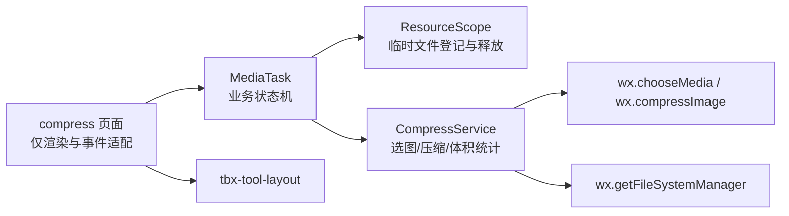
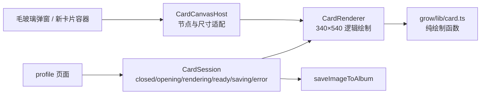
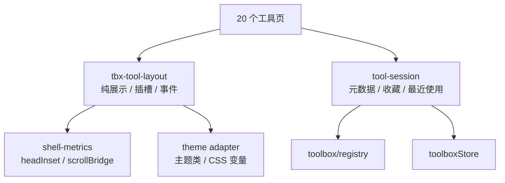

# 超欢 1.0.0 架构重构建议报告

> 范围：`pages/`、`components/`、`core/`、`subpackages/` 中与毛玻璃 UI 改造直接相关的耦合点  
> 性质：只读分析后的重构建议，不包含任何源码修改  
> 日期：2026-11-05  
> 依据：当前仓库实际代码与 `CODE_WIKI.md` 中的源码证据

---

## 0. 结论摘要

本次 UI 改造的真正风险不在 WXSS，而在 **业务状态、资源生命周期、布局契约三者与旧 UI 绑定**。建议不要直接换皮，而是按「先冻结契约 → 再抽业务状态 → 最后替换视图」的顺序推进。

| 优先级 | 耦合点 | 核心问题 | 影响面 | 建议动作 |
|---|---|---|---|---|
| P0 | `tbx-tool-shell` 混合职责 | 布局、自动滚动、主题注入、收藏、最近使用全部集中在一个组件 | 20 个工具页 | 先抽 `tool-session` 与 `shell-metrics`，保留原 WXML 作为第一阶段外壳 |
| P1 | 图片压缩资源生命周期 | `compressing / saving` 旧 UI 标志直接决定临时文件删不删 | 压缩工具及同类媒体工具 | 引入 `MediaTask` 状态机 + `ResourceScope`，资源释放不再读 UI 布尔量 |
| P1 | 个人简介 Canvas | 画布依赖固定 `#card-canvas`、弹窗可见态、140ms 延迟与旧尺寸算法 | 名片生成 / 保存 | 引入 `CardCanvasHost` 契约，把 Canvas 节点获取与绘制内核分离 |
| P2 | 二维码生成状态机 | `shellState / hasResult / qrImagePath / saving` 与生成、清理逻辑耦合 | 二维码工具 | 在完成 P0/P1 后按同一模式迁移，优先级低于前三处 |

**推荐总路线：**

```text
阶段 0 基线冻结
  → 阶段 1 抽纯逻辑与资源管理（UI 完全不变）
  → 阶段 2 固化 Shell / Canvas / Media 契约（行为完全不变）
  → 阶段 3 分区域替换毛玻璃 UI
  → 阶段 4 清理旧状态与兼容层、全量复核
```

---

## 1. 评估方法与边界

### 1.1 评估方法

- 逐文件阅读工具页、公共组件、`core/toolbox`、`core/utils` 与媒体库。
- 对每个耦合点记录：现状证据、根因、受影响的 UI 状态、资源风险、可迁移边界。
- 只提出重构建议，不修改现有代码、不新增运行时代码。

### 1.2 当前架构事实

- 工具页统一使用 `tbx-tool-shell`，20 个工具全部依赖同一套属性、插槽与事件。
- 工具页的计算逻辑与 UI 状态混在 `Page.data` 中：`shellState`、`hasResult`、`error`、`compressing`、`saving` 等。
- 媒体工具没有统一的任务状态机；每个页面各自维护 `generating / analyzing / saving / compressing`。
- 个人简介的 Canvas 绘制内核已抽到 `subpackages/grow/lib/card.ts`，但 **节点获取、尺寸计算、弹窗状态、保存授权仍留在页面**。
- 项目未找到单元测试或 E2E 脚本；现有质量保障依赖 `npm run typecheck` 与 `真机验收清单.md`。

### 1.3 重构成功标准

1. 毛玻璃 UI 替换后，20 个工具的计算结果、异常文案、收藏 / 最近使用行为完全一致。
2. 临时文件、Canvas、定时器在正常退出、异常退出、保存中被返回三种路径下都不泄漏。
3. `tbx-tool-shell` 的 20 个使用方不需要逐个重写业务逻辑。
4. `npm run typecheck` 通过，真机验收清单全部通过。
5. 不以运行时开关或双套 UI 长期共存作为交付方式；阶段内可用分支 / 备份回滚。

---

## 2. 耦合点一：图片压缩的资源生命周期被 UI 标志绑死

### 2.1 现状证据

| 证据 | 位置 | 说明 |
|---|---|---|
| `onUnload` 按 `saving` 决定是否删除压缩图 | `subpackages/tools-media/pages/compress/index.ts:126-134` | `saving` 为 true 时保留 `compressedPath`，否则立即 `unlink` |
| `compress()` 用 `compressing` 阻止重入 | 同文件 `:307-381` | 同时写 `compressing`、`shellState`、`hasResult`、`error` |
| `onSave()` 用 `saving` 阻止重入 | 同文件 `:225-255` | `finally` 中按页面销毁状态补删临时文件 |
| 临时文件由页面手动管理 | 同文件 `:19-28`、`:166-167`、`:282-283`、`:320-329`、`:363-365` | 原图、压缩图、上一次压缩图分别清理 |

### 2.2 根因

`compressing` 与 `saving` 表面是 UI 加载态，实际承担了三个业务职责：

1. **并发锁**：阻止重复压缩 / 重复保存。
2. **资源生命周期开关**：决定临时文件何时可删。
3. **业务阶段标识**：决定结果区、按钮、错误文案。

因此换 UI 时只要重命名或删除这两个字段，就会出现：

- 保存中被返回 → 压缩图被提前删除 → 写入相册失败；
- 保存结束但页面已销毁 → 临时文件泄漏；
- 快速连点 → 重复压缩产生多个临时文件；
- 压缩失败后旧文件未清理。

### 2.3 目标结构



设计要点：

| 旧职责 | 新归属 |
|---|---|
| `compressing` 并发锁 | `MediaTask.state === 'compressing'` |
| `saving` 并发锁 | `MediaTask.saving`（与主状态正交） |
| `saving` 决定文件删除 | `ResourceScope.dispose()`，只在所有在途 Promise settle 后执行 |
| `shellState / hasResult` | 由 `MediaTask.state` 派生，页面只做映射 |
| 临时文件手动 unlink | `ResourceScope.track(path)` / `release(path)` / `dispose()` |

示意契约（设计草案，非落地代码）：

```ts
type MediaTaskState = 'idle' | 'choosing' | 'compressing' | 'ready' | 'error'

interface ResourceScope {
  track(path: string): void
  release(path: string): void
  dispose(): Promise<void>
}

interface CompressService {
  choose(): Promise<PickedImage | null>
  compress(input: CompressInput): Promise<CompressResult>
  save(path: string): Promise<AlbumSaveResult>
}
```

### 2.4 迁移步骤

**阶段 1-A：只抽资源管理，不改 UI**

1. 新建 `ResourceScope`，把 `imagePath`、`compressedPath`、导出临时图统一登记。
2. `onUnload` 改为 `scope.dispose()`，不再读取 `saving`。
3. `saving` 仅用于按钮禁用与文案，不参与文件删除决策。
4. 保持原 WXML / 原交互不变。

**阶段 1-B：抽任务状态机**

1. 新建 `MediaTask`：`idle → choosing → compressing → ready | error`，`saving` 作为正交布尔量。
2. 页面 `compressing / shellState / hasResult` 改为从 `MediaTask` 派生。
3. 选图、压缩、体积统计移入 `CompressService`，页面只保留事件转发。

**阶段 3：替换 UI**

1. 毛玻璃视图只消费 `MediaTask` 派生的只读状态。
2. 不直接读写 `imagePath / compressedPath`。
3. 保存按钮的 loading 由 `task.saving` 驱动，不再反向控制资源。

### 2.5 验收用例

| 用例 | 期望 |
|---|---|
| 选图后取消 | 不产生新文件，旧结果保留 |
| 连续切换质量 / 尺寸 | 仅保留最新压缩图，旧图被释放 |
| 压缩中返回 | 不 `setData`，生成中的临时文件被释放 |
| 保存中返回 | 保存完成后释放文件，不提前删除 |
| 相册授权拒绝 | 返回 `denied`，Toast 正确，文件可重试 |
| 连续 20 次压缩 / 保存 | 临时文件数量不增长 |
| 压缩后体积变大 | 显示「体积增加」，不误报节省 |

### 2.6 风险与回滚

| 风险 | 缓解 |
|---|---|
| `wx.compressImage` 低版本不支持尺寸压缩 | 保留现有「尺寸压缩失败 → 纯质量压缩」回退 |
| `getFileSize` 失败返回 0 | 结果中保留 `—`，不参与比例计算 |
| `ResourceScope` 误删正在读取的文件 | 引用计数 + 在途 Promise settle 后再 dispose |
| 页面销毁与保存 Promise 竞争 | dispose 由 `finally` 触发，不在 `onUnload` 立即删除 |

回滚方式：阶段 1 只新增模块与适配层，原页面逻辑可原样保留；若验收失败，直接回退该阶段分支，不涉及 UI。

---

## 3. 耦合点二：个人简介 Canvas 依赖固定 DOM、弹窗状态与旧尺寸算法

### 3.1 现状证据

| 证据 | 位置 | 说明 |
|---|---|---|
| 固定选择器 `#card-canvas` | `subpackages/grow/pages/profile/index.ts:231` | `createSelectorQuery().select('#card-canvas')` |
| 画布容器由弹窗状态控制 | `subpackages/grow/pages/profile/index.wxml:96`、`:120` | `wx:if="{{cardShow}}"` + 固定 `id` |
| 开卡状态与延迟取节点 | `index.ts:176-203` | `cardShow`、`cardRendering`、`cardDevtools`、`cardCanvasW/H`，延迟 140ms |
| 绘制状态机 | `index.ts:221-313` | `cardNode`、`cardReady`、`cardRendering`、`hooks.isDestroyed` |
| 保存门控 | `index.ts:333-391` | `cardDevtools`、`cardSaving`、`cardRendering`、`cardReady` |
| 尺寸算法 | `subpackages/grow/lib/card.ts:56-73` | `maxCardHeightFor`、`computeCardDisplaySize` 依赖窗口宽高 |
| 绘制内核 | `card.ts:94-294` | `drawCardBase / drawAvatar / drawAvatarFallback` 已与页面分离 |

### 3.2 根因

绘制内核已经相对独立，真正绑死 UI 的是 **Canvas 宿主契约**：

1. 页面必须知道画布的固定 id 与 WXML 结构。
2. 页面必须知道画布只在 `cardShow` 为 true 时存在，并延迟 140ms 取节点。
3. 页面必须知道 340:540 逻辑尺寸、窗口 52% 上限、dpr 缩放。
4. 保存必须等待 `cardReady`，并由 `cardRendering / cardSaving` 门控。

换毛玻璃弹窗后，容器结构、可见时机、圆角裁剪、宽高都会变化；只要 id、`wx:if` 时机或显示尺寸变化，`renderCard` 就会取不到节点或按错误比例绘制。

### 3.3 目标结构



设计要点：

| 旧职责 | 新归属 |
|---|---|
| 固定 `#card-canvas` 查询 | `CardCanvasHost.getNode()`，由新容器组件实现 |
| `cardShow / cardRendering / cardReady` | `CardSession.state` 派生 |
| `cardSaving` | `CardSession.saving`，保存门控 |
| 窗口尺寸 / 52% 上限 | `CardCanvasHost.measure()` + 布局层 |
| 340×540 逻辑坐标 | `CardRenderer` 内部冻结，不随 UI 改变 |
| 头像加载 / 失败回退 | 保留 `drawAvatar / drawAvatarFallback` |

示意契约：

```ts
interface CardCanvasHost {
  measure(): Promise<{ width: number; height: number; dpr: number }>
  getNode(): Promise<WechatMiniprogram.Canvas | null>
  release(): void
}

interface CardSession {
  state: 'closed' | 'opening' | 'rendering' | 'ready' | 'saving' | 'error'
  open(): Promise<void>
  render(profile: Profile, palette: CardPalette): Promise<void>
  save(): Promise<AlbumSaveResult>
  close(): void
}
```

### 3.4 迁移步骤

**阶段 1-C：抽 Canvas 宿主**

1. 新建一个只负责 Canvas 节点的 `g-card-canvas` 组件（或页面内的 Host 适配器），对外暴露 `measure / getNode / release`。
2. 把 `createSelectorQuery().select('#card-canvas')` 从页面移到 Host。
3. 页面不再知道画布 id；`renderCard` 只接收 Host 提供的节点与尺寸。

**阶段 1-D：抽 CardSession**

1. 把 `cardShow / cardRendering / cardReady / cardSaving` 改为 `CardSession.state` 派生。
2. `onOpenCard / onCloseCard / onSaveCard` 只调用 Session 方法。
3. 保持 `card.ts` 的 340×540 逻辑坐标与现有绘制顺序不变。

**阶段 3：替换弹窗 UI**

1. 新毛玻璃容器只需实现 `CardCanvasHost`，不需要理解名片绘制。
2. 关闭弹窗时 Host `release()`；Session 进入 `closed`。
3. 保存仍走 `saveImageToAlbum`，授权补救链路不变。

### 3.5 验收用例

| 用例 | 期望 |
|---|---|
| 打开 / 关闭名片 10 次 | 每次都能取到节点，关闭后节点释放，无残留计时器 |
| 开发者工具打开 | 显示「需真机预览」，不崩溃 |
| 真机保存 | 导出尺寸正确、圆角 / 头像 / 二维码完整 |
| 保存中关闭弹窗 | 不 `setData` 到已销毁画布，临时图在保存结束后释放 |
| 头像加载失败 | 走 `drawAvatarFallback`，不空白 |
| 不同屏宽 / 窗口高度 | 名片不变形，高度不超过 52% |

### 3.6 风险与回滚

| 风险 | 缓解 |
|---|---|
| Skyline 自定义组件内 Canvas 节点获取差异 | Host 保留页面级 Canvas 作为回退实现，契约不变 |
| 弹窗动画期间取节点失败 | Host 提供 `waitForLayout()`，替代固定 140ms |
| `wx:if` 销毁导致节点失效 | Session 在 `close` 时立即 `release`，禁止异步回调写画布 |
| 新容器尺寸变化 | 逻辑绘制尺寸冻结 340×540，显示尺寸由 Host 适配 |

回滚方式：保留原 `profile/index.ts` 的 Canvas 分支作为 Host 回退实现；新 UI 只替换容器，不替换绘制内核。

---

## 4. 耦合点三：`tbx-tool-shell` 同时承载布局、业务副作用与主题桥接

### 4.1 现状证据

| 证据 | 位置 | 说明 |
|---|---|---|
| 属性 / 插槽 / 事件契约 | `components/tbx-tool-shell/index.ts:40-55`、`index.wxml` | `toolId / title / desc / sensitive / state / canRun / showRun / hasResult`；`input / result / note` 三插槽；`run / reset / example` 三事件 |
| 业务副作用 | `index.ts:95-146` | `toolboxStore.init()`、`isFavorite` 绑定、`recordRecent(toolId)` |
| 布局计算 | `index.ts:110-124` | `headInset`、`resultGap`、`scrollBridge` 由胶囊与窗口尺寸推导 |
| 自动滚动 | `index.ts:79-92` | `observers['state, hasResult']` 直接驱动 `scrollTarget` |
| 主题桥接 | `index.ts:169-179` | `syncPageTheme()` 通过 `getCurrentPages()` 给当前页 `setData({ v3Theme })` |
| 收藏写操作 | `index.ts:190-203` | 骨架内部直接 `toolboxStore.toggleFavorite` |
| 使用面 | `subpackages/tools-core/pages/*`、`subpackages/tools-media/pages/*` | 20 个工具页全部注册 `tbx-tool-shell` |

### 4.2 影响面量化

| 维度 | 数量 | 说明 |
|---|---|---|
| 使用 `tbx-tool-shell` 的页面 | 20 | 16 个 tools-core + 4 个 tools-media |
| `show-run=false` 的实时工具 | 13 | age、base64、countdown、dedupe、rmb、span、timestamp、unit、url、wordcount、compress、nine-grid、palette |
| 使用运行按钮的工具 | 7 | tax、loan、deposit、json、password、bmi、qr |
| `sensitive=finance` | 3 | tax、loan、deposit |
| `sensitive=health` | 1 | bmi |
| `sensitive=privacy` | 4 | compress、palette、nine-grid、qr |
| `show-example=false` | 3 | compress、nine-grid、palette |

这意味着 Shell 的任何属性 / 插槽 / 事件重命名，都会同时影响 20 个页面。

### 4.3 根因

`tbx-tool-shell` 不是纯展示组件，而是四层职责的混合体：

1. **布局层**：页首、输入面板、结果面板、滚动桥、胶囊避让。
2. **会话层**：工具元数据、收藏、最近使用。
3. **交互层**：运行 / 重置 / 示例、自动滚动、返回。
4. **主题层**：把 `uiStore.themeClass` 写入页面 `v3Theme`。

因此换毛玻璃 UI 时，无法只替换 WXML；任何布局变化都会触碰业务副作用与 20 个页面的契约。

### 4.4 目标结构（推荐两阶段拆分）



| 旧职责 | 新归属 | 说明 |
|---|---|---|
| 页首 / 输入 / 结果 / 底部布局 | `tbx-tool-layout` | 只接收 props 与 slots，不读 Store |
| `headInset / resultGap / scrollBridge` | `core/toolbox/shell-metrics.ts` | 纯函数，输入窗口与胶囊矩形，输出布局数值 |
| 工具元数据查询 | `core/toolbox/tool-session.ts` | 输入 `toolId`，返回分类 / 字标 / 隐私文案 |
| 收藏 / 最近使用 | `tool-session` | 页面 / 会话层调用 Store，不放在布局组件 |
| 自动滚动 | `tbx-tool-layout` | 只根据 `state/hasResult` 计算 `scrollTarget`，不触发业务 |
| 主题同步 | 页面或 theme adapter | 用 CSS 变量 / 根类名，不再 `getCurrentPages().setData` |
| 返回 | `tbx-tool-layout` 发 `back` 事件 | 页面统一处理 `navigateBack` |

**两个可选方案：**

- **方案 A（低风险，推荐先做）**：保留 `tbx-tool-shell` 名称与全部外部契约，只把 `shell-metrics` 与 `tool-session` 抽到 `core/`，Shell 内部改为调用它们。20 个页面零改动。
- **方案 B（彻底拆分）**：新增 `tbx-tool-layout` + `tool-session`，20 个页面机械替换。适合毛玻璃 UI 需要彻底重写 DOM 时。

建议先 A 后 B：A 阶段完成行为冻结与纯函数测试，B 阶段只做结构迁移，不改变业务。

### 4.5 迁移步骤

**阶段 1-E：抽纯函数与会话**

1. 新建 `shell-metrics`：`computeHeadInset`、`computeResultGap`、`computeScrollBridge`。
2. 新建 `tool-session`：`resolveToolMeta(toolId)`、`privacyTextFor(sensitive)`、`recordRecentOnce(toolId)`、`toggleFavorite(toolId)`。
3. `tbx-tool-shell` 改为调用纯函数 / 会话，WXML 与外部属性不变。
4. 20 个页面不改。

**阶段 2：冻结契约**

1. 输出一份 `tbx-tool-shell` 契约清单：属性、插槽、事件、CSS 类、`v3Theme` 注入。
2. 对 20 个页面做契约对照，确认没有页面依赖内部实现。
3. 增加纯函数测试：布局数值、隐私文案、收藏 / 最近使用去重。

**阶段 3：替换 UI**

1. 新增 `tbx-tool-layout` 毛玻璃版本。
2. 页面仅把标签名从 `tbx-tool-shell` 换成 `tbx-tool-layout`，props / slots / events 保持不变。
3. `tool-session` 继续承担业务，不进入布局组件。

### 4.6 验收用例

| 用例 | 期望 |
|---|---|
| 13 个 `show-run=false` 工具 | 无运行按钮，输入实时计算，重置 / 示例正常 |
| 7 个运行按钮工具 | `run` 事件正确，`running` 阻止重复点击 |
| 4 个 `sensitive=privacy` 工具 | 隐私文案正确 |
| 3 个 finance + 1 个 health | 免责声明文案正确 |
| 收藏 / 取消收藏 | Store 正确写入，Toast 与震动正确 |
| 最近使用 | 成功打开后记录，失败不记录，最多 12 条 |
| 自动滚动 | 结果出现后滚到 `#tbx-result`，500ms 后可再次滚动 |
| 主题切换 | 页面根类与 `v3Theme` 正确，原生状态栏同步 |
| 返回 | 轻触返回；失败回首页；长按历史菜单保留 |

### 4.7 风险与回滚

| 风险 | 缓解 |
|---|---|
| 20 个页面逐个替换出错 | 先做方案 A，页面零改动；方案 B 用契约清单逐页核对 |
| 自动滚动时序变化 | 保留 `TIMING.TOOL_SCROLL_RESET=500` 与原 observer 逻辑 |
| 主题类注入方式变化 | 新布局只消费 `themeClass` / CSS 变量，不依赖 `getCurrentPages` |
| 收藏 / 最近使用重复写入 | `recordRecentOnce` 做幂等；保留现有去重 |
| 插槽内容跨组件样式失效 | 保持 `styleIsolation: isolated` + `addGlobalClass: true` 的现有约定 |

回滚方式：方案 A 阶段 Shell 名称与契约不变，可随时回退内部实现；方案 B 按页面灰度替换，单页失败只回退该页标签。

---

## 5. 跨耦合点的通用重构原则

### 5.1 业务状态与 UI 状态分离

- 业务状态用明确枚举：`idle / choosing / compressing / ready / saving / error`。
- UI 的 `isLoading`、`disabled`、`errorText` 一律由业务状态派生，不允许反向控制资源。
- 禁止在资源释放、文件删除、Canvas 销毁逻辑中读取 UI 布尔量。

### 5.2 资源生命周期统一收口

建议引入一个轻量 `ResourceScope`，统一登记：

- 临时文件路径；
- Canvas 节点；
- `requestAnimationFrame` 句柄；
- `setTimeout / setInterval` 句柄。

释放规则：

1. 页面 / 组件销毁时统一 `dispose()`。
2. 在途 Promise 未结束时延迟释放。
3. 资源释放不依赖 `saving / loading / cardShow` 等 UI 状态。

### 5.3 契约先行

在换 UI 前先冻结三份契约：

| 契约 | 内容 |
|---|---|
| Shell 契约 | 属性、插槽、事件、CSS 类、主题注入方式 |
| Card Host 契约 | `measure / getNode / release`、逻辑尺寸 340×540 |
| Media Task 契约 | 状态枚举、资源登记、保存结果类型 |

契约冻结后，UI 替换只允许改变 DOM 与样式，不允许改变业务字段含义。

### 5.4 纯函数优先

以下逻辑应保持纯函数，便于测试与 UI 解耦：

- `core/toolbox/money.ts`、`date.ts`、`rmb.ts`；
- 新增 `shell-metrics`；
- `card.ts` 的绘制几何；
- 媒体任务状态迁移函数。

纯函数不 import `wx`、Store、页面，输入输出可断言。

### 5.5 页面变薄

页面只保留：

- 生命周期转发；
- `setData` 映射；
- 事件绑定；
- 错误 Toast。

业务计算、资源管理、Canvas 绘制、保存授权全部下沉到 `core/` 或 `lib/`。

---

## 6. 分阶段实施路线（每阶段 0 缺陷门槛）

### 阶段 0：基线冻结

| 项目 | 内容 |
|---|---|
| 目标 | 建立可对比的行为基线，不改代码 |
| 动作 | 录制 20 个工具的关键路径；记录临时文件数量、最近使用 / 收藏、Canvas 打开关闭、主题切换 |
| 产出 | 基线清单、真机截图 / 录屏、当前 `npm run typecheck` 结果 |
| 退出条件 | 基线可复现；所有关键路径有明确预期 |

### 阶段 1：抽纯逻辑与资源管理（UI 完全不变）

| 子项 | 内容 |
|---|---|
| 1-A | `ResourceScope` + 压缩临时文件登记 |
| 1-B | `MediaTask` 状态机 + `CompressService` |
| 1-C | `CardCanvasHost` 契约 + 名片尺寸适配 |
| 1-D | `CardSession` 状态机 |
| 1-E | `shell-metrics` + `tool-session` |
| 退出条件 | 20 个工具行为与基线一致；`npm run typecheck` 通过；临时文件 / Canvas 无新增泄漏 |

### 阶段 2：契约固化与测试补强

| 项目 | 内容 |
|---|---|
| 动作 | 冻结 Shell / Card Host / Media Task 契约；为纯函数补单元测试；补真机资源用例 |
| 产出 | 契约文档、纯函数测试、真机验收用例 |
| 退出条件 | 契约清单与 20 个页面逐项对照通过；纯函数测试全部通过 |

### 阶段 3：毛玻璃 UI 分区替换

| 顺序 | 区域 | 约束 |
|---|---|---|
| 3-1 | `tbx-tool-layout` 新外壳 | 属性 / 插槽 / 事件不变；先替换 1 个工具做样板 |
| 3-2 | 13 个实时工具 | 无运行按钮；输入实时计算逻辑不变 |
| 3-3 | 7 个按钮工具 | `run / reset / example` 行为不变 |
| 3-4 | 媒体工具 | 资源生命周期由 `MediaTask / ResourceScope` 接管 |
| 3-5 | 名片弹窗 | Canvas Host 不变，只替换容器与样式 |
| 退出条件 | 每替换一个区域，跑该区域真机用例；0 缺陷后才进入下一区域 |

### 阶段 4：清理与全量复核

| 项目 | 内容 |
|---|---|
| 动作 | 移除旧 UI 标志的残留引用；全仓库扫描旧状态字段；最终真机验收 |
| 退出条件 | 源码中不再有「UI 标志控制资源」的路径；20 个工具全量通过；包体积无异常增长 |

---

## 7. 风险登记表

| 风险 | 影响 | 概率 | 缓解措施 | 触发信号 |
|---|---|---|---|---|
| Shell 契约被 20 个页面隐式依赖 | 高 | 中 | 先做契约清单与逐页对照；方案 A 页面零改动 | 某工具插槽 / 事件失效 |
| Canvas 在新容器中取不到节点 | 高 | 中 | `CardCanvasHost` 保留页面级回退；`waitForLayout` 替代固定延迟 | 名片空白或比例错误 |
| 保存中被返回导致文件提前删除 | 高 | 中 | `ResourceScope` 引用计数 + 延迟释放 | 相册保存失败 / 临时文件丢失 |
| 媒体任务状态机与旧 UI 字段双写 | 中 | 高 | 阶段 1 只做派生，不保留双源；一次性切换 | `compressing` 与 `task.state` 不一致 |
| 自动滚动时序变化 | 中 | 中 | 保留 `TOOL_SCROLL_RESET` 与原 observer 语义 | 结果区不滚动或重复滚动 |
| 主题注入方式变化 | 中 | 中 | 用 `themeClass` / CSS 变量替代 `getCurrentPages().setData` | 工具页主题不跟随 |
| 性能回退 | 中 | 低 | 纯函数无额外 `setData`；布局计算缓存 | 首屏变慢 / 滚动卡顿 |
| 回归缺少自动化 | 高 | 高 | 阶段 2 补纯函数测试；真机用例清单化 | 手工验收遗漏 |

---

## 8. 验收矩阵

### 8.1 功能验收

| 维度 | 用例 |
|---|---|
| 工具入口 | 20 个工具从首页 / 收藏打开，最近使用正确 |
| 计算 | 每个工具至少 3 组正常值 + 3 组边界值 |
| 异常 | 空输入、非法格式、越界、跨字段冲突 |
| 收藏 | 收藏 / 取消 / 上限 / 下线 id / 写入失败回滚 |
| 主题 | 三态切换、原生状态栏、工具页 `v3Theme` |
| 返回 | 轻触返回、长按历史菜单、无上级页回首页 |

### 8.2 资源验收

| 场景 | 判定 |
|---|---|
| 压缩中返回 | 无 `setData` 到已销毁页；临时文件不增长 |
| 保存中返回 | 保存完成后释放；不提前删除 |
| 名片打开 / 关闭 10 次 | Canvas 节点可重复获取；关闭后释放 |
| 二维码连续生成 20 次 | 只保留最新 PNG；旧文件被 unlink |
| 九宫格重复生成 | 旧 9 张切图被清理 |
| 页面销毁后异步回调 | 无 `setData`、无 Toast、无未处理异常 |

### 8.3 质量门槛

- `npm run typecheck` 退出码 0。
- 阶段 1 行为与基线一致，不允许「顺手优化」。
- 阶段 3 每区域替换后，该区域真机用例 0 缺陷。
- 最终全量扫描：源码中不再出现「UI 标志决定资源释放」的路径。

---

## 9. 非目标与约束

- 不在本报告阶段修改任何源码。
- 不一次性重写 20 个工具页。
- 不引入运行时双 UI 开关；阶段回滚使用分支 / 备份，不用 feature flag 长期共存。
- 不改变现有计算规则、金额单位、日期边界与隐私文案。
- 不为了「架构漂亮」引入额外状态库；现有 MobX + 纯函数足够。
- 旧实现如需删除，按项目约定以注释保留关键旧逻辑并注明原因，不直接静默删除。

---

## 附录 A：受影响文件清单

| 文件 | 角色 | 重构归属 |
|---|---|---|
| `subpackages/tools-media/pages/compress/index.ts` | 压缩页面 + 资源管理 | 页面适配 / `MediaTask` / `ResourceScope` |
| `subpackages/tools-media/lib/image.ts` | 选图 / 文件信息 / 保存 | 保留，补 Result 化 |
| `subpackages/tools-media/lib/png.ts` | 二维码 PNG 编码 | 保留 |
| `subpackages/tools-media/lib/qrcode.ts` | QR 矩阵库 | 保留 |
| `subpackages/grow/pages/profile/index.ts` | 名片页面 + Canvas 宿主 | `CardCanvasHost` / `CardSession` |
| `subpackages/grow/lib/card.ts` | 名片绘制内核 | 保留，补 Host 契约 |
| `components/tbx-tool-shell/index.ts` | 20 工具外壳 | `tbx-tool-layout` / `tool-session` / `shell-metrics` |
| `core/toolbox/store.ts` | 收藏 / 最近使用 | 保留，供 `tool-session` 调用 |
| `core/toolbox/registry.ts` | 元数据 | 保留 |
| `core/constants/index.ts` | TIMING / LIMITS | 保留 |
| `pages/home/index.ts` | 最近使用写入 | 保留，改为 session 幂等接口 |
| `subpackages/tools-media/pages/qr/index.ts` | 二维码状态机 | 后续按 `MediaTask` 模式迁移 |

## 附录 B：建议的新增模块（设计层，不落地）

```text
core/toolbox/shell-metrics.ts        # 纯函数：headInset / resultGap / scrollBridge
core/toolbox/tool-session.ts         # 元数据 / 收藏 / 最近使用 / 隐私文案
subpackages/tools-media/lib/media-task.ts      # 媒体任务状态机
subpackages/tools-media/lib/resource-scope.ts  # 临时文件登记与释放
subpackages/tools-media/lib/compress-service.ts # 选图 / 压缩 / 保存
components/g-card-canvas/             # CardCanvasHost 的组件实现
subpackages/grow/lib/card-session.ts  # 名片会话状态机
```

## 附录 C：落地前检查清单

- [ ] 三份契约（Shell / Card Host / Media Task）已冻结。
- [ ] 20 个工具页的 props / slots / events 对照表已完成。
- [ ] 纯函数测试覆盖 `shell-metrics`、状态迁移、金额 / 日期边界。
- [ ] 阶段 1 未改变任何 WXML / WXSS。
- [ ] 临时文件、Canvas、定时器的销毁路径不再读取 UI 布尔量。
- [ ] 每个阶段有独立分支 / 标签，可单独回滚。
- [ ] 真机验收覆盖授权拒绝、保存中返回、连续生成、低内存。
- [ ] 最终全量扫描确认无旧 UI 状态残留。

---

> 本报告为重构建议，不构成代码变更。落地时应按阶段拆分提交，每阶段通过验收后再进入下一阶段。
